# v1.8.0: Financial Integrity and Simplicity Audit

**Date:** November 22, 2026 — Asia/Singapore  
**Reviewed commit:** `378bba283caf55970470c72727d0256fa1302b3d`  
**Version:** 1.8.0, Android versionCode 22  
**Inputs:** [First audit](V1_8_0_PRERELEASE_AUDIT.md), [remediation plan](V1_8_0_REMEDIATION_PLAN.md), [second audit and implementation updates](V1_8_0_v2_PRERELEASE_AUDIT.md), current source, automated tests, and isolated SQLite probes.

## Decision

**Fix the financial consistency defects before production release. Do not start another broad performance rewrite.**

The app can legitimately take time to import, export, restore, generate reports, or catch up on many transactions. A correct result with a clear waiting state is acceptable. A quick result that changes payment meaning, reports the wrong amount, or leaves half an operation committed is not.

This review found new-to-this-audit defects in subscription payments, card statements, refunds, category deletion, attachment cleanup, Trash restoration, and goal totals. “New-to-this-audit” does **not** establish when a defect was introduced. There is insufficient evidence to blame all of them on performance remediation.

The strongest candidate for simplification is the whole-database staging and SQL replay used by schedule catch-up and CSV import. Its safeguards are purposeful, but it creates a second transaction mechanism, copies the entire database, and can make unrelated saves fail during publication. Keep it working until a simpler replacement passes correctness tests; do not remove it as an isolated cleanup.

**This deliverable changes documentation only.** No app code, databases, dependencies, migrations, versions, or release notes were modified. Recommendations below are not implemented fixes.

## Evidence and limits

| Verification | Result | Meaning |
|---|---|---|
| `npx tsc --noEmit` | Passed, exit 0 | Existing TypeScript integrity |
| `npm test` | 724 passed; zero failures/skips | Existing regression suite passes, including prior remediation tests |
| Additional isolated probes | 11 scenarios executed successfully | Exercised actual services with disposable SQLite databases; one suspected defect was disproved |
| `npx expo install --check` | Reported 11 incompatible/outdated package versions | Dependency alignment remains pending; this alone does not prove a crash |
| `adb devices` | No connected devices | No Android UI or release-device validation |
| Real Google Drive, purchases, iOS, release APK/AAB, memory/FPS profiling | Not performed | No claim of native acceptance or sustained 60–120fps |

The probes reuse the project's migration/test adapters and transpile the actual TypeScript services. SQLite operations use real databases; native files, React Native, and network dependencies are substituted where needed. The attachment failure probe injects a cleanup failure and observes the destructive cleanup callback; it is not a physical-device filesystem failure test.

Probe scripts/logs were created under the OS temporary directory (`finance-v3-audit-probes.cjs` / `.log`). They assert or print the **current defective behavior**, not successful remediation. Reproduction steps and observed values are included below so the report does not depend on those temporary files.

Scope: broad workflow review across the module inventory, with deeper execution checks on financial writes and recovery paths. This is not a line-by-line proof of every file, an exhaustive security audit, or confirmation that every old manual checklist item is complete.

## Priorities

“Immediate” means a release gate and a correction/containment task before ordinary polish. Severity separates changes to stored data from incorrect derived displays.

| ID | Priority | Finding | Evidence |
|---|---|---|---|
| B01 | Immediate — High | One subscription payment can mark two periods posted, with only one posting link | Executed SQLite probe |
| B02 | Immediate — High | A subscription account change makes manual and automatic payment amounts disagree | Executed service/SQLite probe |
| B03 | Immediate — High | Reducing a card payment leaves the old statement allocation | Executed SQLite probe |
| B04 | Immediate — High | Moving a card charge leaves debt on the old card statement | Executed SQLite probe |
| B05 | Immediate — High | Refunds increase reported spending and budget usage | Executed SQLite probe |
| B06 | Immediate — High | Failed category deletion can commit part of the reassignment | Executed SQLite probe |
| B07 | Immediate — High | Cleanup failure after commit can discard a newly saved receipt | Controlled failure + real SQL commit |
| B08 | Before release — Medium | Restoring a fee revives its deleted transfer group | Executed SQLite probe |
| B09 | Before release — Medium | Goal summary adds different currencies and displays PHP | Executed service probe + UI source |
| B10 | Before release — High recovery risk | Cloud restores lack the durable safety copy used by local restore | Source-traced; no destructive cloud test |
| S01 | Simplify after integrity fixes | Whole-database staging for small schedule batches and imports | Source-confirmed design cost |
| S02 | Fix localized side effect — Medium | A note-only subscription edit rewinds recurrence processing | Executed SQLite probe |
| S03 | Operational follow-up | Immutable full-snapshot history grows without retention | Source-confirmed limits |
| S04 | Recovery follow-up — High when encountered | One missing receipt or the portable size cap blocks backups and local recovery/import workflows | Source-traced failure chain |

## B01 — Mark Paid can leave a posted period without a payment link

**Evidence:** [payment service](src/modules/subscriptions/services/record-subscription-payment.service.ts#L128), [resolve paid occurrences](src/modules/scheduled-transactions/services/resolve-schedule-paid.service.ts#L19), [unique posting transaction](src/infrastructure/database/schema/transaction-schedules.ts#L205).

**How to encounter it**

1. Create a monthly PHP 100 subscription with automatic posting disabled.
2. Leave several installments overdue; let catch-up create January through April occurrences.
3. Tap **Mark Paid** once for PHP 100.
4. Inspect the subscription's scheduled occurrences and payment links.

**Observed:** January and February become `posted`; March and April remain `due`. There is **one** posting link to **one** ledger payment. Before payment, the next schedule sequence was already 5; it remains 5 after this failure.

The resolver loops over every unpaid occurrence using the same transaction ID. It updates the second occurrence to posted, then the database rejects its duplicate transaction link. The payment service catches and ignores that exception **inside the outer transaction**, so the partial changes commit. This is more specific than “one payment pays all periods”: the uniqueness constraint interrupts the loop after partial mutation.

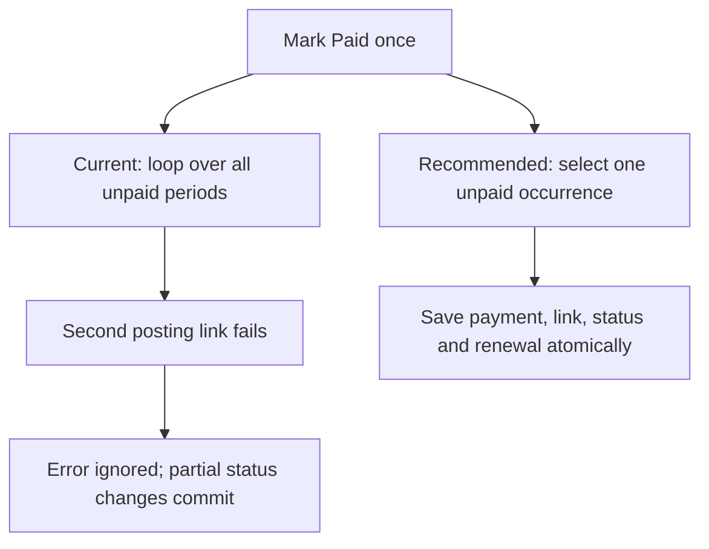

**Recommended fix, in order**

1. Resolve one explicitly selected occurrence, or the oldest unpaid occurrence under a clearly stated policy.
2. Write the ledger payment, subscription history, occurrence link/status, and renewal change in one transaction.
3. Let any required link failure abort the transaction. Do not suppress financial synchronization errors. Also review [auto-post's ignored subscription-history errors](src/modules/scheduled-transactions/services/process-due-schedules.service.ts#L229); that failure branch was source-reviewed, not failure-injected here.
4. Advance the schedule only when needed; resolving an already materialized period must not skip an additional future period.
5. For existing data, find `posted` subscription occurrences without posting links. Review payment history before restoring their status; do not invent payments.

**Acceptance:** With four overdue periods, one payment changes exactly one period. Inject link failure and verify zero changes to payment, status, history, and renewal. Repeat the same request without producing a second payment.

**Complexity judgment:** This is a business workflow bug, not a justified speed tradeoff. One occurrence lookup and one atomic write are simpler than reconciling all pending periods.

**Performance:** Use an ordered one-row query for the target occurrence. No new mount/focus query or provider subscription is needed.

## B02 — Subscription currency has two conflicting meanings

**Evidence:** [form's saved currency](src/modules/subscriptions/components/subscription-form-modal.tsx#L400), [form's amount display currency](src/modules/subscriptions/components/subscription-form-modal.tsx#L524), [subscription schedule construction](src/modules/subscriptions/services/save-subscription.service.ts#L115), [manual payment currency](src/modules/subscriptions/services/record-subscription-payment.service.ts#L85), [schedule posting](src/modules/scheduled-transactions/services/process-due-schedules.service.ts#L394).

**How to encounter it**

1. Create a subscription paid from a PHP account.
2. Edit it, select a USD account, and enter 10 in the amount field, which displays USD.
3. Save. The form keeps the existing subscription currency, PHP.
4. Compare its automatic/scheduled payment with **Mark Paid** using the same account.

**Observed:** The scheduled posting path treats 1,000 minor units as **USD 10.00**. The manual payment path treats them as **PHP 10.00** and converts them to **USD 0.17** using the available rate. The probe executed the same transaction input constructed by schedule posting and the actual manual payment service. It did not drive the native form.

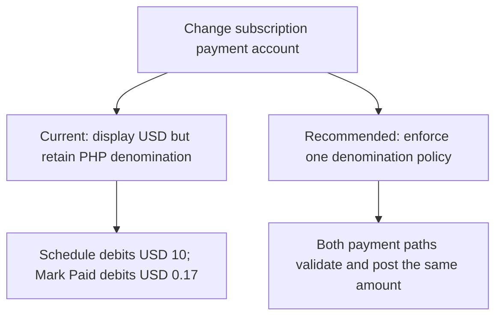

**Recommended fix, in order**

1. For the simplest safe policy, require the payment account currency to match the subscription currency in both service paths and account overrides.
2. Display the subscription's true denomination consistently. Reject a mismatched account selection instead of silently reinterpreting the amount.
3. If changing denomination is supported later, make it explicit and preserve historical payment currency; existing payment amounts must not be relabeled retrospectively.
4. Review mismatched existing subscription/account pairs and their postings using the user's original intended amount.

**Acceptance:** Test account changes, Mark Paid account overrides, automatic posting, and Post Now. Either all reject mismatches, or all produce exactly the same documented conversion. Include JPY and a three-decimal currency.

**Complexity judgment:** A consistent validation rule is preferable to adding another conversion/cache system. General transaction FX support does not automatically make subscription scheduling FX-safe.

**Performance:** One account validation per write; no ledger scan or new screen subscription.

## B03 — Editing a card payment can leave the statement falsely paid

**Evidence:** [allocation reconciliation](src/modules/credit-cards/services/reconcile-credit-card-billing.service.ts#L263), [available credit calculation](src/modules/credit-cards/services/reconcile-credit-card-billing.service.ts#L325), [transfer editing](src/modules/transactions/services/update-transfer.service.ts#L40).

**How to encounter it**

1. Record a PHP 100 purchase on a card and let its statement issue.
2. Transfer PHP 100 from Cash to the card. Its statement remaining becomes zero.
3. Edit that payment transfer down to PHP 50.
4. Compare the account ledger with the card statement.

**Observed:** The ledger correctly owes PHP 50, but the statement still has zero remaining. Reconciliation retains the original PHP 100 allocation. It allocates additional positive credit when available, but does not reduce an allocation that now exceeds the edited payment.

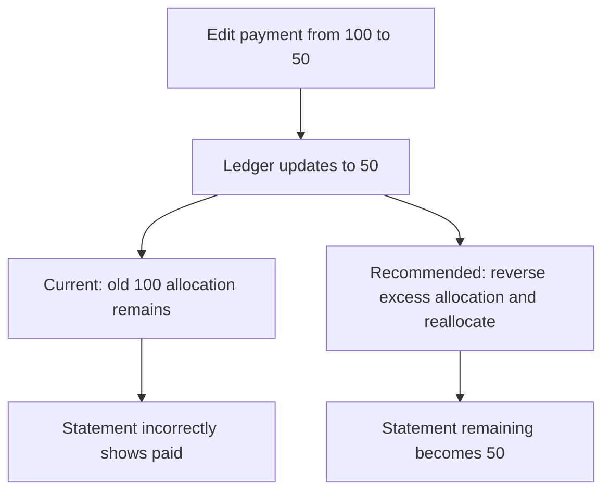

**Recommended fix, in order**

1. Define the invariant: a transaction's net allocated payment/refund cannot exceed its current active credit amount.
2. Reconcile changed credits, not only newly available credits. Reverse obsolete allocations with traceable adjustments, then allocate the current amount deterministically.
3. Perform the ledger edit and affected-card reconciliation atomically. Preserve issued statement history.
4. Audit existing payments/refunds whose net allocation exceeds their active amount.

**Acceptance:** Test payment decrease/increase, refund decrease, deletion/restore, and payment spanning two statements. Repeated reconciliation must make no further changes. For this fixture, ledger debt and statement remaining must both be PHP 50.

**Complexity judgment:** The separate allocation ledger serves a real billing purpose. Its edit rules are incomplete. Replacing it with more caching would make the problem harder to detect.

**Performance:** Scope work to affected cards. Current ordinary mutations reconcile all cards and hydrate their histories; do not preserve that global cost merely to keep this fix small. Large affected-card work may show a waiting state.

## B04 — Moving a card charge leaves a phantom statement balance

**Evidence:** [account-scoped transaction history](src/modules/credit-cards/services/reconcile-credit-card-billing.service.ts#L70), [reconciliation over present transactions](src/modules/credit-cards/services/reconcile-credit-card-billing.service.ts#L263), [transaction account update](src/modules/transactions/services/update-transaction.service.ts#L130).

**How to encounter it**

1. Record a billed PHP 100 purchase on a credit card.
2. Edit it and change its account to Cash.
3. Open the old card's statement.

**Observed:** There are no remaining transaction rows on the old card, but its statement still has PHP 100 remaining. Moving the row means it disappears from the old card's transaction loop, so that loop never reverses its old statement entry.

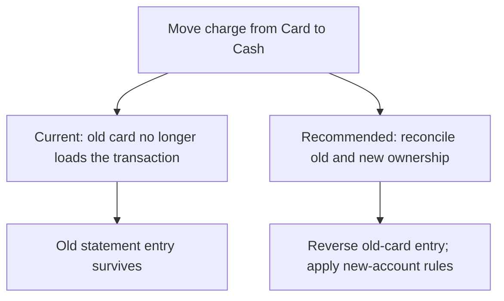

**Recommended fix, in order**

1. Capture the old and new account IDs before editing.
2. Reconcile statement-linked transaction IDs even when they have moved away from the old card. Treat the old account's target allocation as zero.
3. Update both affected accounts in the same business transaction. Preserve historical entries through adjustments.
4. If this behavior cannot be completed safely for release, temporarily reject moving billed transactions with a clear explanation; never silently retain phantom debt.
5. Review active statement links whose transaction now belongs to another account.

**Acceptance:** Card → Cash, Card A → Card B, payment destination changes, and repeated reconciliation. The old card must have no remaining charge for the moved purchase. Also verify existing installment edit restrictions.

**Complexity judgment:** This is missing ownership handling, not a need for a new synchronization engine. B03 and B04 should share one correct affected-card reconciliation policy.

**Performance:** Bounded account selection; reconciliation scales with relevant statement history. No new mount/focus queries are required.

## B05 — Refunds are counted as additional spending

**Evidence:** [SQL absolute amounts](src/modules/transactions/repositories/category-expense-totals.repository.ts#L23), [budget summary absolute totals](src/modules/transactions/services/get-category-expense-summary.service.ts#L41), [category report](src/modules/transactions/services/get-category-breakdown.service.ts#L119), [cashflow uses signed amounts](src/modules/transactions/services/get-cashflow-history.service.ts#L119).

**How to encounter it**

1. Record a PHP 100 expense in Food.
2. Record a PHP 20 positive expense refund in Food, directly or through signed import.
3. Compare the balance, category report, and budget spending for that period.

**Observed:** Ledger delta is **-PHP 80**. Cashflow net is **-PHP 80**. Category report and budget spending both show **PHP 120**.

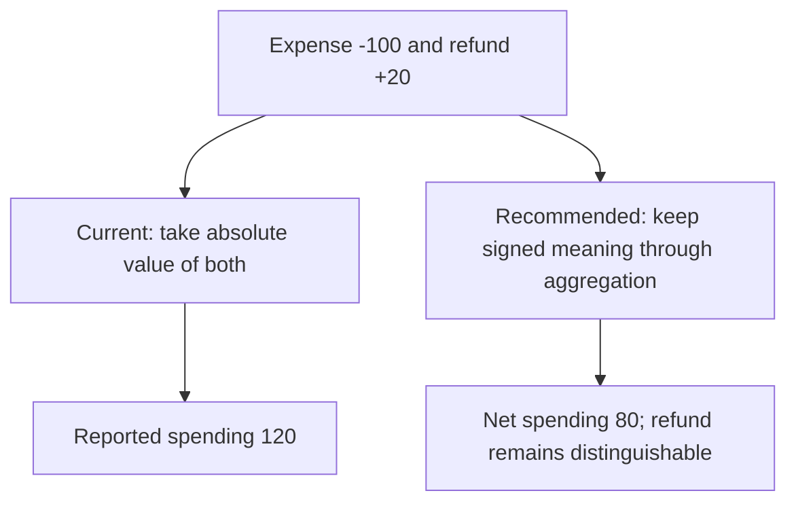

**Recommended fix, in order**

1. Define one shared signed rule: expense spending contribution is `-amount`; income contribution is `amount`.
2. Preserve the sign until totals are complete. Removing just one `abs()` is insufficient because several layers apply it.
3. Apply the parent transaction's sign to split magnitudes; a split refund must reduce the appropriate categories.
4. Reuse the rule across budgets, category/label reports, Calendar Net, and Dashboard category totals. Check each consumer rather than assuming all use the same helper.
5. Decide how to present a period with net refunds or net income reversals. If showing gross amounts, show purchases and refunds separately; do not label their absolute sum as spending.

**Acceptance:** Expense/refund, income/reversal, split refund, mixed currencies, fees, deleted rows, and refund-only periods. Use exact expected amounts across screens. This is a derived-data correction; do not rewrite valid refund ledger signs.

**Complexity judgment:** Correct signed arithmetic is simpler than special refund repair branches. The prior signed-import fix exposed an existing assumption in downstream totals; the import fix itself should be retained.

**Performance:** Same query passes and aggregation complexity as today. SQL remains grouped and bounded by the requested period; no new cache or subscription is necessary.

## B06 — Category deletion is not reliably atomic

**Evidence:** [async transaction callback](src/modules/categories/services/delete-category.service.ts#L37), [split category restriction](src/infrastructure/database/schema/transaction-entries.ts#L13), [preset deletion](src/modules/categories/services/category-presets.service.ts#L44), [category reordering](src/modules/categories/repositories/categories.repository.ts#L394). The installed Drizzle Expo SQLite transaction implementation commits after the callback returns; it does not await an async callback's later work.

**How to encounter it**

1. Create a custom expense category and ensure the protected Other expense category exists.
2. Record an ordinary expense using the custom category.
3. Record a split expense containing the same category.
4. Delete that custom category.

**Observed:** Deletion fails with a foreign-key error because the split entry still references the category. The custom category remains. **The ordinary expense has already changed to Other**, while the split line retains the custom category.

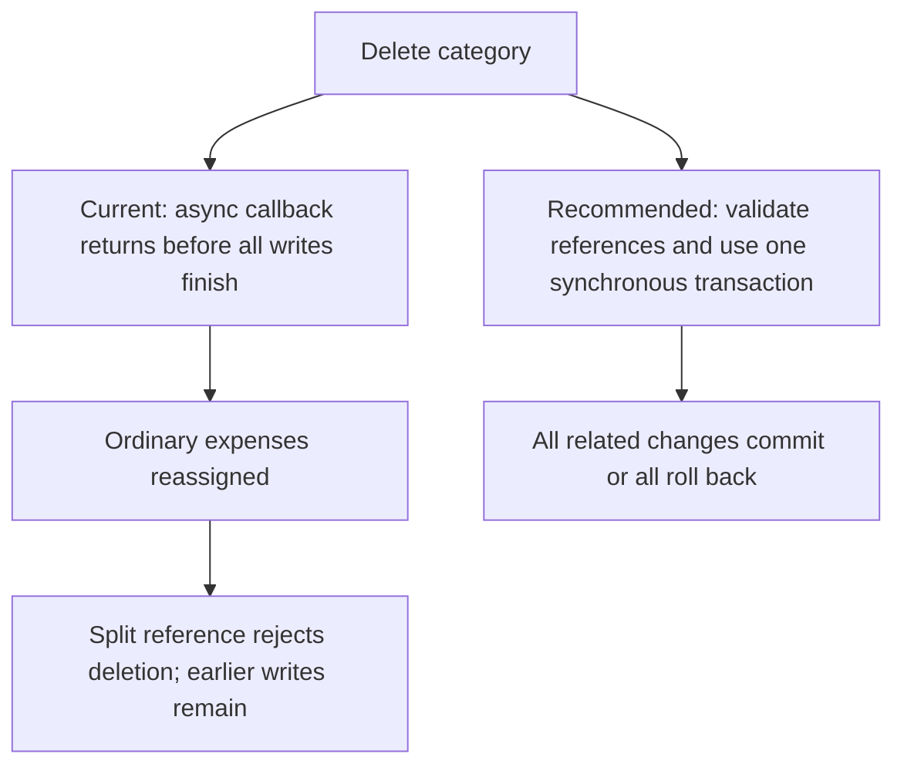

**Recommended fix, in order**

1. Remove async callbacks from the three synchronous Drizzle transaction paths above. Use synchronous repository `.run()`/`.get()` operations inside their transaction boundaries.
2. Handle split entries and other required references under a deliberate deletion policy: reassign them atomically, or reject deletion before changing anything.
3. Keep transaction-owned reassignment in the transactions module's public service, as required by module boundaries.
4. Emit category/cache notifications only after a successful commit.
5. Review failed deletions and partial preset operations before attempting automatic repair; current rows do not retain their previous category automatically.

**Acceptance:** Reproduce the ordinary-plus-split fixture. Force the final deletion to fail and verify every earlier change rolls back. Inject failure midway through preset deletion and reordering as well.

**Complexity judgment:** Async syntax around synchronous database work adds misleading control flow without making it nonblocking. A conventional atomic transaction is the simpler fix.

**Performance:** Same write complexity, fewer misleading async boundaries. Large preset work may wait; it must remain atomic. No new mount/focus work or context changes.

## B07 — A post-commit cleanup error can remove a newly saved receipt

**Evidence:** [transaction update try/catch](src/modules/transactions/services/update-transaction.service.ts#L34), [transfer update](src/modules/transactions/services/update-transfer.service.ts#L28), [file cleanup](src/modules/transactions/services/transaction-attachments.service.ts#L132), [physical deletion](src/modules/transactions/services/transaction-attachment-storage.service.ts#L98).

**How to encounter it**

1. Edit a transaction that has a receipt.
2. Remove the old receipt, add a new receipt, and change the amount.
3. Make deletion of the old local file fail, for example through a controlled filesystem-error test.
4. Save, then inspect the ledger, attachment rows, and cleanup calls.

**Observed with failure injection:** The changed amount and new attachment row commit. The old attachment is marked deleted. The service then rejects the save and invokes `discardPreparedAttachmentChanges` for the **new attachment that is already referenced by the committed database**. In production that discard path deletes its prepared local file.

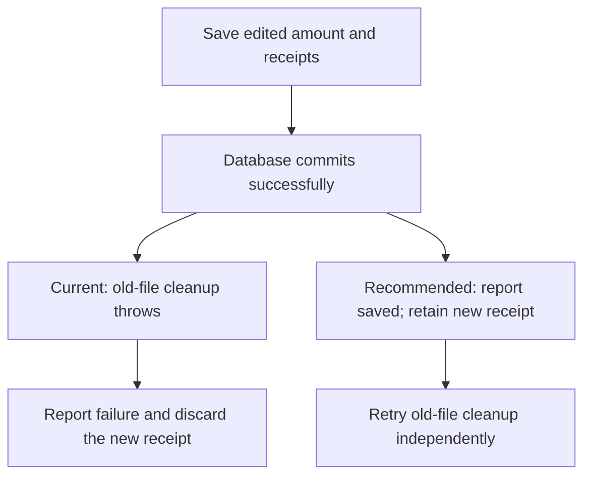

**Recommended fix, in order**

1. Limit rollback/discard handling to preparation and database-transaction failure.
2. After commit, never discard newly referenced files or report the financial operation as uncommitted.
3. Make old-file cleanup best-effort and retryable. Reuse the existing deletion/outbox mechanism where suitable; do not introduce a general job framework.
4. Apply the same commit-boundary review to transfer updates and other services with filesystem work after a commit.
5. Identify active attachment rows with missing local files; recover verified remote copies where available. Do not delete their records as a repair shortcut.

**Acceptance:** Force old-file deletion failure. Saving must still return committed success, the new receipt must remain readable, and retrying cleanup must not duplicate the transaction or delete the new file.

**Complexity judgment:** Preparation, commit, and cleanup need separate error boundaries. Treating them as one rollback scope creates the bug; extra performance machinery is unnecessary.

**Performance:** No additional ledger query is required. Deferred cleanup reduces save-path work and cannot affect the committed amount.

## B08 — Restoring a fee also restores deleted transfer legs

**Evidence:** [deletion distinguishes transfer rows](src/modules/transactions/services/delete-transaction.service.ts#L36), [restoration restores every grouped row](src/modules/transactions/services/restore-transaction.service.ts#L20).

**How to encounter it**

1. Create a PHP 100 transfer with a PHP 1 fee.
2. Delete its fee expense independently.
3. Delete the transfer.
4. Restore the fee from Trash.

**Observed:** Both PHP 100 transfer legs and the PHP 1 fee become active. The restore path uses group membership alone, while deletion permits the fee to be treated separately. Restoring the transfer can also revive a fee the user had deleted earlier.

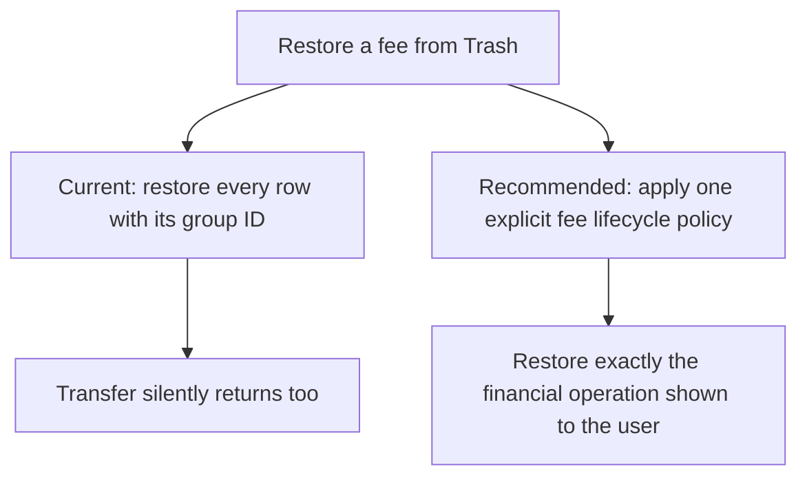

**Recommended fix:** Choose and enforce one policy. The simplest is to make transfer fees managed with their transfer, and route delete/restore actions to that clearly labeled group. If independent fee deletion remains supported, restoring an expense must restore only that expense, and grouped restore must preserve independently deleted fees. Do not infer the user's intent solely from group membership.

**Acceptance:** Fee-only delete/restore; fee deleted before transfer; full transfer delete/restore; permanent deletion. Verify both account balances and the fee expense total after each step.

**Complexity judgment:** A consistent product rule is preferable to adding hidden recovery heuristics. Supporting independent deletion may require explicit deletion ownership metadata; do that only if the behavior is needed.

**Performance:** Small group updates within one transaction; no full-ledger read or screen subscription.

## B09 — Goal summary mixes currencies and labels them PHP

**Evidence:** [raw summary addition](src/modules/goals/services/get-goals-with-progress.service.ts#L96), [PHP default](src/modules/goals/components/goal-summary-header.tsx#L19), [caller omits currency](src/modules/goals/screens/goals-screen.tsx#L276).

**How to encounter it**

1. Create a PHP 100 goal.
2. Create a USD 100 goal.
3. Open the goals summary.

**Observed:** The service produces `totalTargetMinorUnits: 20000`. The header displays that as **PHP 200**, rather than grouping currencies or converting them. Even a USD-only summary is mislabeled because the screen omits the header currency prop.

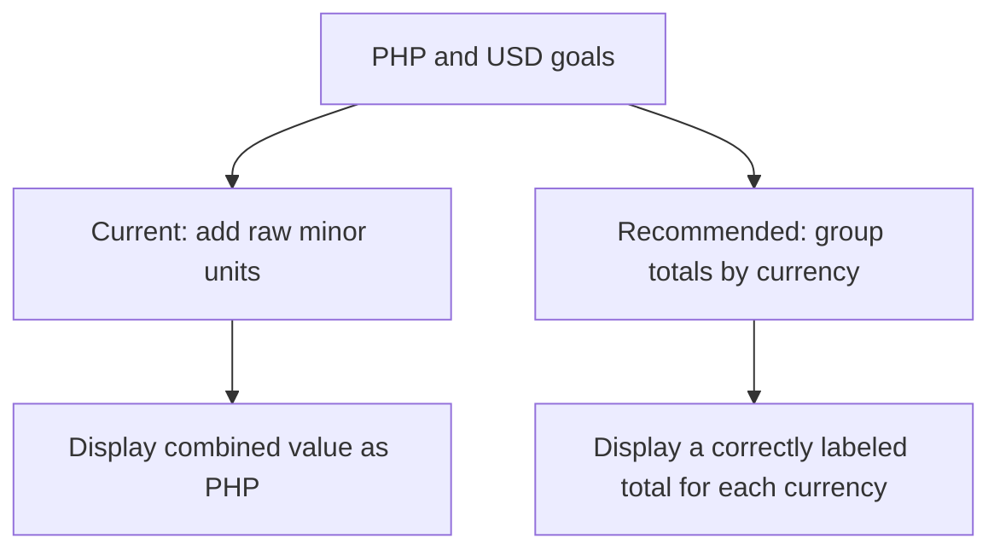

**Recommended fix:** Prefer separate totals per currency for the simplest transparent behavior. Alternatively, convert each goal to the selected display currency using the existing currency service, state that the total is an estimate, and pass the actual summary currency to the header. Do not only change the symbol. Compute overall progress from compatible totals.

**Acceptance:** PHP-only, USD-only, mixed PHP/USD, JPY, and a three-decimal currency; verify amounts, labels, remaining value, and percentage. Goal rows must retain their original denomination.

**Complexity judgment:** This is a reporting bug. Currency grouping requires no new conversion infrastructure or persistent summary cache.

**Performance:** One O(number of goals) pass. Current goal loading already reads account/pocket balances; currency grouping adds no SQLite query.

## B10 — Cloud restore has no durable undo copy of the current workspace

**Evidence:** [local restore saves safety first](src/modules/local-backup/services/restore-local-backup.service.ts#L32), [manual Drive restore](src/modules/google-drive-backup/services/restore-google-drive-backup.service.ts#L32), [Quick Sync restore](src/modules/google-drive-backup/services/restore-google-drive-backup.service.ts#L77), [temporary rollback handle](src/infrastructure/database/snapshot.ts#L116).

**How to encounter the risk**

1. Make local changes that are not present in a cloud snapshot.
2. Choose the wrong older Drive or Quick Sync snapshot and restore it successfully.
3. Close/restart the app and attempt to undo that choice.

The replacement layer keeps a verified **in-memory rollback database during replacement**. It can recover from an operation failure. It is closed afterward and is not a persistent “undo restore” backup. Local restore explicitly creates a safety archive; the cloud entry points do not. An older immutable cloud history cannot recover local-only edits that were never uploaded.

This is a source-confirmed recovery gap, not a claim that every cloud restore loses data or that a native crash was reproduced.

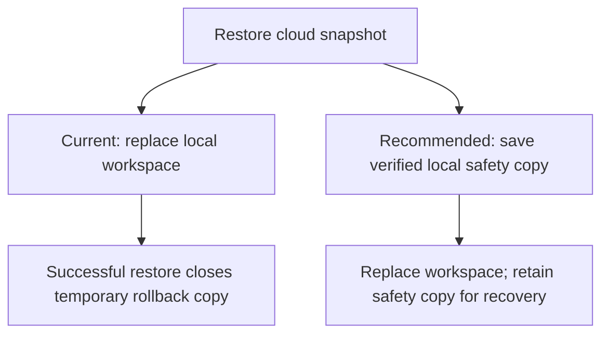

**Recommended fix:** Use the same durable safety-copy step for local, manual cloud, and Quick Sync restore. Put it in the shared restore workflow, not three divergent implementations. Handle the incomplete-backup case in S04 explicitly. Preserve operation coordination, validation, and rollback.

**Acceptance:** Start with local-only transactions and receipts; restore each backup type; restart; recover the exact former workspace from the safety copy. Inject safety-copy failure and verify the current workspace remains untouched unless the user explicitly chooses an explained recovery alternative.

**Complexity judgment:** One shared restore sequence reduces branching while adding a meaningful data-safety guarantee. The coordinator and rollback are necessary safeguards, not speed optimizations.

**Performance:** One deliberate whole-workspace backup per destructive restore. A longer wait is acceptable. It belongs on the restore screen, not screen focus or normal transaction saves.

## S01 — Whole-database staging is too much machinery for ordinary catch-up

**Evidence:** [staging implementation](src/infrastructure/database/staged-transaction.ts#L14), [batches of eight](src/modules/scheduled-transactions/services/process-due-schedules.service.ts#L69), [import publication](src/modules/data-import/services/commit-import.service.ts#L54), [existing concurrency/rollback tests](src/modules/data-import/__tests__/commit-import.test.cjs#L535).

**How the current process behaves**

1. Open another native writer connection and serialize the **entire** live database.
2. Deserialize an isolated database; run domain writes there while JavaScript yields.
3. Capture SQL writes through a logger.
4. Acquire a live write transaction; reject if any other connection changed the database.
5. Replay every captured write, commit, restore the UI connection's busy timeout, and close handles.
6. Repeat for the next eight schedule occurrences. On intervening changes, discard staging and retry.

For 500 overdue occurrences, eight per batch requires **at least 63 whole-database snapshots**, before retries. Cost grows with both database size and backlog. During publication the UI connection's busy timeout becomes zero, so a simultaneous ordinary save can fail with `SQLITE_BUSY` and need retry.

**This review did not demonstrate silent lost writes in staging.** Existing tests protect rollback and reject competing changes. The concern is disproportionate complexity, memory amplification, and coupling introduced to make background work yield.

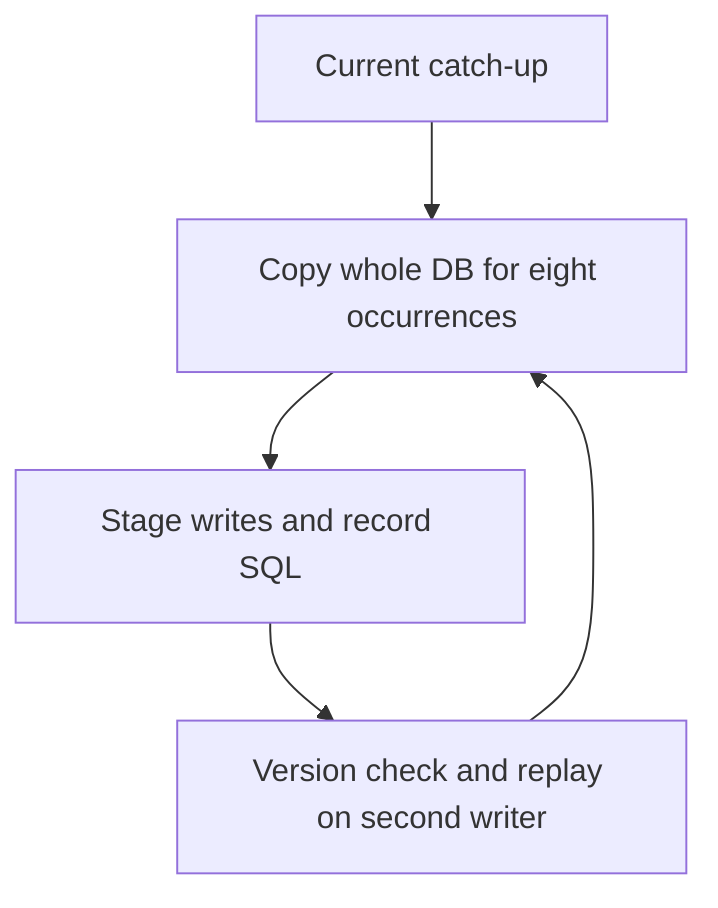

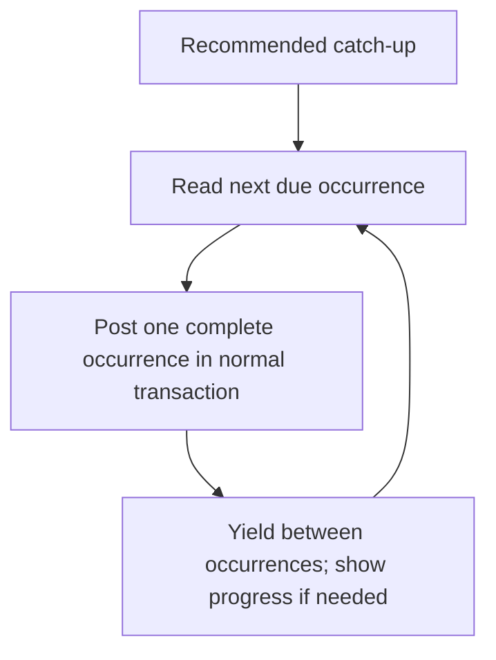

**Recommended simplification, in order**

1. First fix B01–B07 and retain their regression cases. Do not change financial semantics while swapping transaction mechanisms.
2. For schedules, use one normal synchronous Drizzle transaction per occurrence, then yield **after commit**. Reconcile only affected cards and coalesce refresh notifications.
3. Let a long backlog take longer. Support restart through the existing occurrence/posting keys; no transaction should stay open across a JS yield.
4. For imports, keep cooperative parsing, validation, indexed matching, and a frozen reviewed draft outside the transaction. Revalidate required constraints at save time.
5. Start with a conventional atomic transaction for the currently supported maximum of 1,000 rows, with a clear busy state. Measure it on a release device. If that risks a crash, excessive memory, or an unusable stall, use a focused native async publication path or a smaller supported batch size; do not promise that synchronous work becomes nonblocking.
6. If async publication remains necessary, prefer an explicit command plan and one well-defined writer boundary over using a SQL logger as a general replay protocol. This requires design/testing before replacement, not a quick edit.
7. Remove staging only after atomic failure, concurrent-action behavior, schedule restart, import parity, and receipts pass. Do not split one import into silent partial commits.

**Why this is overengineered for the stated goal:** A scheduler needs atomic posting and resumability. It does not need to copy unrelated notes, settings, and ledger history before every eight payments just to pursue a frame-time target. The import mechanism deserves separate measurement because atomic bulk import has different needs.

**Performance assessment:** Current preparation/publication runs on demand or background catch-up, not ordinary screen mount, but copies O(database bytes) per batch and can cause unrelated write failures. Recommended scheduling removes that copying. Each individual synchronous occurrence can still block JS; profiling must determine whether affected-card reconciliation needs further scoping or async work. No new root context or route subscription is warranted.

## S02 — A note-only subscription edit rewinds the scheduler

**Evidence:** [original first date reused](src/modules/subscriptions/services/save-subscription.service.ts#L126), [anchor reset on every save](src/modules/scheduled-transactions/services/save-scheduled-transaction.service.ts#L80), [existing occurrence deduplication](src/modules/scheduled-transactions/services/process-due-schedules.service.ts#L414).

**How to encounter it**

1. Let a monthly subscription process January through April.
2. Confirm the next sequence is 5 and next due date is May 1.
3. Change only its notes and save.
4. Inspect the next scheduled date before catch-up finishes.

**Observed:** The schedule anchor changes from 1 to 5. Save immediately processes one occurrence, leaving sequence 6 with a **February 1** next date, although the schedule had already advanced to May. Catch-up walks earlier nominal dates again.

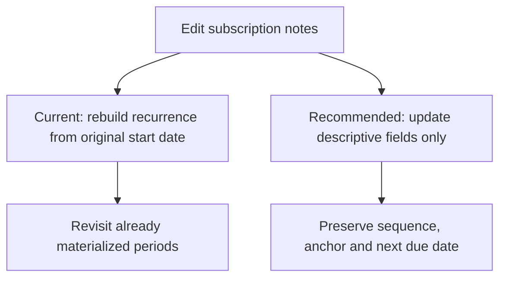

**Recommended fix:** Distinguish descriptive/template changes from recurrence changes. Preserve anchor, next occurrence, and due dates when frequency/start/end rules did not change. Make changes to recurrence deliberate and define which future occurrence they affect. Avoid rewriting an unpaid historical occurrence's amount merely because a future subscription price changed without a stated policy.

**Acceptance:** Notes/name changes preserve the May date and emit no extra ledger posting. Test intentional frequency/date changes separately and keep deduplication. The probe did **not** demonstrate duplicate payments; current nominal-date checks prevented that in the fixture.

**Complexity judgment:** This is a confirmed unnecessary workflow and a temporary misleading schedule state. Patching it locally is preferable to relying on catch-up and deduplication to undo the rewind.

**Performance:** Avoids historical reprocessing and its staging copies. No extra mount/focus reads or subscriptions.

## S03 — Quick Sync retains every complete snapshot indefinitely

**Evidence:** [revision discovery and 10,000-record cap](src/infrastructure/sync/adapters/google-drive-backup.adapter.ts#L250), [immutable publication](src/infrastructure/sync/adapters/google-drive-backup.adapter.ts#L321), [archive built per sync](src/modules/google-drive-backup/services/quick-sync.service.ts#L524).

**How to encounter the limitation**

1. Keep Quick Sync enabled while recording changes over weeks or months.
2. Each publication creates another full database-and-attachments archive.
3. Historical bytes and metadata grow even when there is no conflict.
4. Discovery eventually rejects histories above 10,000 records, or storage fills earlier. The graph also rejects more than 16 competing tips.

For illustration, 100 publications per day reaches 10,000 in about 100 days. At a constant 10 MiB per publication, that history holds roughly 98 GiB. These are arithmetic examples, not measured user activity or a prediction of a particular Drive quota.

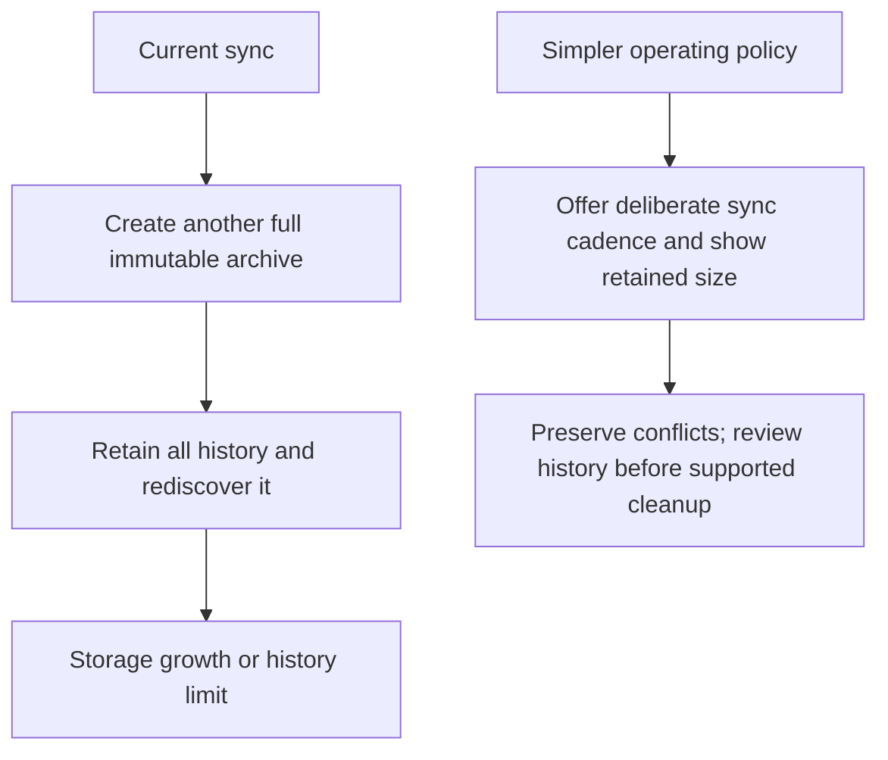

**Recommended approach**

1. Retain immutable publication and branch detection while multi-device snapshot sync is supported. Reverting to unconditional overwrite recreates a proven data-loss race.
2. Avoid unnecessary publication when nothing relevant changed; expose an understandable manual/less-frequent sync policy if it fits the product.
3. Show retained-history size/count and useful error/recovery instructions before limits are reached.
4. Design retention as a separate, correctness-sensitive task. Never automatically delete unresolved branches or blindly prune graph parents; test discovery, offline-device return, retries, and legacy clients after pruning.
5. If maintaining multi-device snapshot history is beyond the product's needs, explicitly scope the feature to manual backups or a single writer as a product decision. That is a capability change, not a harmless refactor.

**Complexity judgment:** The graph is a data-preservation safeguard, not primarily a performance optimization. Unbounded full-snapshot retention is the operational weakness. A safe replacement cannot be reduced to “keep only the latest file.”

**Performance:** Network discovery/graph processing scales with revision count R, and each publication processes the whole archive. No new screen-mount SQL is needed. Longer sync is acceptable; inability to back up indefinitely is a separate availability concern.

## S04 — Strict portable backup blocks recovery when the current workspace is incomplete

**Evidence:** [missing attachment fails backup](src/modules/local-backup/services/backup-attachments.service.ts#L17), [32 MiB payload cap](src/modules/local-backup/utils/portable-backup.ts#L63), [mandatory pre-import safety backup](src/modules/data-import/services/commit-import.service.ts#L52), [mandatory pre-local-restore safety backup](src/modules/local-backup/services/restore-local-backup.service.ts#L32).

**How to encounter it**

1. Have an active attachment record whose local file is missing, for example after a legacy database-only restore, or exceed the 32 MiB combined portable payload cap.
2. Try a new backup or Quick Sync: portable archive creation fails explicitly.
3. Try importing CSV or restoring a known-good local backup.
4. Those workflows first require a new portable safety backup of the **current** workspace, so they fail too. A damaged receipt can block the operation intended to recover it.

This failure chain is established from current branches. It was not reproduced on a phone with missing receipt files. The explicit failure is safer than claiming a complete backup that omits files, but the recovery route is incomplete.

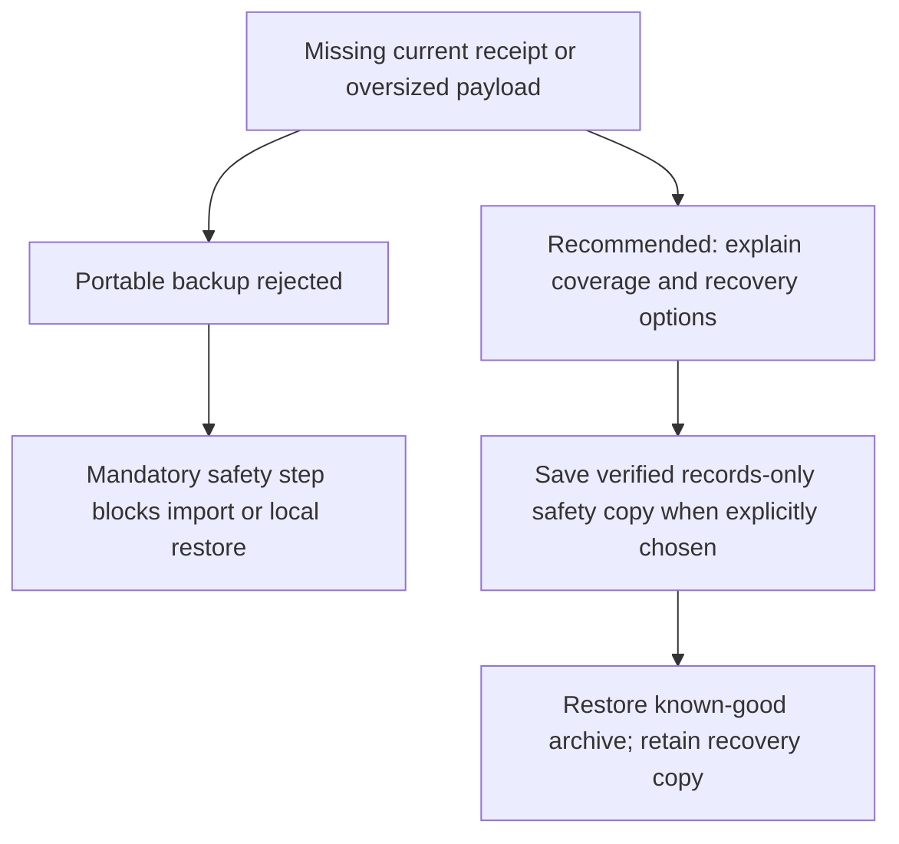

**Recommended fix, in order**

1. Keep honest attachment coverage and memory bounds. Do not silently skip receipts or simply remove the size cap from the in-memory implementation.
2. Identify the missing file or limit in an actionable message; allow downloading the remote file where available.
3. Provide an explicit recovery choice to save a verified **records-only** safety copy, clearly stating which receipts it cannot recover. Retain available files independently; never label it a complete portable archive.
4. Permit the chosen recovery workflow to proceed after that safety step. User intent and incomplete coverage must be clear before replacing data.
5. If ordinary expected receipt usage exceeds 32 MiB, plan a file-backed/streaming backup format separately. Waiting longer does not solve peak-memory limits. Preserve old-format readers and checksum verification.
6. Add bounded retention for obsolete safety copies after a suitable recovery period, with a documented policy. Automatic-backup pruning currently does not prune safety copies.

**Complexity judgment:** Portable receipts, checksums, and copy-on-write restore are appropriate. Coupling every recovery action to a complete, size-limited archive of an already incomplete workspace is the avoidable complexity. A separate explicit recovery mode is simpler than multiple hidden fallback branches.

**Performance:** Current peak memory includes serialized SQLite and several archive/crypto buffers; 64 KiB yields do not remove those full allocations. No native peak-memory/crash threshold was measured. Preserve bounds until file-backed work is validated.

## Protections worth keeping

These are useful engineering practices, not excess complexity merely because they improve performance:

| Keep | Why |
|---|---|
| One atomic transaction for transfer legs, fee, labels, and related writes | Prevents half a financial operation |
| Stable schedule occurrence identities and duplicate checks | Makes restart/retry safe |
| Integer minor units and saved FX meaning | Prevents floating-point money drift and accidental reinterpretation |
| SQL filtering, practical pagination, and appropriate indexes | Bounds memory and rendering when the ledger grows |
| Separate complete export path | Pagination must not silently truncate exports |
| 500-ID query chunks | Avoids database parameter-limit failures |
| Cooperative pure-JS import parsing/matching and stale-request guards | Keeps inputs usable and prevents obsolete previews from becoming saveable |
| Lightweight closed modals, stable provider values, focused subscriptions | Prevents avoidable background work without changing financial rules |
| Snapshot validation, verified rollback, and replacement coordination | Protects destructive recovery and stale async completions |
| Immutable cloud conflict preservation | Keeps both devices' data recoverable |
| CSV text encoding and signed import recognition | Protects exported text and preserves refund/reversal meaning |

One suspected defect was rejected during this audit: moving a transfer fee to a USD account correctly updates its stored currency through the transaction repository. That probe is a useful control and is **not** a finding.

## Workflow coverage

“No additional defect confirmed” is not a clean bill of health. Support modules received source/test review rather than complete native interaction testing.

| Process / modules | Review result and remaining checks |
|---|---|
| Ordinary transactions, transfers, fees, labels, splits, attachments | Deep service/schema review and probes; B03–B08. Standard transfer creation remains atomic. Native receipts/sharing still need device checks. |
| Accounts, pockets, fund groups, account types, currencies | Balance/denomination paths and deletion/currency guards reviewed. No extra account-balance mutation defect established; account/pocket transfers and FX rounding remain acceptance fixtures. |
| Scheduled transactions and subscriptions | Deep posting, payment, recurrence, and catch-up review; B01/B02/S01/S02. Review old V2-01 flagged historical payments before release. |
| Credit cards and installments | Deep reconciliation review/probes; B03/B04. Installment restrictions exist; full historical edit/payment/reversal combinations still need dedicated acceptance. |
| Budgets, Dashboard, Calendar, reports | Read/aggregation paths and existing regression coverage reviewed; B05. Verify signed totals in every consumer after fixing the owning service. Long report generation can wait visibly. |
| Goals | Service/UI review and probe; B09. Linked accounts/pockets exclude parent duplication, but mixed-currency summary does not. |
| CSV import/export and onboarding | Previous signed/text fixes present; staging/preview/duplicate tests pass. S01/S04 remain design concerns. Advanced unsupported CSV fields are explicitly rejected instead of silently imported. CSV is not a full backup. |
| Local backup, Drive backup, Quick Sync, reset | Deep replacement, archive, coordination, graph, and transport review; B10/S03/S04. Live two-device and clean-directory recovery remain unverified. |
| Categories and presets | Deep delete/transaction review and probe; B06. Related reorder/preset async callbacks need the same correction. |
| Notes and file storage | Attachment preparation/update/delete and portable backup paths reviewed. Native lifecycle and missing-file recovery require device tests. |
| Search and Chat with Kai | Read gating, bounded transaction search, and shared mutation ownership reviewed with existing tests. Test edits/deletions through these alternate entry points after financial fixes. |
| Settings, localization, security, gestures | Preference cache/replacement behavior and lock gate source reviewed. App Lock/native modal order and backup privacy need native acceptance; no new bypass confirmed here. |
| Notifications and widgets | Processor deferral, watched tables, and summary sources reviewed. Derived-data bugs such as B05 can propagate to these displays. OS delivery/rendering not validated. |
| Pro, ads, app updates, support | Integration/configuration paths and relevant existing tests reviewed. Real purchases/restore, native ads, update flow, and release signing require release-artifact acceptance. iOS billing is not certified by this review. |
| Walkthrough, hex colors, developer message, version history, monitor, app shell | Source/test inventory review; no additional financial mutation defect established. These are lower priority than the confirmed integrity defects. |

## Status of the second audit's ten findings

The implementation updates in the second audit matter. Its original failure descriptions should not be repeated as if none were fixed.

| Previous ID | Current source/test assessment |
|---|---|
| V2-01 — Subscription expense sign | Negative schedule sign and named repair migration exist. Historical flagged positive postings still require review. B01/B02 are different remaining problems. |
| V2-02 — Concurrent mutable cloud overwrite | Immutable revisions/branch detection implemented; controlled tests pass. Retain this protection; see S03 for growth. |
| V2-03 — Restore/upload race | Shared coordinator and generation checks implemented; controlled tests pass. B10 concerns durable undo after success, not this old race. |
| V2-04 — Missing portable receipt bytes | Version-2 payload/manifest, hashes, staged files, and coverage labels implemented. See S04 for limits/recovery coupling. |
| V2-05 — Imported refund signs | Signed interpretation and actual round-trip tests implemented. B05 is incorrect downstream aggregation of valid signs. |
| V2-06 — Replacement cleanup/rollback | Encompassing cleanup and verified recovery copy implemented; failure tests pass. Device interruption acceptance remains necessary. |
| V2-07 — 5 MiB Drive limit | Resumable uploads implemented and tested beyond 5 MiB. The independent 32 MiB portable payload cap remains. |
| V2-08 — Import preview freezes | Cooperative preview/matching, request cancellation, scoped comparison reads, and staged atomic import implemented. S01 questions staging proportionality; it does not reinstate the old render-time finding. |
| V2-09 — Giant synchronous catch-up | Async catch-up with small staged batches implemented. S01/S02 identify current design costs/side effects. |
| V2-10 — CSV formula-like text | Text protection/recognized decoding implemented; automated tests pass. Actual Excel/LibreOffice interpretation still needs verification. |

## Performance assessment under the simpler product goal

Ordinary navigation, typing, gestures, and scrolling should remain responsive; 60–120fps is a useful target there. Bulk operations may show progress and take time. Do not use “every computation must finish within one frame” as a reason to build a second persistence engine.

The [Expo SDK 57 reference](https://docs.expo.dev/versions/v57.0.0/) and [versioned SQLite documentation](https://docs.expo.dev/versions/v57.0.0/sdk/sqlite/) were consulted. Synchronous SQLite work can block JavaScript. Deferring it until after paint changes **when** it blocks, not its duration. A native-driven skeleton can animate while JS is busy; it does not guarantee working JS input handlers.

| Area | JS thread / crash concern | Mount/focus and query assessment | Render/context assessment |
|---|---|---|---|
| Normal feeds and pickers | Keep practical pages and avoid rendering the whole ledger | Existing bounded transaction reads and lightweight picker options are worth retaining; exact app-wide query counts were not measured | No new root context or route subscription recommended |
| Import preview/commit | Pure-JS yielding is useful; whole DB copies create memory pressure | Runs on import actions; up to 1,000 rows. Comparison queries are scoped/chunked; balance aggregation still depends on ledger size | Keep stale-result guards and input pending state; avoid doing preview in render |
| Schedule catch-up | Eight-occurrence staging repeatedly copies O(database bytes); individual domain work can still block | Triggered by startup/resume/focus requests and continuation. Total processing is O(backlog), plus repeated snapshots and affected-card work | Coalesce notifications rather than refreshing every screen per SQL statement |
| Ordinary card reconciliation | Currently drains all cards' histories synchronously after many mutations, even cash-only ones | On writes, not merely card focus. Ledger hydration scales with card history; JS allocation loops can exceed linear work across many statements | Scope to affected accounts before adding caches or more workers |
| Reports, budgets, balances, goals | Aggregation may take time; avoid unbounded UI hydration and memory spikes | Requested date-window SQL scans are acceptable. Budget shared-period aggregation is useful; exact latency needs device measurement | Show an honest loading state; do not show stale totals as final |
| Backup and restore | Full buffers/native SQLite/AES allocations can exhaust memory despite chunked loops | Whole-workspace work belongs to explicit operations/background backup, not ordinary navigation | Keep stable operation state and prevent conflicting destructive actions |
| Quick Sync | Archive work scales with bytes; metadata discovery scales with retained revisions | Async network work should never be required for a local financial save | Conflict/dirty state must remain correct even when the operation is slow |

No complete mount/focus SQL budget, React re-render profile, native peak-memory measurement, or release-device FPS result was obtained. Therefore, this report does not claim the app crashes at a certain ledger size or certifies any frame rate.

For future fixes, assess three things explicitly: synchronous JS duration, mount/focus SQL scope, and re-render/subscription fan-out. Require evidence before adding complexity. A slower bounded operation with truthful progress is preferable to speculative optimization; a crash or indefinite freeze still needs remediation.

## Step-by-step remediation plan

1. **Preserve the evidence and original data.** Export a verified recovery copy before repair. Use disposable fixtures for reproductions; retain existing IDs, original amount/currency, and posting relationships for reconciliation.
2. **Fix financial transaction boundaries first:** B01, B06, and B07. These can partially commit or mishandle already committed work. Add failure-injection tests that inspect the database after rejection.
3. **Fix denomination and statement consistency:** B02–B04. Agree on one subscription currency policy and one affected-card reconciliation policy before coding. Add exact amount/link expectations across entry points.
4. **Fix derived financial displays:** B05 and B09. Preserve the ledger and compute correct signed/currency-aware results. Verify budgets, reports, Dashboard, Calendar, widgets, and alerts against the same fixture.
5. **Fix lifecycle and recovery:** B08, B10, and S02. Use an explicit transfer-fee rule, one shared safe restore sequence, and recurrence changes only when requested.
6. **Review affected historical records.** Check orphan posted occurrences, overallocated/moved card entries, missing receipt files, and the existing V2-01 repair marker. Present reviewable corrections; do not globally negate refunds, erase statement history, or fabricate payment links.
7. **Simplify one process at a time:** Start with schedule catch-up in S01. Compare output and failure behavior before/after. Evaluate import separately. Keep staging until the replacement is complete and verified.
8. **Resolve growing-dataset recovery limitations:** S03/S04. Make limits visible, preserve unresolved cloud branches, and provide an explicit incomplete-workspace recovery path. Do not equate accepting a longer wait with removing memory safeguards.
9. **Validate the actual release artifact.** Align SDK patch versions deliberately, review native dependency changes, verify signing/version metadata, then build/install the release APK/AAB. No dependency changes were made in this audit.
10. **Only then consider polish.** Keep localized release notes synchronized with each implemented fix, and ask whether to keep it in the active release or bump the version under the project's versioning rules. Do not defer those updates until the end of remediation. This audit alone does not justify changing versions.

## Acceptance gates

Use a small exact fixture first, then larger fixtures for stability. The first gate is correctness, not a benchmark score.

- [ ] One transfer/fee operation commits completely or leaves every related table unchanged.
- [ ] One subscription payment resolves exactly the intended period; failure leaves no orphan posted status.
- [ ] Subscription payment paths agree on denomination, amount, history, and renewal.
- [ ] Edited/moved/deleted/restored card transactions reconcile against issued statements without phantom debt or excess credit allocation.
- [ ] Refunds and reversals retain signs in storage and produce correct category, budget, and report totals.
- [ ] Failed category/preset changes roll back all prior writes.
- [ ] Post-commit file cleanup cannot turn a successful save into a retryable financial failure or delete active receipt bytes.
- [ ] Fee Trash actions restore only the operation promised by the UI.
- [ ] Goal summaries never add incompatible minor units or display the wrong currency.
- [ ] Every restore path retains a recoverable former workspace across app restart, with explicit attachment coverage.
- [ ] Imports remain atomic and complete exports are not silently paginated or presented as full backups.
- [ ] Schedule catch-up survives interruption/restart without duplicates; note-only edits do not rewind it.
- [ ] Real two-device Drive conflicts preserve both snapshots; upload/restore interruption and expired sessions recover safely.
- [ ] On a modest release device, 1k/10k+ rows and expected receipt sizes complete without crashes, memory exhaustion, or an unrecoverable busy state. Long bulk work displays truthful progress.
- [ ] Ordinary navigation/typing/scrolling remain responsive; profile only the paths with demonstrated stalls before adding new machinery.
- [ ] TypeScript, the full suite, targeted behavioral regressions, native acceptance, and SDK compatibility checks pass on the final candidate.

**Release recommendation:** Hold for the confirmed financial and recovery issues. Preserve the safeguards that make writes and recovery correct. Simplify the transaction machinery gradually, with exact financial parity and failure behavior as the deciding evidence.
