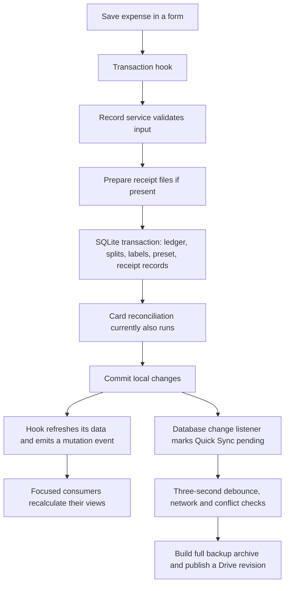
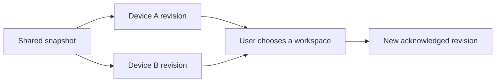

# v1.8.0: Screen-by-screen flow, correctness, and simplicity review

**Reviewed:** November 22, 2026, Asia/Singapore

**Source:** `dfa87d3` on the current working branch; working tree initially clean

**Release metadata:** 1.8.0 / Android versionCode 22

**Scope:** Read-only application audit. Only this document was added. No application behavior, migrations, dependencies, version numbers, or release notes were changed.

A separate edit to `AGENTS.md` appeared during the review. This audit did not make or revert that edit.

## Deployment decision

**Hold the current v1.8.0 production release. Fix the confirmed financial and recovery findings first. Do not begin another broad performance refactor.**

The reason is specific: a subscription payment can leave incorrect payment-period statuses; edited card payments can leave statements falsely paid; moving a card charge can leave phantom statement debt; and a failed category deletion can still change existing transactions. These behaviors remain reproducible against the current source even though all 724 existing tests pass.

This review also found and executed additional Calendar and Notes cases. A pending PHP 100 expense increases the Calendar projection by PHP 100; refunds/reversals can be counted twice in that projection; searching Notes for a literal `%` returns unrelated notes.

Your intended flow is reasonable and is still the foundation of the app:

1. Record an expense locally.
2. Read the transaction list from the local database.
3. Calculate account balances from the same ledger when needed.
4. Calculate Dashboard and report totals from that ledger.
5. If Quick Sync is enabled, synchronize separately, without making a local save wait for Drive.

The app does not need a broad rewrite to return to an understandable model. It needs clear ownership of each financial rule, complete transactions for related writes, and tests that check the result through every relevant entry point.

## How to read the judgments

| Label | Meaning |
|---|---|
| **Reproduced** | Executed actual application services/repositories with disposable SQLite databases, or the actual Calendar hook with controlled dependencies. The defective result was observed. |
| **Source-confirmed** | The behavior follows from the current branches and calls, but the corresponding native/cloud interaction was not executed. |
| **Risk / needs acceptance** | There is a reason to test the workflow. This is not a claim that it is broken. |
| **No additional defect confirmed** | No further defect established within this review. It does not certify every action as bug-free. |
| **Keep** | Complexity that protects correctness or keeps ordinary interaction responsive. |
| **Simplify later** | A proportionate design improvement, after a tested replacement exists. It is not permission to remove safeguards immediately. |

Old finding IDs **B01–B10 / S01–S04** refer to the [financial integrity audit](V1_8_0_v3_INTEGRITY_AND_SIMPLICITY_AUDIT.md). They are retained so remediation does not become several competing issue lists. **N01–N03** are additional findings in this review.

This is a source-level action audit covering the route and feature inventory, with deeper executable checks on financial writes and calculations. It is not an exhaustive execution of every button, native permission dialog, file operation, or device combination. The distinction matters when deciding what is safe to ship.

Suggested reading order: [the actual data flow](#the-apps-actual-data-flow), [screen-by-screen review](#screen-by-screen-action-review), [Quick Sync explanation](#19-quick-sync--screen-controls-plus-background-processor), [confirmed findings](#confirmed-findings-and-exact-consequences), then [correction sequence and release gates](#recommended-correction-sequence-and-release-gates).

## Verification performed in this review

| Check | Current result | What it establishes |
|---|---|---|
| `npx tsc --noEmit` | Passed, exit 0 | Types compile. |
| `npm test` | **724 passed**, zero failed/skipped; approximately 102 seconds | Existing automated expectations pass. |
| Re-execution of prior financial probes | 11 scenarios completed against current source | Ten reproduce the previously documented defects/side effect; one rejects a suspected fee-currency defect. Passing here means the probe ran, not that the behavior is correct. |
| Additional actual-Calendar-hook fixtures | Three cases executed | Reproduced N01 and both sign-reversal examples in N02. React lifecycle/native rendering was substituted. |
| Additional SQLite/service query probe | Completed | Measured selected service query counts and reproduced N03 using the actual Notes repository. |
| `npx expo install --check` | Exit 1; **11 package compatibility updates suggested** | Dependency alignment needs review; this result alone does not establish a runtime crash. No packages were installed. |
| `adb devices` | No connected devices | No Android UI, profiler, or release-device acceptance performed. |
| Real Drive, two physical devices, purchases, native file failures, APK/AAB build, iOS | Not executed | These remain acceptance gates. |

The financial probes were inspected and reused from the previous audit's temporary script; cleanup was guarded to the newly created temporary fixture directories. Native file/network dependencies were substituted. The receipt failure case observes a committed attachment and the subsequent discard callback; it does not physically delete a receipt on a phone.

Temporary evidence logs: `%TEMP%/finance-v180-screen-audit-tests.log`, `finance-v180-screen-audit-typecheck.log`, `finance-v180-screen-audit-probes.log`, `finance-v180-screen-audit-query-probes.log`, and `finance-v180-screen-audit-expo.log`. The reproduced values are recorded below so this document does not depend on retaining those logs.

The [Expo SDK 57 reference](https://docs.expo.dev/versions/v57.0.0/) and [versioned SQLite documentation](https://docs.expo.dev/versions/v57.0.0/sdk/sqlite/) were read. SQLite synchronous calls run synchronously; scheduling them after paint does not turn their execution into background-thread work.

## The app's actual data flow

### One ordinary expense



The important distinction: **the expense is saved once**. Accounts and Dashboard calculate different views of it. They should not each record another expense or permanently rewrite a balance when you open them.

An account's ordinary balance is essentially:

```text
opening balance + sum of its active signed transaction amounts
```

Related examples:

- Expense: negative amount; income: positive amount. Refunds and reversals can legitimately have the opposite sign within their original type.
- Transfer: two linked rows, a negative source and positive destination. An optional fee is an additional expense.
- Split expense: one financial parent plus category detail rows. Category reports must use the details instead of counting both parent and children.
- Pocket: a subdivision of its parent account. Adding parent and pocket again would double-count the same money.
- Subscription: a recurring template, schedule occurrences, payment history, and actual ledger transactions. These must agree about which period a payment satisfies.
- Card statement: a stored history of charges, installments, payments, refunds, and adjustments. This is additional financial state that must stay consistent with ledger edits.

**One caveat to “screens only recompute”:** credit-card monitoring can call `ensureCreditCardBillingReconciled`, which writes statement data when its day/database guard requires it. Schedule reads can also initiate catch-up. Those are maintenance workflows hidden behind some reads, and should be documented explicitly.

Primary sources: [record service](src/modules/transactions/services/record-transaction.service.ts), [balance calculation](src/modules/accounts/services/get-accounts-with-balances.service.ts), [transaction hooks](src/modules/transactions/hooks/use-paginated-transactions.ts), [card reconciliation](src/modules/credit-cards/services/reconcile-credit-card-billing.service.ts), [Quick Sync processor](src/modules/google-drive-backup/components/quick-sync-processor.tsx).

### Why these mechanisms exist

| Mechanism | Plain-language purpose | Judgment |
|---|---|---|
| Route → screen → hook → service → repository | Separates a button, the financial rule, and database access so all entry points can reuse the rule. | Keep; avoid empty pass-through services for simple reads. |
| Integer minor units | Stores PHP 100 as 10,000 centavos instead of floating-point arithmetic. Currency decimal places still matter. | Keep. |
| Saved exchange amount/rate | Remembers what was entered and what actually affected the account. A later rate change must not reinterpret that ledger amount. | Keep; summaries may intentionally use current conversion rates. |
| Database transaction | Saves all related records together, or none. | Keep; swallowing an error inside it can defeat this protection. |
| Transfer group ID | Connects both legs and the fee. | Keep; group membership alone is insufficient to define every Trash action. |
| Schedule occurrence + posting link | Gives a particular recurrence a stable identity and connects it to its payment. | Keep; enforce one clear period/payment policy. |
| Mutation event + source ID | Tells visible consumers to refresh, without making the saving hook refresh itself twice. | Keep; apply consistently. |
| Deferred reads / skeleton | Lets a shell appear before heavier work starts. | Keep where needed; does not prove 60–120fps during a synchronous query. |
| Request counter / cancellation | Stops an old search, filter, or load result replacing a newer one. | Keep; lifecycle details must be tested. |
| Pagination, SQL limits, indexes, 500-ID chunks | Avoids loading the whole ledger into every list and avoids oversized SQL parameter lists. | Keep. |
| Attachment manifest and hashes | Includes actual receipt/note files and verifies their identity during backup/restore. | Keep; missing-file recovery needs a separate policy. |
| Replacement coordinator and generation | Stops an old upload or file worker publishing success after restore, reset, sign-out, or disabling sync. | Keep. |
| Immutable Quick Sync revision IDs and parents | Preserves both snapshots when devices publish concurrently; identifies which earlier snapshots a new one follows. | Purposeful protection; retention and product presentation need work. |
| Whole-database staging and SQL replay | Prepares writes on a copy while yielding, then checks for concurrent changes and publishes atomically. | Substantial complexity; reconsider especially for ordinary schedule catch-up. |

There are also **two different sync mechanisms**: Quick Sync publishes workspace snapshots; `sync_operations` queues transaction-attachment work. The finance ledger is not currently a general row-by-row cloud outbox/merge engine. The architecture guide's generic queue diagram must not be mistaken for the exact implementation.

## Screen-by-screen action review

### 1. Dashboard — `/`

**Expected contract:** Display a consistent overview of the current local workspace. Its quick actions must save exactly the same transaction as the Transactions screen.

| Action | What actually executes and why |
|---|---|
| Open / return / pull to refresh | `useDashboard` defers a base summary, then separately defers historical net-worth calculation. Accounts, monthly cashflow, categories, and five recent transactions feed the overview. The second phase avoids making the initial summary wait for chart history. |
| Add expense, income, transfer | A mutation-only `useTransactions({ skipQuery: true })` calls shared transaction services. It avoids fetching the ledger just to expose Save callbacks. |
| Edit / duplicate / delete recent transaction | Uses the shared transaction form/services. Duplicate creates a new entry; edit changes the existing one; delete moves it to Trash. |
| Chat with Kai / presets | Alternate ways to prepare a transaction; saving should still reach the same financial services. |
| Customize cards / quick actions / privacy / walkthrough | Changes layout/preferences or presentation; does not create a financial transaction. Eligible preference writes can nevertheless queue Quick Sync. |

**Findings:** B05 affects category spending: PHP 100 expense plus PHP 20 refund displays PHP 120 spending instead of PHP 80. B07 can affect receipt edits made here. Card mutation findings apply to relevant quick actions too. The existing focused transaction-event listener is useful; Dashboard does not need a second financial ledger or stored running balance.

**Performance:** A tiny service fixture measured **16 SQL statements for the base summary, then 3 for historical net worth**, excluding separate screen hooks, providers, and form loads. Monthly cashflow currently materializes the month's transaction rows and loops over them: O(month rows), not O(1). History costs grow with account count and historical cutoffs. Retain bounded recent rows and cancellation; profile before merging calculations into another cache. Background refresh can preserve old chart points temporarily; do not represent mixed-stage values as a newly resolved chart.

Sources: [screen](src/modules/dashboard/screens/dashboard-screen.tsx), [hook](src/modules/dashboard/hooks/use-dashboard.ts), [summary repository](src/modules/dashboard/repositories/dashboard.repository.ts).

### 2. Accounts, pockets, types, and fund groups — `/accounts`

**Expected contract:** A balance is derived from the ledger; changing grouping or opening an account must not change recorded money.

| Action | What actually executes and why |
|---|---|
| Open / refresh | `useAccounts` loads accounts plus signed ledger deltas, pockets and types; management mode includes deletion/currency-change flags and card monitoring. |
| Create / edit account | Service validates type, currency, opening balance/date, maintaining balance, and card details; saves related records in one transaction. Currency changes are checked against transaction history at write time. |
| Lock starting balance | Prevents later changes to the historical starting amount/date. This protects the meaning of subsequent balances. |
| Archive / restore | Hides or restores the account without deleting its history. |
| Permanently delete | Authoritative usage checks prevent deleting accounts/pockets still used by financial workflows. A hidden button alone would be insufficient. |
| Create / edit / archive pocket | Validates parent account and eligibility; records location metadata. Actual allocation/movement belongs to transactions. |
| Manage types / reorder / search / collapse | Changes organization/presentation, not ledger amounts. |
| Manage fund groups | Saves group memberships, then sums member balances by currency. Preloaded account/pocket arrays avoid recalculating the same base snapshot. |
| Export accounts | Produces an account CSV through the export service; it is not a complete application backup. |

**Findings:** No additional account-balance mutation defect confirmed. B03/B04 can make embedded card statement figures disagree with the account ledger. Goals' incorrect cross-currency summary does not establish that account balances are themselves wrong. Test account+child-pocket combinations in fund groups against the intended overlapping-membership policy.

**Performance:** The tiny fixture measured **2 statements for lightweight account balances**, **5 with management flags**, excluding pockets, types, and card monitoring. The grouped ledger sum still scans matching history: a constant number of SQL calls is not constant computational cost. Management/card-history work belongs on the management screen, not every account picker. Reusing preloaded balances is useful and already supported.

Sources: [screen](src/modules/accounts/screens/accounts-screen.tsx), [read hook](src/modules/accounts/hooks/use-accounts.ts), [save account](src/modules/accounts/services/save-account.service.ts), [fund groups](src/modules/accounts/services/get-fund-groups.service.ts).

### 3. Transactions and its form — `/transactions`

**Expected contract:** One save changes the intended ledger entry once; list, account, Dashboard, reports, and sync then agree about it.

| Action | What actually executes and why |
|---|---|
| Open / filter / sort / search / load more | `usePaginatedTransactions` requests a first page of 50 logical entries by default, asks for an extra row to detect more, and follows deterministic cursors. Related metadata and historical balances are hydrated for returned rows. |
| Save expense / income | Validates account/category/pocket and denomination, writes the parent, optional splits/labels/installment/preset, and receipt records atomically. Card reconciliation currently runs too. |
| Save transfer / fee | Writes signed source/destination legs with one group ID and optional fee, plus labels/attachments. These writes must commit together. |
| Edit amount / date / account / category / FX | Updates the existing record(s), saved exchange meaning, split details and relevant installment state; billed installments have extra restrictions. |
| Duplicate | Prepares a new form from an existing entry. It must not mutate the original or copy identifiers that imply the same posted occurrence. |
| Split expense | Validates split amounts/categories; detail rows allocate the one parent amount. Category summaries must avoid counting the parent twice. |
| Add / remove receipt | Prepares local files, updates attachment records/outbox with the ledger transaction, then performs disk cleanup and background attachment sync. |
| Delete / Trash / restore / permanent delete / empty Trash | Soft deletion changes active totals; restore reactivates records; permanent deletion removes eligible trashed records and queues remote attachment deletion. Trash loads on demand. |
| Presets / labels | Reuses input or attaches organizational tags; neither should independently create another financial entry. |
| Export filtered data | Uses a dedicated complete export path, not just the loaded page. Text protection prevents exported names/notes being interpreted as spreadsheet formulas. |

**Findings:** B03/B04 for card edits; B07 for post-commit receipt cleanup; B08 for grouped fee restoration; B05 for downstream refund summaries. Standard transfer creation's atomic boundary is worth keeping. The earlier suspected fee currency problem was rejected again: changing the fee account to USD produces a USD fee row.

**Performance:** Page rows are bounded, but total counts, historical anchor sums, some sort modes, and reconciliation still depend on matching history. Exact full form/mount SQL count was not measured. Ordinary cash saves currently reconcile **all cards**, so their cost can grow with unrelated card histories. First correct reconciliation, then restrict it to affected old/new accounts; do not invent a second balance cache to mask it.

Sources: [screen](src/modules/transactions/screens/transactions-screen.tsx), [paged hook](src/modules/transactions/hooks/use-paginated-transactions.ts), [repository](src/modules/transactions/repositories/transactions.repository.ts), [record service](src/modules/transactions/services/record-transaction.service.ts), [transfer service](src/modules/transactions/services/create-transfer.service.ts), [update service](src/modules/transactions/services/update-transaction.service.ts).

### 4. Scheduled Transactions — `/transactions/scheduled`

**Expected contract:** A recurrence identifies a particular due period. Posting it creates one payment; skipping it creates no ledger payment; retries cannot duplicate it.

| Action | What actually executes and why |
|---|---|
| Open / refresh | Loads templates and an actionable occurrence page; also requests coalesced asynchronous catch-up. This screen is not a purely passive read. |
| Create / edit schedule | Validates template and recurrence; saves its next-date/sequence state. Some save paths process one immediately due occurrence and request continuation. |
| Post due / retry failed | Uses the stored occurrence template and links the ledger result to that occurrence inside a database transaction. |
| Skip | Updates occurrence/recurrence without recording income or expense. |
| Advance post | Allows a future scheduled occurrence to be recorded through its explicit service. Date/sequence meaning must remain consistent. |
| Pause / resume / end | Changes whether future occurrences are eligible. It must not undo already paid history. |
| Archive / restore / permanent delete | Preserves schedules with postings where necessary and applies deletion rules. |
| Filter / search / load more | Filters visible templates; actionable occurrence reads use pages of 100 plus one probe row. |

**Findings:** B01 and B02 cross this screen's boundary from Subscriptions. S02 causes note-only subscription edits to rewind recurrence. Occurrence identities and duplicate detection serve a real purpose; removing them would make restart/retry unsafe.

**Complexity assessment:** Catch-up stages up to eight occurrences on a full database copy, logs parameterized writes, then publishes them through a second connection if the live database has not changed. This avoids exposing half a batch while yielding, but is substantial machinery for a few ordinary recurring operations. Prefer evaluating **one complete occurrence transaction at a time, yielding between occurrences**. Confirm that per-occurrence atomicity meets the product contract, preserve exact recurrence/date behavior, and compare failure/restart outcomes before replacing staging. Import has a different whole-batch atomicity requirement and should be considered separately.

**Performance:** Catch-up is O(backlog), with additional full-database byte-copy cost per staged batch. The visible actionable list is bounded; template inventory and some calendar occurrence paths are not. Startup/resume workers are coalesced/staggered, but exact device timing remains unmeasured. Cancellation/restart and local-edit contention need release-device fixtures.

Sources: [hook](src/modules/scheduled-transactions/hooks/use-scheduled-transactions.ts), [processing](src/modules/scheduled-transactions/services/process-due-schedules.service.ts), [recurrence save](src/modules/scheduled-transactions/services/save-scheduled-transaction.service.ts), [staging](src/infrastructure/database/staged-transaction.ts).

### 5. Calendar — `/calendar`

**Expected contract:** Actual totals match the ledger for the selected date range; projections add signed future effects once; viewing a date does not itself record an expense.

| Action | What actually executes and why |
|---|---|
| Open / switch month / Today | Loads the calendar grid's date window and caches month transaction arrays. Subsequent uncached month changes are deferred. |
| Select / clear day | Derives a date scope from the loaded month; changes visible transactions, summaries and applicable schedule rows. |
| Transactions tab / add / edit / delete | Uses existing transaction data and shared mutation flows; reloads relevant totals after changes. |
| Schedules tab / Post / Skip | Projects/reads occurrences and calls schedule services. A posted subscription must also update subscription history consistently. |
| Net tab | Computes actual cashflow, category breakdown, savings rate, and month-end projection. |
| Balance Sheet tab | Defers a cutoff-date balance sheet; resolved key and data govern pending state. This tab should not query while unselected. |
| Pull refresh / external mutation | Clears month cache and reloads data. The mutation listener currently reloads synchronously even if this mounted screen is offscreen. |

**Findings:** **N01 and N02 reproduced**; B05 also appears in the Calendar category breakdown's separate `Math.abs` calculation. Previous rapid-month skeleton and schedule dependency corrections are present; do not report those old versions as still unchanged.

**Performance:** Initial month transactions are fetched **synchronously in the state initializer**, before the first render finishes. The month limits dates but not the number of transactions in a very busy month. `getCalendarScheduleOccurrences` also loads all recorded occurrences before filtering dates in JS, and limits forward projections to 100 iterations per schedule. Far-future visibility beyond that cap needs an explicit test/contract. These are concrete bounds/gating concerns, not proof of a device crash. Exact mount/focus SQL count was not measured; work scales with month rows plus schedule history. Scope listeners to focused consumers before adding more caches.

Sources: [screen](src/modules/calendar/screens/calendar-screen.tsx), [data hook](src/modules/calendar/hooks/use-calendar-data.ts), [schedule projection](src/modules/scheduled-transactions/services/get-calendar-schedules.service.ts), [category breakdown](src/modules/calendar/utils/category-expense-breakdown.ts).

### 6. Credit Cards — `/credit-cards`

**Expected contract:** Ledger debt, issued statements, remaining due, payments, and installment history reconcile under edits, deletes, moves, and restoration.

| Action | What actually executes and why |
|---|---|
| Open / refresh / inspect card | Loads balances and billing state; `ensureCreditCardBillingReconciled` may generate missing statement/adjustment records first. |
| Inspect statement / activity | Reads stored charge, payment, refund, installment and adjustment entries. History explains why the amount is due. |
| Record payment | Uses the transaction transfer workflow; incoming card credit is allocated to eligible statements. |
| Record / edit card purchase | Uses transaction services; installment setup spreads billing entries without recording the full purchase repeatedly. |
| Edit card configuration | Accounts owns credit limit and statement/due-day details. Changes require historical billing acceptance. |

**Findings:** **B03 reproduced:** pay PHP 100, reduce payment to PHP 50; ledger owes PHP 50 while statement remains zero. **B04 reproduced:** move a billed PHP 100 charge to cash; old card has no ledger transaction left but still has PHP 100 statement debt. These are release blockers. Stored statement history is justified, but its update rule is incomplete.

**Performance:** Reconciliation hydrates each card's history and walks statement/link collections. Ordinary writes drain the generator synchronously; calling the function a generator does not yield to input when drained in a tight loop. Monitoring's day guard helps repeated reads but does not make mutation reconciliation cheap. Exact full-screen SQL count/FPS is unmeasured. Reconcile affected accounts after fixing adjustment/allocation semantics; keep issued history explainable.

Sources: [monitoring hook](src/modules/credit-cards/hooks/use-credit-card-monitoring.ts), [monitoring service](src/modules/credit-cards/services/get-credit-card-monitoring.service.ts), [reconciliation](src/modules/credit-cards/services/reconcile-credit-card-billing.service.ts).

### 7. Subscriptions — `/subscriptions`

This is the recurring-expense tracker introduced in your feature work, separate from the app's own Pro purchase system.

**Expected contract:** A subscription describes a recurring obligation. Recording one payment changes one intended period, one ledger payment, one history link, and the appropriate next renewal together.

| Action | What actually executes and why |
|---|---|
| Open / status tab / search | Loads subscriptions including archived records, filters in memory, and calculates recurring cost summaries. |
| Create | Saves subscription metadata and, when an account exists, creates a linked expense schedule. Schedule reuse avoids implementing recurrence twice. |
| Edit cost / account / notes / dates | Updates subscription and resaves its linked schedule. This coupling currently affects recurrence even for non-recurrence edits. |
| Mark Paid | Creates a ledger expense, inserts subscription payment history, advances renewal, and tries to resolve pending schedule occurrences. |
| Automatic posting / post from Calendar or Schedules | Schedule creates the ledger payment and calls back into Subscriptions to record history/renewal. These paths must share amount/currency/period rules. |
| Pause / cancel / reactivate | Changes subscription state and corresponding schedule eligibility. |
| Delete / archive / restore | Payment history determines whether ordinary removal archives or deletes; restoration resynchronizes the schedule. |
| Payment history / cancellation link | Displays prior payment associations or opens an external cancellation URL; the latter does not itself cancel a provider's subscription. |

**Findings:** **B01, B02, S02 reproduced.** These explain why this feature feels more complicated than an ordinary expense. There are several representations of the same obligation, and current code can update them inconsistently.

- B01: Four overdue periods; one Mark Paid leaves **two posted statuses but one posting link** because a uniqueness failure is caught inside the transaction.
- B02: Subscription retains PHP denomination after choosing a USD account. The same 1,000 stored units become **USD 10.00 through the scheduled-style input** versus **USD 0.17 through manual payment** at the fixture's rate. The probe executes the generated schedule input and actual manual service, not the native form.
- S02: Changing only notes moves an already advanced schedule from its May next date back into February processing. Deduplication prevents some duplicate payments but does not justify rewinding the recurrence.
- Source risk: automatic posting also suppresses subscription-history update failures. Failure-inject it; do not assume the ledger and history stay atomic just because an outer transaction exists.

**Simplest reliable policy:** Choose exactly one period for Mark Paid; keep one consistent denomination rule; atomically write its payment/link/status; change recurrence anchors only when recurrence fields change. Do not combine this correction with a new subscription engine.

**Performance:** Current list refresh loads all subscription records and computes/filter summaries in JS, O(subscription count). That is normally a smaller catalog, but not an unlimited ledger strategy. Save/payment work includes schedule and card work; it must remain local and never await Drive. Exact mount SQL count was not measured. Avoid querying or resetting recurrence on each form keystroke.

Sources: [screen](src/modules/subscriptions/screens/subscriptions-screen.tsx), [hook](src/modules/subscriptions/hooks/use-subscriptions.ts), [save](src/modules/subscriptions/services/save-subscription.service.ts), [payment](src/modules/subscriptions/services/record-subscription-payment.service.ts), [period resolver](src/modules/scheduled-transactions/services/resolve-schedule-paid.service.ts).

### 8. Categories and presets — `/categories`

**Expected contract:** A category organizes records. Deleting it either completes the declared reassignment everywhere or changes nothing.

| Action | What actually executes and why |
|---|---|
| Open / income-expense tab / search | Loads a category hierarchy and derives visible groups/children. |
| Add / edit / move subcategory | Validates type, names and parent rules; writes category metadata and invalidates dependent category/Kai caches. |
| Reorder | Persists ordering; it should not alter financial amounts. |
| Delete | Tries to reassign existing transactions and presets to parent/Other, then delete the category. Protected defaults and parents with children are guarded. |
| Load / remove presets | Inserts/removes predefined categories and reassigns dependent records. |
| Icons / colors / Kai keywords | Customizes appearance and categorization vocabulary, not ledger amounts. |

**Finding B06 reproduced:** If an ordinary transaction and split line reference the category, delete fails on the split foreign key, but the ordinary transaction has already moved to Other. `transaction(async ...)` is incompatible with this synchronous Drizzle transaction boundary; it commits before awaited continuation work finishes. The operation also fails to handle the split reference before deletion.

**Required correction:** Use a synchronous transaction callback with synchronous repository operations, and explicitly cover ordinary parents, split lines, presets, and other references under the owning module's service APIs. Test an injected final failure and inspect every earlier write. Apply the same transaction-boundary review to preset removal and reorder.

**Performance:** Hierarchy work is O(category count); deletion can touch many referencing rows, which is acceptable as an explicit operation with feedback. Do not trade atomicity for speed. Exact screen query count was not measured. Keyword cache invalidation is justified; uncontrolled reload cascades are not.

Sources: [delete](src/modules/categories/services/delete-category.service.ts), [presets](src/modules/categories/services/category-presets.service.ts), [repository](src/modules/categories/repositories/categories.repository.ts), [split reference](src/infrastructure/database/schema/transaction-entries.ts).

### 9. Budgets — `/budgets`

**Expected contract:** Spending reflects signed ledger effects in the intended category, period, and currency. A toggle changes budget behavior, not historical expenses.

| Action | What actually executes and why |
|---|---|
| Open / refresh / change period | Loads budgets and categories, groups current/prior-period expense aggregations, then resolves cards and summary together. |
| Create / edit target | Validates period/currency/category rules; stores base and applicable monthly targets. |
| Rollover | Calculates unused prior-period budget under the configured policy. |
| Enable / disable / delete | Changes budget configuration; transactions remain. |
| Live form indicator | Uses a previously queried baseline and pure calculations while typing; final save rules still need authoritative checks. |
| Threshold alert | Uses shared budget results, so aggregation bugs can affect notifications as well as cards. |

**Finding B05 reproduced:** Expense PHP 100 plus refund PHP 20 gives budget usage PHP 120 instead of PHP 80. Fix the signed aggregation in its owner and verify every consumer. The previous disabled-budget-zeroing correction is present: the current batching loop includes disabled budgets' spending data; do not revive that old finding without new evidence.

**Performance:** Grouping by period/currency reduces query fan-out; it does not eliminate scanning matching expense rows. Work is roughly category/budget processing plus matched transaction aggregation, with extra prior-period groups for rollover. Exact screen SQL count is unmeasured. Keep zero-query amount typing and data/loading resolution together.

Sources: [hook](src/modules/budgets/hooks/use-budgets.ts), [batch calculation](src/modules/budgets/services/calculate-category-budget.service.ts), [expense totals](src/modules/transactions/services/get-category-expense-summary.service.ts).

### 10. Goals — `/goals`

**Expected contract:** Goal progress comes from the intended accounts/pockets; incompatible currency units are never simply added.

| Action | What actually executes and why |
|---|---|
| Open / refresh | Reads goals plus account/pocket balances, maps linked members, then calculates progress and summary. |
| Create / edit / link accounts or pockets | Saves target, dates, currency and member associations. Linking a source does not move money. |
| Pause / resume / complete | Updates goal status and resulting visibility/progress interpretation. |
| Delete / filter | Removes goal configuration or changes presentation; does not delete account transactions. |

**Finding B09 reproduced:** A PHP 100 goal and USD 100 goal produce raw combined target `20000`, and the header defaults to PHP. Even a USD-only summary can be mislabeled because the screen omits the currency prop. Use separate currency totals or deliberate conversion with the correct label. Per-goal calculation already filters incompatible account currencies and avoids parent/pocket duplication; retain those safeguards.

**Performance:** Balances are loaded once per service invocation, but current calls request management flags unnecessarily for this read. Processing scales with goals, linked members, accounts/pockets, and ledger aggregation. Exact screen query count is unmeasured. Do not add a persisted progress balance; derive from the same source and refresh focused consumers after external saves. Native acceptance should cover Global Quick Entry while Goals remains visible.

Sources: [progress service](src/modules/goals/services/get-goals-with-progress.service.ts), [header](src/modules/goals/components/goal-summary-header.tsx), [screen](src/modules/goals/screens/goals-screen.tsx), [hook](src/modules/goals/hooks/use-goals.ts).

### 11. Reports — `/reports`

**Expected contract:** Reports are views of the same ledger, with documented transfer/refund/currency/date treatment; changing tabs does not write new money.

| Action | What actually executes and why |
|---|---|
| Income/Expense, category drilldown | Uses category totals for the selected mode/range. |
| Cash Flow | Computes signed inflows/outflows and period summaries. Transfers must not become external income/expense. |
| Balance Sheet / comparisons | Uses account opening balances and cutoff ledger deltas for assets/liabilities/net worth. |
| Net Worth Growth | Derives historical points and comparisons in the reporting currency. |
| Labels Summary | Aggregates labeled records with its own grouping rules; a multi-label transaction may belong in multiple label views, which must be explained. |
| Date range / account/category filters | Re-queries the relevant service and changes presentation. Only the selected report component mounts. |
| Pro gate | Restricts premium presentation. It is separate from the accounting calculation. |

**Findings:** B05 causes the category report to disagree with signed cashflow for valid refunds. B03/B04 affect statement-derived presentations, not necessarily the signed ledger balance sheet. Compare exact fixtures per report instead of assuming all totals should be identical when their definitions differ.

**Additional source concern:** `useIncomeExpenseReport` does not return the cancel handle from `runDeferredSyncQuery`; after its first result, cached refreshes also do not set loading true through that helper. Rapid range changes/unmounts can leave obsolete work queued and old data visible during a new range. This is source-confirmed lifecycle/loading debt, not a reproduced financial write bug. Test rapid A→B→A range changes and publish range/data/pending state consistently.

**Performance:** Tabs are lazy, but aggregation grows with matching history, account count and historical points. Exact screen query counts were not measured. Some reports can legitimately take time; give them truthful pending/error states and cancellation. Do not materialize an entire ledger just to render a few chart points.

Sources: [screen](src/modules/reports/screens/reports-screen.tsx), [income/expense hook](src/modules/reports/hooks/use-income-expense-report.ts), [report services](src/modules/reports/services/get-income-expense-report.service.ts), [cashflow service](src/modules/reports/services/get-cash-flow-report.service.ts).

### 12. Notes — `/notes`

**Expected contract:** Save the intended note/files locally; searching returns literal matches; deletion removes only the intended note and attachments.

| Action | What actually executes and why |
|---|---|
| Open / refresh | Screen explicitly refreshes the Notes hook on focus. Rows and attachment metadata are loaded together. |
| Search / sort / view mode | Search is debounced about 150ms, then SQL filters titles/content and orders pinned/sorted results. Grid/list mode is presentation. |
| Create / edit / pin / color | Validates note content, prepares new files, writes note and attachment records transactionally, then reloads the note/list. |
| Attach / open / remove file | Uses Notes-owned storage. Portable backups include active local file bytes. |
| Delete | Deletes the note and attachment records in one transaction; local disk cleanup follows and catches per-file failures. There is no Notes Trash flow equivalent to transaction Trash in this path. |

**Finding N03 reproduced:** Search `%` matches both `Tax report` and `Shopping`, neither containing `%`; the term is used as an SQL wildcard. Escape literal `%` and `_` consistently. No additional ordinary note-save defect confirmed. Review the post-commit reread failure path in update: cleanup of prepared files must depend on whether commit occurred, not just whether any later line throws, as illustrated by B07. Note creation returns the result built inside its transaction and does not have that same post-commit reread.

**Performance:** Actual tiny-fixture repository counts were **1 query for empty Notes**, **2 for nonempty Notes** with small attachment-ID counts. More IDs add bounded 500-ID chunks. However the list itself has **no page limit**, loads full note bodies and all matching attachment metadata, and the screen renders the collection in a scroll view. Cost/memory grows with all matched note contents. This is a real scaling concern, not evidence that a particular number of notes crashes a phone. Global Search should eventually request bounded note previews rather than hydrate all note bodies.

Sources: [screen](src/modules/notes/screens/notes-screen.tsx), [hook](src/modules/notes/hooks/use-notes.ts), [repository](src/modules/notes/repositories/notes.repository.ts), [update](src/modules/notes/services/update-note.service.ts), [delete](src/modules/notes/services/delete-note.service.ts).

### 13. Global Search and Global Quick Entry — shared modals

**Expected contract:** Search is read-only until an action is selected. Global entry must use the same save services and refresh the visible screen.

| Action | What actually executes and why |
|---|---|
| Open with empty query | Shows curated shortcuts. Empty-query feature reads are skipped. Closed modal wrappers gate heavy subtrees. |
| Type search | Debounces about 150ms; transaction search requests eight results; other feature hooks load domain data and filter matches. |
| Select result | Navigates with an identifier/target or opens the intended form. Search itself should not post schedules; its schedule hook uses read-only mode. |
| Quick add / widget / gesture entry | Opens a common transaction form, saves locally, and emits the mutation signal for active consumers. |

**Findings:** Previous missing-Notes, transfer grouping, split-category search and deferred transfer-mode fixes have source/test coverage in the current tree. They still require native deep-link acceptance. N03 concerns the Notes screen repository's search; Global Search currently filters already loaded Notes in JS, so do not automatically claim the exact same wildcard bug there.

**Performance:** Closed/empty gating and transaction LIMIT are useful. First nonempty search still mounts multiple domain hooks, including balance/budget/goal calculations and unbounded Notes/subscription catalogs. This can create a burst of synchronous reads even though transactions are limited to eight. Exact aggregate modal SQL count/render fan-out was not measured. Prefer focused bounded search services per domain as a later measured improvement, not another rewrite of financial rules.

Source: [general search hook](src/modules/search/hooks/use-general-search.ts), [transaction search](src/modules/transactions/services/search-transactions.service.ts), [mutation-only transaction hook](src/modules/transactions/hooks/use-transactions.ts).

### 14. Chat with Kai and Knowledge — modal / `/kai-knowledge`

**Expected contract:** A phrase is a suggested transaction, not financial truth until the configured review/save action succeeds. Edit/Delete must refer to the saved record/group.

| Action | What actually executes and why |
|---|---|
| Type / choose prompt | Local parsing extracts amount, action, account, merchant, category and note using keyword maps. This path is a local rules parser, not evidence of a remote generative-model request. |
| Review / auto-save | Shared mutation callbacks record the proposal. Review mode lets the user verify an interpretation; auto mode has greater reliance on parser correctness. |
| Edit / delete saved proposal | Builds the transaction form target or invokes shared deletion, including transfer group identity. |
| Learn / reassign keyword / manage Knowledge | Persists vocabulary and invalidates the keyword cache. These writes can queue Quick Sync even when no money changes. |
| Close / reopen / clear conversation | Uses an in-memory external session store. It is not a cloud conversation-history guarantee. |

**Findings:** The earlier transfer edit/delete identity fixes are present: saved transfer proposals carry a group ID, and deletion can resolve a group. Re-test transfer/fee/FX edits through Kai after B03/B04/B07/B08 are corrected. No additional parser-write defect confirmed here.

**Performance:** Keyword cache avoids repeated catalog reads; parsing/matching scales with phrase/catalog size. Knowledge seeding still writes through repositories, and the hook coordinates persistence directly in places, exceeding the stated hook→service write discipline. This is architecture debt, not sufficient reason for a broad refactor before release. Exact modal SQL count/re-render profiling was not measured.

Sources: [chat hook](src/modules/chat-with-kai/hooks/use-chat-with-kai.ts), [modal](src/modules/chat-with-kai/components/chat-with-kai-modal.tsx), [parser](src/modules/chat-with-kai/services/parse-chat-transaction.service.ts), [knowledge repository](src/modules/chat-with-kai/repositories/chat-knowledge.repository.ts).

### 15. Settings, Language, Currency, and appearance — `/settings`, `/language`, `/currency-setup`

| Action | What actually executes and why | Judgment |
|---|---|---|
| Language / follow system | Persists language choice and updates localization provider. | No additional defect confirmed; verify all three languages on final changed flows. |
| Home currency / formatting / negative format | Saves preferences and updates subscribers/formatting. Stored ledger amounts keep their account meaning; displayed combined totals can change conversion. | Keep distinction between storage and display currency; B02/B09 violate related denomination rules elsewhere. |
| Manage currencies / rates | Uses currency mutation/usage services and local rate data. | Verify historical transaction snapshots stay unchanged after rate edits. |
| Theme / custom hex colors / nickname | Updates visual/preferences metadata. | Normal functionality; preference sync can create snapshots. |
| Default expense/income accounts and pockets | Stores validated selection; forms consume defaults. | Service checks matter when accounts later archive/delete. |
| Privacy / sound / haptics / shake / search / guide helper / chat mode | Persists preferences, refreshes caches/subscribers, and controls presentation/native feedback. | Batch/cache shared settings; keep root providers light. |
| Data / security / reminders / widgets / Pro / help links | Opens the corresponding feature workflow. | Covered separately below. |

**Performance:** Many shared settings are cached, while currency preferences/rates still incur reads in several calculation paths. User-initiated theme/language changes legitimately re-render many components. High-frequency route subscriptions should stay at leaves; header state/dispatch separation is worth keeping. Exact Settings mount SQL count and consumer re-render cascades were not measured. Do not build a global provider containing every frequently changing screen state.

Sources: [settings screen](src/modules/settings/screens/settings-screen.tsx), [settings persistence](src/modules/settings/services/persist-settings.service.ts), [currency preferences](src/modules/currencies/services/currency-preferences.service.ts), [header contexts](src/components/app-shell-header-context.tsx).

### 16. Data Import — `/data-import`

**Expected contract:** Preview identifies exactly what will be imported. Commit either publishes that reviewed batch completely or leaves the financial workspace unchanged.

| Action | What actually executes and why |
|---|---|
| Pick CSV / map columns | Parses an explicitly limited CSV workflow, recognizes supported signed/text conventions, and maps accounts/categories/currencies. CSV is not a full backup format. |
| Review duplicates / exclusions / balances | Prepares an asynchronous cooperative preview with a signature and stale-request guards. Unsupported advanced data should be rejected explicitly. |
| Import | Revalidates workspace/Pro limits and preview; creates a local safety archive; stages accounts/categories/labels/transactions/billing/audit records; publishes atomically only if the live data still matches the baseline. |
| Onboarding import | Converts sample/pending setup correctly and preserves imported accounts for Finish Setup. |

**Findings:** Previous signed-refund/text round-trip and sample→import corrections are present and covered by passing existing tests. S04 remains: a missing current receipt or oversized current archive can prevent creating the mandatory safety backup, blocking import before it starts.

**Performance/complexity:** Up to 1,000 import rows; matching/indexing/yields and stale preview guards are useful. Whole-database staging is heavier than ordinary SQL, but whole-batch atomicity is a legitimate requirement here. It also consumes memory proportional to database bytes and can reject publication after a concurrent edit. Explain that rejection and let the user refresh/review. Do not remove atomic publication merely because schedule catch-up can use smaller transactions. Exact commit memory and frame times were not measured.

Sources: [commit](src/modules/data-import/services/commit-import.service.ts), [preview](src/modules/data-import/services/prepare-import-preview.service.ts), [staging](src/infrastructure/database/staged-transaction.ts).

### 17. Local Backup — `/local-backup`

| Action | What actually executes and why |
|---|---|
| Create protected/unprotected backup | Serializes the database, inventories attachment paths from that snapshot, embeds verified file bytes, and optionally password-protects the archive. |
| List / share / export / delete | Reads archive metadata, shares a file, or removes the selected local archive. An in-app archive must be exported if it should survive uninstall. |
| Configure automatic backups | Saves schedule; eligible background processor creates due archives and retains seven automatic copies. |
| Pick / restore | Validates password/archive, creates a safety copy of the current workspace, stages restored files, replaces the database with rollback protection, invalidates sync baseline, then remounts consumers. |

**Findings:** S04 source-confirmed: strict complete-archive creation is also a prerequisite for local recovery/import. A missing current attachment can block restoring a known-good archive. Offer an explicit, honest records-only recovery copy when the user chooses incomplete attachment coverage. Never silently call it complete.

**Performance:** Portable payload is capped at **32 MiB**, manifest at **1 MiB**; loops use 64 KiB chunks/yields. Those safeguards do not eliminate full database/archive/crypto/native buffers. Do not remove the cap without a tested file-backed design. Long backup time is acceptable with progress; memory exhaustion is not. No peak-memory/native interruption measurement obtained. Safety copies are separate from seven-copy automatic pruning.

Sources: [archive](src/modules/local-backup/services/create-backup-archive.service.ts), [portable format](src/modules/local-backup/utils/portable-backup.ts), [local restore](src/modules/local-backup/services/restore-local-backup.service.ts), [automatic retention](src/modules/local-backup/services/automatic-local-backup.service.ts).

### 18. Google Drive Backup — `/google-drive-backup`

| Action | What actually executes and why |
|---|---|
| Connect / reconnect / disconnect | Native Google sign-in/session handling obtains access; connection changes invalidate old sync operations. |
| List / open Drive folder | Lists backup metadata; adapter also has legacy-backup migration behavior, so catalog access is not universally side-effect-free. |
| Create manual backup | Builds the same portable archive and uploads via resumable transport. A manual backup is a separate dated recovery snapshot. |
| Scheduled backup | Pro-gated due/network/session checks; uploads and records successful run time. It is separate from Quick Sync. |
| Restore selected cloud backup | Downloads/verifies archive, prepares files, coordinates database replacement, adjusts sync metadata and remounts. |

**Finding B10 source-confirmed:** Manual Drive restore and Quick Sync restore lack the durable pre-restore local safety archive used by local restore. The in-process rollback copy protects a replacement failure; it does not let a user undo a successful but mistaken restore after restart. Add a reviewable safety/recovery policy consistently, including S04's incomplete-workspace case.

**Performance:** Async network/resumable chunks avoid one giant network request; archive construction still has whole-workspace costs and the independent 32 MiB payload limit. The earlier 5 MiB upload cap has been addressed; do not confuse that with unlimited archive capacity. Exact screen/network/memory performance was not measured. Real expired-token, lost-response, interrupted-upload and restore tests remain required.

Sources: [Drive hook](src/modules/google-drive-backup/hooks/use-google-drive-backup.ts), [restore](src/modules/google-drive-backup/services/restore-google-drive-backup.service.ts), [resumable upload](src/infrastructure/sync/adapters/google-drive-resumable-upload.ts).

### 19. Quick Sync — screen controls plus background processor

**Your observed multiple files are explained by the current code. They are not random duplicate financial entries.**

| Action | Current flow |
|---|---|
| Enable | Saves config, then starts an immediate sync attempt. Only a completed personal workspace is eligible. |
| Local financial/data change | SQLite listener marks device-local changes pending and schedules a 3-second debounce. Preference services explicitly queue eligible setting changes because the listener excludes `settings`. |
| Sync Now / debounced sync | Checks operation generation, workspace, session, account email, network policy, and remote revision state; creates a full portable archive; publishes a **new immutable file**. |
| Save another edit during upload | Tracks the local change generation and requests a follow-up upload instead of falsely clearing the newer edit. |
| Open/resume/reconnect | Defers remote check around 1.5 seconds; checks use a 12-second cooldown unless forced. Lock-aware deferral prevents prompting over the app lock. |
| Other device changed data | Raises a conflict; current implementation does not automatically merge individual transactions from two databases. |
| Choose restore | Replaces the local workspace with the selected snapshot; when resolving branches it can publish a new revision acknowledging the observed competing parents. |
| Choose overwrite | Publishes the chosen local workspace as a new revision following the observed tips. Older snapshot bytes are retained. “Overwrite” is a logical choice here, not an in-place file PATCH. |
| Disable / sign out / restore / reset | Coordinator/generation invalidates old work so stale completions cannot claim the current workspace is synced. |

**It is snapshot synchronization, not live record merging.** The other device checks on explicit actions/startup/resume/reconnect; there is no continuous foreground push/poll loop in this processor. A newer remote workspace can require a user choice rather than silently appearing while both devices edit.

#### Why the files have IDs

The adapter explicitly creates names like `...quick-sync-<revision-id>.kfb` and deliberately does **not** PATCH the old file. Each file records predecessor tokens. Usually one revision follows the previous one. If A and B both upload from the same old snapshot, there are two tips; the app can preserve both and ask which workspace to keep.



The earlier mutable-file model had a race: both devices could read the same baseline and then overwrite the same file, with the last upload erasing the other device's only cloud snapshot. Checking before upload alone does not serialize two concurrent writers. [Google Drive supports updating an existing file](https://developers.google.com/workspace/drive/api/reference/rest/v3/files/update); the decision to retain immutable files is application policy, not a requirement to generate a different visible file for every ordinary backup.

**Judgment:** The preservation safeguard is justified for unsupervised multi-device writers. The current unlimited full-snapshot history and user-facing explanation are incomplete. Calling the whole design unnecessary would ignore the data-loss case it addresses; accepting unlimited history would ignore the operational cost.

#### What deserves simplification

- **S03 source-confirmed:** No Quick Sync revision retention/pruning was found. Discovery reads the revision history; it fails closed beyond 10,000 discovered files or more than 16 competing tips. Those are safety limits, not a cleanup policy.
- A small edit can upload the full database **and all embedded active receipts/Notes files** again. For scale, 1,000 snapshots averaging 10 MiB represent roughly 10 GiB before any Drive-specific storage behavior. This is an illustration, not a measurement of your Drive.
- “Sync Now” with an up-to-date remote baseline can still create another full revision; there is no general clean-workspace early return for that branch. Preference/keyword changes can also legitimately request snapshots.
- The function name `uploadOrUpdateGoogleDriveQuickSyncBackup` and service comments still suggest updating, although protocol 2 publishes immutable revisions. This naming mismatch makes the app harder to understand; a small rename/comment cleanup can follow behavior tests.
- Do not manually bulk-delete the revision files as a fix. Removing parents or unresolved branches without a tested retention policy can change conflict discovery and erase recovery choices.

**Recommendation for the current candidate:** Keep conflict preservation while fixing correctness. Separately define a bounded-history policy that preserves unresolved branches and handles old offline/legacy devices, then test it. If your actual product requirement is one writable file and a single designated writer, explicitly narrow the feature to that contract. That is simpler, but changes capabilities. A safe single-file multi-writer design needs proven coordination/conflict behavior; it is not a one-line refactor.

**Performance:** Local save must not await Drive. Archive work scales with workspace bytes B; discovery/graph work grows with retained revisions R. Debouncing reduces frequency, not size per upload. Device metadata/generation checks are small and useful; the expensive part is full-archive creation/history discovery. Exact native memory/FPS and actual Drive file inventory were not measured.

Sources: [service](src/modules/google-drive-backup/services/quick-sync.service.ts), [processor](src/modules/google-drive-backup/components/quick-sync-processor.tsx), [revision adapter](src/infrastructure/sync/adapters/google-drive-backup.adapter.ts#L240), [debounce](src/infrastructure/sync/quick-sync-debounce.ts), [coordinator](src/infrastructure/sync/quick-sync-operation-coordinator.ts).

### 20. Reset and onboarding — Settings action / startup gate / import setup

| Action | What actually executes and why |
|---|---|
| Reset application | Coordinates against sync/snapshots; disconnects/reset sync identity; deletes local user records transactionally, restores required defaults through startup flow, cleans app-managed backups/attachments, and remounts consumers. This is destructive, unlike opening a screen. |
| Guided / manual / recommended setup | Writes categories/accounts/defaults/onboarding state as an intentional workspace initialization. |
| Load sample / start personal | Seeds a sample workspace or clears sample data before personal setup. It must never erase newly imported personal accounts later. |
| Restore during setup | Validates/replaces workspace and finalizes onboarding state if restored accounts establish a usable workspace. |

**Findings:** Prior reset identity/restore-upload coordination and sample-import safeguards are present. No new reset-erases-cloud defect confirmed. Reset also clears in-app backup storage; an external recovery copy is required if the data must survive it. Do not treat reset as an ordinary method for recovering one damaged receipt.

**Performance:** Explicit destructive operations can take time and require a busy state. Initialization/migrations may scan or maintain data; current maintenance revision guards are useful. The database provider's keyed remount after replacement is intentional because every mounted screen/cache must stop referring to the previous workspace. It is not a normal per-transaction refresh strategy. Exact startup SQL/FPS/memory not measured.

Sources: [reset](src/modules/settings/services/reset-app-data.service.ts), [workspace setup](src/modules/onboarding/services/workspace.service.ts), [database provider](src/infrastructure/database/database-provider.tsx), [snapshot replacement](src/infrastructure/database/snapshot.ts).

### 21. Security / App Lock — Settings modal and startup/resume gate

**Actions:** Set/change password, configure biometric unlock, lock on lifecycle changes, and unlock through supported authentication. Secrets use the security module/SecureStore path rather than the finance ledger.

**Why:** Keeps normal app interaction behind authentication. It does not by itself encrypt every exported archive, hide Drive files, or prove a device-level database-encryption claim. Automatic/Quick Sync archives are created without an archive passphrase; manual password-protected backup is a different choice.

**Findings:** The Quick Sync processor now defers checks while locked, and its conflict UI uses lock-aware behavior. The old conflict-over-lock scenario should not be labeled still broken without new evidence. Native Android/iOS modal stacking, background/resume, biometric cancellation and a conflict already open when locking remain acceptance cases. No new bypass reproduced.

**Performance:** Authentication/lifecycle state should notify only on real changes; do not attach ledger queries to lock renders. No new mount ledger query is required by lock protection; exact native latency/subscription fan-out unmeasured.

Sources: [lock gate](src/modules/security/components/app-lock-gate.tsx), [lock hook](src/modules/security/hooks/use-app-lock.ts), [lifecycle service](src/modules/security/services/app-lock-lifecycle.service.ts).

### 22. Reminders — `/reminder-settings`

**Actions:** Request permission; toggle reminders/alerts; choose time/lead days; send a test; tap a delivered reminder. Settings service persists choices; scheduling services configure native notifications; response service navigates to the relevant feature. Startup/resume processor reschedules eligible reminders and alerts.

**Why:** Notifications are derived from financial/schedule state. Scheduling a notification is not payment. A delivered subscription reminder must not mark its period paid unless an explicit posting action succeeds.

**Findings:** No additional native-delivery defect confirmed; B05 can affect budget alerts and B03/B04 can affect card due messages. Real permissions, time zone/date changes, device reboot, and reminder tap destinations need device tests.

**Performance:** Resume work is deferred; settings can be passed once into the orchestrator. The orchestrator runs several domain schedulers, including subscription/card/goal work; exact aggregate query count is unmeasured and scales with eligible domain records. Avoid rescheduling everything for unrelated keystrokes or every table event.

Sources: [settings hook](src/modules/notifications/hooks/use-notification-settings.ts), [orchestrator](src/modules/notifications/services/sync-all-reminders.service.ts), [processor](src/modules/notifications/components/notifications-reminder-processor.tsx).

### 23. Widgets — `/widgets` and Android home screen

**Actions:** Browse/pin widgets, tap quick expense/income/transfer actions, display monthly cashflow/net worth/budget summaries. Quick actions navigate to normal transaction entry; data widgets use a locally computed snapshot.

**Why:** A persisted widget snapshot supplies the native surface without keeping every React screen mounted. The database listener intentionally excludes `settings` to avoid a loop when writing its own snapshot; currency/Pro changes have explicit subscriptions.

**Findings:** No additional widget-specific financial mutation defect confirmed. B05 can propagate to budget figures. Verify currency/privacy/Pro state, first tap after cold start, locked-device behavior and restored-workspace refresh on Android. JS tests do not establish actual launcher rendering.

**Performance:** It checks for widget consumers before expensive work and debounces relevant table changes by around one second. Snapshot computation can still aggregate ledger history. Exact worker query count/native timing unmeasured. Retain active-consumer gating; do not query all widget summaries on every normal screen mount.

Sources: [processor](src/modules/widgets/components/widget-sync-processor.tsx), [snapshot service](src/modules/widgets/services/widget-snapshot.service.tsx), [task handler](src/modules/widgets/services/widget-task-handler.service.tsx).

### 24. Pro, ads, updates, support, version history, and diagnostic screens

These received source/configuration and existing-test review rather than end-to-end native acceptance.

| Feature / route | Actions, implementation purpose, and result |
|---|---|
| Pro paywall / Restore Purchases | RevenueCat/store service loads an offering, purchases/restores entitlement, caches it in SecureStore and notifies consumers. Offline cached access is intentional. Real purchase, cancellation, refund/revocation, reinstall and store-account changes remain unverified. iOS shares a Google-named API-key path and has placeholder Google sign-in configuration in app config: iOS release configuration needs explicit review, not inferred readiness from Android tests. |
| Ads | Native SDK initializes and screen docks show eligible ads under Pro/dev configuration. Test production IDs/no-fill/offline/layout in the actual artifact. No ledger writes are needed. SDK startup/render work has not been profiled. |
| App updates | Processor invokes native/store update checks and user update flow. Verify on a store/internal-test installed build. This is separate from local schema migration. |
| Support — `/support` | Opens review/share/feedback actions. Preparing an external app intent should not alter financial records. Native intent/store success not executed. |
| Version History / Developer Message | Reads localized release blocks, displays/dismisses dialogs, and saves acknowledgment/preferences. Guides should not mask errors or post transactions. Version metadata agrees at 1.8.0/22; v1.8.0's English release date still says November 18, 2026 and must be aligned with the actual deployment date. |
| Walkthrough | Registers targets and sequences help overlays. Purposeful UI state, not accounting logic. Test close/back/keyboard/modal overlap; keep heavy domain hooks gated when dialogs are closed. |
| Hex colors / labels / currencies | Supporting catalogs used by forms and settings, with focused CRUD/usage services. Preserve referenced identities; changes may queue Quick Sync. No additional catalog-specific financial defect confirmed. |
| SQLite Monitor — `/monitor` | Diagnostic table listing/counts, paged table reads, arbitrary raw SQL execution including writes, and vacuum. Raw writes bypass financial services by design, so it is a developer tool, not a safe financial editing workflow. The screen checks developer/build eligibility, but mounts `useMonitor` before that guard, allowing metadata reads even when access is denied. Verify final release restrictions. Metadata enumeration counts every table and can be expensive. |
| Localization / telemetry / gestures / app shell | Cross-cutting providers/listeners and native integration. Telemetry privacy options and development simulations need actual-release acceptance. Root provider values/route listeners must avoid refreshing every mounted screen on ordinary saves. No frame-rate or privacy/security certification is claimed here. |

Sources: [Pro billing](src/modules/pro/services/pro-billing.service.ts), [Pro state](src/modules/pro/services/pro-status.service.ts), [ads](src/modules/ads/services/ads.service.ts), [updates](src/modules/app-updates/services/in-app-update.service.ts), [support](src/modules/support-development/screens/support-development-screen.tsx), [release history](src/modules/version-history/constants/release-notes.ts), [monitor](src/modules/monitor/repositories/monitor.repository.ts), [root layout](src/app/_layout.tsx).

## Confirmed findings and exact consequences

### Existing financial findings rechecked against this candidate

| ID / priority | Reproduction result in this review | Smallest correction to agree on |
|---|---|---|
| **B01 — High, release blocker** | Four overdue subscription periods; one payment sets periods 1 and 2 posted, but only one posting link exists. | Resolve one defined period, atomically; do not catch required link failures inside the transaction. |
| **B02 — High, release blocker** | 1,000 subscription units: scheduled-style input debits USD 10.00; manual payment debits USD 0.17 after PHP conversion. | Choose a single denomination policy and use it in form, manual payment and schedule snapshot. |
| **B03 — High, release blocker** | PHP 100 card payment reduced to PHP 50: ledger delta owes 5,000 minor units, statement remains zero. | Reconcile reduced/removed credit allocations with explainable adjustment history. |
| **B04 — High, release blocker** | Billed charge moved to cash: old card ledger empty, old statement still owes 10,000 minor units. | Reconcile both old and new account associations, including statement-linked records absent from the old account's current ledger query. |
| **B05 — High, release blocker** | Expense -10,000 plus refund +2,000: ledger/cashflow -8,000; category report/budget show 12,000 spent. | Aggregate signed expense effects; do not normalize valid refunds into expenses. Check separate Calendar breakdown implementation too. |
| **B06 — High, release blocker** | Category delete fails on split foreign key; ordinary transaction has already moved to Other. | Synchronous atomic callback plus complete reference handling through owning services. |
| **B07 — High, release blocker** | Injected old-file cleanup failure: updated amount and new receipt row committed; service rejects and calls discard on prepared new receipt. | Track commit boundary; post-commit cleanup must not destroy referenced files or invite another financial save. |
| **B08 — Medium, before release** | Delete fee, delete transfer, restore only fee: both transfer legs and fee become active. | Define transfer-vs-fee restore semantics and honor the user's selected operation. |
| **B09 — Medium, before release** | PHP 100 + USD 100 goals become raw `20000`; header defaults to PHP. | Group or convert explicitly and pass the correct display currency. |
| **B10 — High recovery risk, source-confirmed** | Cloud restore lacks durable pre-restore backup; temporary rollback is closed after replacement. | Share a durable safe-restore policy across local, Drive and Quick Sync entry points. |
| **S02 — Medium, before release** | Note-only subscription edit changes May next occurrence back into February processing. | Preserve schedule anchors when recurrence fields did not change. |

The prior fee-currency suspicion was rejected: after switching the fee account to USD, its stored currency is USD. The temporary probe's old test title is misleading; the printed row is the evidence. Do not implement a fix for that rejected suspicion.

Full reproductions and source references: [B01–B10 / S02](V1_8_0_v3_INTEGRITY_AND_SIMPLICITY_AUDIT.md).

### N01 — Calendar adds a pending expense to projected net

**Priority:** Medium financial display defect; correct before release. **Evidence:** Reproduced by executing the actual `useCalendarData` hook with controlled hooks/data providers, same-currency conversion, one due expense and no actual transactions.

1. Create/observe a due or upcoming expense with signed amount `-10000` (PHP 100); subscription-generated expenses use this negative sign.
2. Open Calendar's Net view for that month.
3. Current projected month-end net is `+10000`; expected `-10000`.

The hook adds the negative signed amount into `monthPendingOutflows`, then subtracts that negative total. The schedule-to-calendar service passes the stored sign through. This is not a ledger mutation; it makes the forecast wrong.

**Correction contract:** Projection equals actual signed net plus signed eligible future effects, once per occurrence. Transfers require an explicit net-zero/external-fee policy. Test regular schedules and subscription schedules with income, expenses, skipped/posted status and currency conversion.

**Performance:** Fix is a sign/arithmetic rule over already loaded rows; no additional SQL, root context or cache is needed. O(month rows + relevant occurrences) remains unchanged.

Sources: [pending sum and subtraction](src/modules/calendar/hooks/use-calendar-data.ts#L455), [calendar schedule amounts](src/modules/scheduled-transactions/services/get-calendar-schedules.service.ts).

### N02 — Calendar projection counts opposite-sign entries twice

**Priority:** Medium financial display defect; correct before release. **Evidence:** Two additional cases executed through the actual Calendar hook.

| Actual ledger fixture, no pending schedules | Actual net from hook | Current projected net | Expected projection |
|---|---:|---:|---:|
| PHP 20 positive expense refund | +2,000 | **+4,000** | +2,000 |
| PHP 20 negative income reversal | -2,000 | **-4,000** | -2,000 |

The projection has two separate `if` statements combining sign and type. A positive expense satisfies the inflow sign test and expense-type outflow test; a negative income satisfies the income-type inflow test and negative-sign outflow test. Both add the same signed amount.

**Correction contract:** Calculate actual net once from signed amounts under the report's documented inclusion rules. Decide separately how refund/reversal labels appear in inflow/outflow cards. Do not forbid valid imported refunds to conceal this bug.

**Performance:** Pure arithmetic correction; zero extra SQL and no new subscriptions. Add exact fixtures shared with B05's cross-screen acceptance.

Source: [overlapping branches](src/modules/calendar/hooks/use-calendar-data.ts#L472).

### N03 — Notes search treats literal text as SQL wildcards

**Priority:** Low correctness defect; small localized correction before release if practical. **Evidence:** Actual Notes repository with real SQLite and notes titled `Tax report` / `Shopping`, contents `Annual filing` / `Milk`. Searching `%` returns both; expected no matches for a literal substring search.

The repository constructs `'%<term>%'` for SQL `LIKE` without escaping `%` and `_`. This is a search semantics bug, not evidence of SQL injection: the ORM still binds the value.

**Correction contract:** Escape literal wildcard/escape characters and use an explicit SQL escape convention, as transaction search already does. Test `%`, `_`, ordinary words, empty input and non-ASCII text. Global Search's JS filtering is a different path.

**Performance:** No extra queries; matched results become more accurate. Ordinary contains-search remains a scan of matching note text; pagination is a separate scaling improvement.

Source: [search term construction](src/modules/notes/repositories/notes.repository.ts#L26).

## Is the app overcomplicated?

**In specific places, yes. The whole architecture is not the problem.** The strongest issue is several partially overlapping representations and coordinators whose product contract is not visible to the developer. Removing them wholesale would remove safety as well as complexity.

| Area | Keep | Reduce or clarify |
|---|---|---|
| Normal ledger | One authoritative local ledger, atomic transfer/fee/split writes, integer money and saved exchange meaning. | Multiple UI entry points must call the same use cases. Avoid additional persisted running balances. |
| Subscriptions | Reuse scheduler, occurrence identity and payment links. | One period/payment policy; no note-only anchor reset; one denomination rule; stop swallowing required financial errors. |
| Card billing | Issued history and explainable adjustments. | Correct allocation reversal first; then reconcile only affected accounts instead of every card for cash writes. |
| Catch-up | Idempotency, restart safety, local-first posting. | Prefer bounded complete occurrence transactions over repeated whole-database copies if parity/failure tests support it. |
| Import | Reviewed preview, whole-batch atomic commit, duplicate checks and stale-draft protection. | Assess staging separately; do not sacrifice whole-batch atomicity. |
| Quick Sync | Conflict preservation, generation checks, session/network checks, follow-up for edits during upload. | Bounded history, truthful “snapshot sync” explanation, appropriate no-change behavior and clearer naming. |
| Backup/restore | Verified bytes, attachment coverage, copy-on-write files, safe replacement and rollback. | Consistent durable undo; explicit records-only recovery when current attachments prevent a full safety archive. |
| UI performance | Closed-modal gating, lazy tabs, SQL bounds, stable callbacks, scoped refreshes and cancellation. | Avoid layered loading flags/timers that do not correspond to resolved data; stop offscreen queries before adding caches. |
| Architecture boundaries | Domain services own business rules. | Dashboard directly joins other domains' tables; category deletion writes transaction tables; Kai persistence remains in hooks in places. Correct each affected boundary when touching its workflow, rather than a repository-wide reshuffle. |

Performance changes do not explain every defect. B01/B02 are business-rule consistency problems; B06 is a transaction-boundary error; B07 is commit-vs-cleanup handling; N01/N02 are arithmetic errors. The evidence does not establish when every bug was introduced or justify blaming all of them on earlier optimizations.

## Performance assessment: what is and is not established

Target ordinary navigation, typing, gestures and scrolling at 60–120fps, with roughly 8.3–16.6ms JS frame budgets. Explicit import/export/restore/report work may take longer overall, provided it has truthful progress and does not crash or strand the workspace.

**No FPS, native memory ceiling, or large-device-fixture certification was obtained.** A skeleton animation can run natively while JS is busy; that does not prove input handlers remain responsive.

| Question required by the architecture | Evidence / assessment |
|---|---|
| Can work block navigation or animations? | Yes: synchronous SQLite/calculation still runs on JS. Calendar initializes month rows before first paint; cash mutations synchronously drain all-card reconciliation; report/backup/staging work can be large. Device duration must be measured. |
| Are there unnecessary offscreen refreshes? | Calendar's transaction-event listener is not focus-gated and reloads synchronously. Focus-scoped transaction hooks and mutation source IDs are better patterns. Actual React re-render counts are unmeasured. |
| How many mount/focus SQL queries? | Only selected services were counted: Dashboard 16 base + 3 history; lightweight accounts 2 / management 5; Notes empty 1 / nonempty 2 in tiny fixtures. These exclude parent/providers/other hooks, are not per-screen totals, and change with data shape/chunking. Full screen budgets remain to be instrumented. |
| What is the complexity? | Ledger aggregates scale with matched history; month/Notes lists scale with returned contents; card reconciliation with card history/entries; catch-up with backlog plus repeated database copies; Quick Sync with archive bytes and retained revision history. A fixed query count does not mean O(1) work. |
| Do proposed correctness fixes require root context changes? | No. The focused sign, transaction-boundary, link, cleanup and currency fixes need no new global provider or high-frequency route subscription. |
| What deserves optimization first? | Measure demonstrable stalls. Focus-gate offscreen reads, scope card work, and bound previews before adding another persistence/cache framework. Keep correctness assertions active while doing so. |

`expo install --check` suggested updates for `@expo/ui`, `expo`, `expo-constants`, `expo-crypto`, `expo-image-picker`, `expo-linking`, `expo-notifications`, `expo-router`, `expo-sharing`, `expo-splash-screen`, and `expo-sqlite`. Review SDK-compatible patches and native build impact deliberately, then test the rebuilt release artifact. No automatic dependency fix was run.

## How to use AI effectively for the next pass

The most effective unit of work is **one action with a written accounting contract**, followed by its consumers. A screen-only happy-path check misses errors shared by Calendar, subscriptions, widgets and alternative entry points.

Use this instruction for each follow-up task:

> Audit only [screen + action]. First describe the expected user result with exact example amounts. Trace the real UI → hook → service → repository calls, including refresh, notifications, attachment work and Quick Sync. Execute the actual services against disposable SQLite, inspect every affected table, and test failure/retry. Report confirmed bugs separately from risks. Propose the smallest correction and explain every supporting mechanism. Do not refactor unrelated code or change the implementation until the action's contract is clear. When implementing, add meaningful regression tests, assess JS/SQL/render cost, update all localized release notes, and follow the repository's version-choice requirement.

Practical order:

1. **Write a small financial truth fixture.** Example: PHP cash 1,000, bank 500, expense 100, income 200, transfer 300, fee 10, refund 20. Expected cash **810**, bank **800**, combined **1,610**; external signed net **+110**; transfer principal contributes zero combined net. Expense-category net spend **90** if the fee shares that category. Calculate this expectation independently of the app's implementation.
2. **Trace each action across consumers.** Save from Transactions, Dashboard, Global Quick Entry, Kai, schedule posting, subscription Mark Paid and import. Assert exact final rows/links and derived outputs, not just a success return.
3. **Inject failures.** Fail after one transfer leg, during payment-link insertion, during category reassignment, and after DB commit during file cleanup. Inspect stored data after rejection. A failure message alone does not prove rollback.
4. **Exercise lifecycle.** Repeat taps, leave/reopen screen, A→B→A filters, restart during catch-up, edit while upload is in flight, then restore/disable/sign out before upload completion.
5. **Run the release artifact on a modest device.** A small targeted native suite still matters for keyboard taps, camera/files, auth, Drive, purchases and OS delivery. Automate deterministic accounting; reserve manual effort for platform behavior.
6. **Only optimize a correct action.** Record before/after SQL count, rows read, JS duration and financial parity. If an optimization adds a coordinator/copy/cache, explain which measured problem requires it.

For regression tests, prefer the actual use case plus real SQLite, property/invariant checks, round trips and failure injection. Several existing tests are valuable service tests; others directly insert SQL, inspect source strings, or reimplement calculations (for example, the Calendar balance-sheet test defines a separate calculator). Those cannot alone prove the production screen-to-service path behaves correctly. Do not delete them; add coverage where they stop short.

## Recommended correction sequence and release gates

This is an order for small reviewable changes, not a request to change them all at once.

| Step | Work | Proof required before moving on |
|---|---|---|
| 1 | Agree on ordinary transaction/transfer/refund signs and subscription period/denomination contract. | Independent expected amounts/links; developer can describe the flow without reading implementation. |
| 2 | Correct B01, B06 and B07: payment linking, atomic category operations, post-commit cleanup. | Failure injection leaves no partial financial mutation or deletion of referenced new receipt bytes. |
| 3 | Correct B02/S02 and B03/B04: subscription denomination/anchors and card edits/moves. | Manual/scheduled paths agree; statements and ledger reconcile through edit/delete/restore. |
| 4 | Correct B05/B09/N01/N02 and small N03 search issue. | Exact signed totals and currency labels agree across Dashboard, Calendar, budgets, reports, goals, alerts and widgets under their definitions. |
| 5 | Correct B08/B10 and design S04 recovery. | Fee restore follows its declared scope; every restore path has a durable, coverage-labeled safety option that survives restart. |
| 6 | Agree on Quick Sync product/storage contract, S03. | Explain snapshot replacement/conflicts to users; verify two-device preservation and a practical history/recovery policy before enabling it broadly. No blind pruning. |
| 7 | Consider S01 catch-up simplification separately. | Per-occurrence atomicity, interruption/retry and exact financial parity remain correct; measure database-copy/memory reduction. A full rewrite is not a release prerequisite. |
| 8 | Validate upgrade and final artifact. | Existing-user 1.7.0 upgrade, migrations, old backup reader, all tests/typecheck, SDK alignment, final APK/AAB and native acceptance. |

Before public deployment:

- [ ] Confirmed high-severity stored-data/recovery defects are corrected or affected workflows are explicitly contained with tested behavior.
- [ ] Wrong financial totals/projections/currency labels are corrected; the actual signed ledger is not globally rewritten to fit a faulty report.
- [ ] Review already-created orphan subscription statuses, statement inconsistencies and missing files before any historical repair. Preserve original evidence and recovery copies; do not fabricate payment links or negate all refunds.
- [ ] The existing positive-subscription historical repair marker from the earlier audit is reviewed for affected users.
- [ ] App restart, local restore, cloud restore and reset cannot silently publish an unintended workspace or lose the only recoverable prior workspace.
- [ ] Real two-device conflicts, simultaneous edits, lost upload responses, reconnect and mixed legacy-version behavior preserve recoverable data.
- [ ] Large fixtures (1k/10k+ ledger rows and realistic attachments) complete without crash, memory exhaustion or unrecoverable busy state; ordinary interaction is profiled on a release build.
- [ ] Store purchase/restore, app lock, notification taps, file permissions/sharing and widget cold start work on supported release platforms.
- [ ] Localized release notes and deployment date describe implemented behavior; versionCode/package/app/Gradle metadata match the release choice.

**Final recommendation:** Do not deploy this candidate to production yet. Use an internal test build while correcting the focused financial defects. Keep the simple local-ledger model, preserve the safeguards with demonstrated purpose, and simplify one verified workflow at a time. Documentation/testing alone does not implement a feature or fix, so this audit did not bump the version or add release-note claims about unimplemented corrections.
