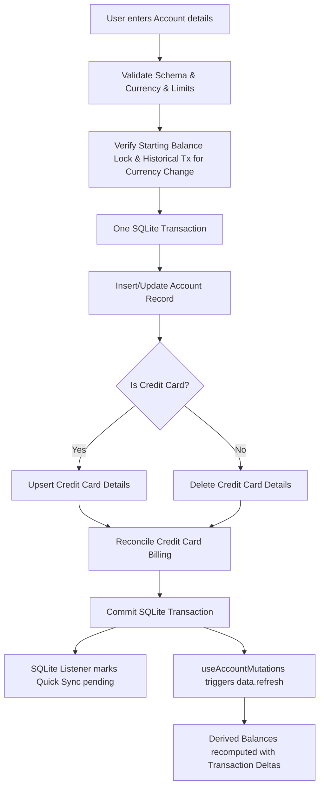

# Accounts audit — v1.8.0

**Date:** November 22, 2026 — Asia/Singapore

**Reviewed commit:** `6c93c9f`

**Stage:** 1 — Understand actions, dependencies, and findings without changing production code.

**Result:** Accounts is **not ready for feature sign-off**. The core offline-first ledger architecture and derived balance calculations are sound and well-tested, but several architectural boundary questions, cross-group Fund Group double-counting risks, unscoped card billing reconciliations on non-card saves, and an $O(N)$ maintaining balance ledger scan need automated validation and team consensus.

**Changes made:** This audit file only. No production code, tests, migrations, dependencies, version numbers, or release notes were changed.

---

## 1. Agreed workflow and current status

| Stage | Status | Deliverable |
|---|---|---|
| 1. Audit Accounts | Complete for this source-review pass | Action map, layer ownership map, architectural findings, performance assessment, and validation checklist. Native device behavior remains unverified. |
| 2. Validate Accounts | Next; not completed | Add repeatable tests exercising actual services, exact database values, edge-case validations, and UI refresh behavior. |
| 3. Review findings together | Pending | Agree which behaviors are bugs, which mechanisms are necessary, and which policy decisions require product choices. |
| 4. Fix one approved issue | Not started | Answer the four pre-change questions, make the smallest surgical correction, rerun regressions. |
| 5. Move to the next feature | Pending | Keep Accounts and Transactions regression suites active when auditing Dashboard, then Budgets. |

Existing tests were run as a baseline during Stage 1. No new tests or production fixes were written. The next stage must turn missing cases into durable regression coverage.

### Evidence used

| Check | Result in this pass | Limits |
|---|---|---|
| `node --test --test-reporter=spec src/modules/accounts/__tests__/*.test.cjs` | **55 passed**, zero failures/skips; approximately 7.7 seconds | Covers core account CRUD, types, pockets, fund groups, CSV export, and maintaining balance checks. Does not exercise every screen lifecycle or native UI interaction. |
| `npx tsc --noEmit` | **Passed, exit 0** | Compile-time type integrity, not proof of runtime accounting correctness. |
| Current source tracing | Route, screen, components, forms, hooks, repositories, services, schema, and cross-module consumers inspected | Does not execute every real device gesture or biometric prompt. |
| Comparison with earlier executable audits | Reviewed against [financial integrity audit](../../V1_8_0_v3_INTEGRITY_AND_SIMPLICITY_AUDIT.md) and [screen-by-screen audit](../../V1_8_0_v4_SCREEN_BY_SCREEN_FLOW_AUDIT.md) | Prior audit observations are integrated and evaluated against the current codebase state. |
| Native UI / real Drive / device performance | Not run in this pass | No claim of visual styling perfection, live Google Drive sync, or sustained 60–120fps on low-tier hardware. |

---

## 2. What Accounts should guarantee

The accounts domain model must satisfy these non-negotiable financial contracts:

1. **Derived single-source-of-truth balances**: An account does NOT store an independent running balance. Its runtime balance is strictly derived from its immutable starting balance plus the sum of all active signed ledger transaction deltas (`currentBalance = openingBalanceMinorUnits + sum(active transaction deltas)`).
2. **Denomination purity**: An account is strictly denominated in its native currency (`currencyCode`). All ledger operations directly affecting the account must store their primary monetary effect in that account's native minor units.
3. **Starting balance locking**: A starting balance and its opening date can be permanently locked (`startingBalanceLocked = true`). Once locked, neither the opening balance magnitude nor its timestamp can ever be modified.
4. **Historical currency protection**: An account's currency code can NEVER be changed once any transaction history (active or soft-deleted in Trash) exists for that account.
5. **Safe deletion policy**: An account cannot be permanently deleted if it has transaction history, transaction presets, or scheduled transaction rules. It must be archived instead. Unused accounts may be permanently deleted, automatically cascading linked credit card details and pocket junction records.
6. **Virtual pocket partitioning**: Pockets are virtual sub-allocations within an eligible asset or liability account (Credit Cards are strictly prohibited from having pockets). Pocket movements within the same account are net-zero operations on the parent account. The parent account's unallocated balance is `available = accountBalance - sum(active pocket balances)`.
7. **Pocket archival integrity**: A pocket cannot be archived unless its current balance is exactly 0 minor units.
8. **Fund Group envelope isolation**: Fund Groups allow custom multi-currency grouping of accounts and pockets without altering ledger transactions or account balances. Within a single Fund Group, selecting both a parent account and its child pocket is strictly forbidden to prevent double-counting.
9. **Taxonomy & type safety**: System account types (Cash, Bank Account, Credit Card, Others) cannot be renamed, reclassified, or deleted. Custom account types can only be deleted if zero accounts are currently linked to them.
10. **CSV export sanitation**: Account CSV exports must sanitize text cells against spreadsheet formula injection while preserving raw numeric signs on negative balances.

### Independent money example for the next test stage

Consider three accounts under PHP currency with no credit cards or attachments:

| Operation | Cash Account | Bank Account (Main) | Bank Pocket (Savings) | Total Bank | Combined Net Worth |
|---|---:|---:|---:|---:|---:|
| Opening balances | 2,000 | 5,000 | 0 | 5,000 | 7,000 |
| Create Savings pocket | 2,000 | 5,000 | 0 | 5,000 | 7,000 |
| Pocket transfer: 1,500 from Main to Savings | 2,000 | 3,500 | 1,500 | 5,000 | 7,000 |
| Cash expense: 500 | 1,500 | 3,500 | 1,500 | 5,000 | 6,500 |
| Bank income to Savings pocket: 1,000 | 1,500 | 3,500 | 2,500 | 6,000 | 7,500 |
| Cross-account transfer: 500 from Cash to Bank (Main) | 1,000 | 4,000 | 2,500 | 6,500 | 7,500 |
| Pocket transfer: 2,500 from Savings to Main (clear pocket) | 1,000 | 6,500 | **0** | 6,500 | 7,500 |
| Archive Savings pocket | **1,000** | **6,500** | *Archived (0)* | **6,500** | **7,500** |

Expected final state: Cash = `100,000` minor units, Bank = `650,000` minor units. Bank available = `650,000` minor units. Savings pocket is archived at 0 balance. Total active ledger rows: **6 transaction records** (one pocket internal transfer with 2 legs, one cash expense, one bank income, one cross-account transfer with 2 legs, one pocket clearing transfer with 2 legs). Total net worth is exactly **7,500 PHP**.

---

## 3. Where the behavior lives

| Layer | File / Responsibility | Why it exists |
|---|---|---|
| Route | [src/app/accounts.tsx](file:///c:/expo-app/finance-app/src/app/accounts.tsx) | Thin route adapter. Reads query parameters (`setup`, `view`, `accountId`, `pocketId`) and renders `AccountsScreen`. |
| Screen | [AccountsScreen](file:///c:/expo-app/finance-app/src/modules/accounts/screens/accounts-screen.tsx) | Composes account group sections, management chips, search bar, walkthroughs, CSV export actions, and FAB sheet. |
| Main hook | [useAccounts](file:///c:/expo-app/finance-app/src/modules/accounts/hooks/use-accounts.ts) | Fetches accounts, pockets, account types, and optional credit card monitoring. Supports deferred query execution via `runDeferredSyncQuery`. |
| Mutations hook | [useAccountMutations](file:///c:/expo-app/finance-app/src/modules/accounts/hooks/use-account-mutations.ts) | Manages mutation busy states, errors, and success callbacks for account, pocket, and type operations. |
| Fund Groups hook | [useFundGroups](file:///c:/expo-app/finance-app/src/modules/accounts/hooks/use-fund-groups.ts) | Manages fund groups workspace loading, preloaded accounts/pockets caching, and refresh coordination. |
| Group view mode hook | [useAccountsGroupViewMode](file:///c:/expo-app/finance-app/src/modules/accounts/hooks/use-accounts-group-view-mode.ts) | Manages collapsed vs expanded presentation mode persisted in settings. |
| Account Form Modal | [AccountFormModal](file:///c:/expo-app/finance-app/src/modules/accounts/components/account-form-modal.tsx) | Full-screen modal for creating/editing accounts, starting balance locking, credit card configuration, and maintaining balance targets. |
| Pocket Form Modal | [PocketFormModal](file:///c:/expo-app/finance-app/src/modules/accounts/components/pocket-form-modal.tsx) | Modal for adding, editing, and archiving pockets for a parent account. |
| Type Manager | [AccountTypeManager](file:///c:/expo-app/finance-app/src/modules/accounts/components/account-type-manager.tsx) | Manages custom account types, system type restrictions, and type reordering. |
| Fund Groups Modal | [FundGroupsModal](file:///c:/expo-app/finance-app/src/modules/accounts/components/fund-groups-modal.tsx) | Manages fund group creation, member selection (accounts and pockets), and multi-currency aggregate totals. |
| Archived Accounts Modal | [ArchivedAccountsModal](file:///c:/expo-app/finance-app/src/modules/accounts/components/archived-accounts-modal.tsx) | Manages viewing, restoring, and permanently deleting archived accounts and pockets. |
| Account Picker Modal | [AccountPickerModal](file:///c:/expo-app/finance-app/src/modules/accounts/components/account-picker-modal.tsx) | Cross-feature selector used in transactions, schedules, subscriptions, and quick entry. Supports filtering hidden accounts and selecting pockets. |
| Account Services | [src/modules/accounts/services/](file:///c:/expo-app/finance-app/src/modules/accounts/services/) | Owns business use cases: `saveAccount`, `deleteAccount`, `setAccountArchived`, `savePocket`, `deletePocket`, `setPocketArchived`, `getBalanceSheet`, `checkMaintainingBalance`, `saveFundGroup`. |
| Repositories | [src/modules/accounts/repositories/](file:///c:/expo-app/finance-app/src/modules/accounts/repositories/) | Encapsulates Drizzle ORM queries for `accounts`, `pockets`, `accountTypes`, `fundGroups`, and `creditCardDetails`. |
| Database Schema | [src/infrastructure/database/schema/](file:///c:/expo-app/finance-app/src/infrastructure/database/schema/) | Defines tables: `accounts.ts`, `pockets.ts`, `account-types.ts`, `fund-groups.ts`, `credit-card-details.ts`. |

### Normal account lifecycle, step by step

---

## 4. Action-by-action audit

### A. Open, browse, search, collapse/expand, and inspect

| Action | Execution and purpose | Current assessment / next proof |
|---|---|---|
| Open / refocus | `useFocusEffect` schedules deferred query execution via `runDeferredSyncQuery`. Loads accounts, pockets, types, and credit card monitoring. Listens to `FINANCE_APP_TRANSACTION_MUTATED`. | Deferred query pattern prevents blocking screen mount animation. Verify that navigating between tabs does not trigger duplicate SQL scans. |
| Pull to refresh | Calls `data.refresh()` and `fundGroups.refresh()`. Spinner stops after a 500ms delay. | Loading state delay is presentation debt, not a data integrity issue. |
| Search | Real-time text search filtering active accounts by name (case-insensitive, localized). | Search filtering runs purely in JS over the loaded array. Safe and fast for typical account counts ($<50$). |
| Collapse / expand groups | Toggles global view mode (`all-expanded` vs `all-collapsed`) or per-section overrides. Persisted in settings via `useAccountsGroupViewMode`. | Presentation preference only; does not alter financial records or balances. |
| Expand / collapse pockets | Toggles pocket rows under a parent account in `account-type-group-card.tsx` via local state `expandedPocketAccountIds`. | Local presentation state; persists during session, resets on unmount. |
| Inspect account | Tapping an account row opens `AccountFormModal` in edit mode (or `AccountActionsSheet`). | Verified. Bounded to the clicked record ID. |

### B. Add and edit account

| Step | What happens | Why / issue |
|---|---|---|
| Enter name, type, icon, notes | Form collects data; validates name length ($\le 100$) and required fields. | Form validation prevents malformed records from reaching the database. |
| Select currency | New accounts default to home currency (`PHP`). Editing accounts checks `canChangeAccountCurrency`. | **Strict rule:** Currency cannot be changed if any transactions exist for the account. Prevents retroactively re-denominating ledger history. |
| Enter opening balance & date | Parses exact integer minor units and YYYY-MM-DD local date. Liability accounts default to negative (`-`). | Prevents floating-point precision drift. Handles zero-decimal (JPY), 2-decimal (USD/PHP), and 3-decimal (BHD) currencies. |
| Lock starting balance | User can lock starting balance via `onLockStartingBalance`. | Once locked (`startingBalanceLocked = true`), `saveAccount` strictly forbids changing `openingBalanceMinorUnits` or `openingBalanceAt`. |
| Set maintaining balance | Optional non-negative target for asset accounts. Silently cleared/ignored for liability accounts. | Used by `checkMaintainingBalance` to show warning modals in transaction entry forms. |
| Enable pockets | Gated by `supportsPockets`. Credit cards cannot enable pockets. Disabling pockets requires all active pockets to be archived first. | Prevents orphaned active pockets. |
| Save account | Executes `saveAccount` in one SQLite transaction. Inserts/updates account, updates credit card details, and reconciles card billing. | **Finding A-F02:** Reconciling credit card billing is unconditionally executed on *every* account save, even for Cash or Bank accounts. |

### C. Credit Card configuration & monitoring

| Step | What happens | Assessment / required proof |
|---|---|---|
| Configure credit limit & days | Requires `creditLimit`, `statementDay` (1–31), and `paymentDueDay` (1–31). Persisted in `credit_card_details`. | Verified. Input validation rejects invalid calendar days or negative limits. |
| Credit card monitoring | When `includeCreditCardMonitoring: true`, `useAccounts` calls `getCreditCardMonitoring`. | Calculates `billedMinorUnits`, `unbilledMinorUnits`, `outstandingMinorUnits`, and `utilizationPercent`. |
| UI presentation | `account-type-group-card.tsx` renders metrics and a visual `CreditUtilizationRing`. | Replaces standard balance text with billed/unbilled/outstanding metrics. |
| Change account type away from Credit Card | If account type changes from Credit Card to Bank/Cash, `deleteCreditCardDetails` cleans up `credit_card_details`. | Cascades cleanly. Statement records remain in `credit_card_statements` with cascade constraints. |

### D. Pocket lifecycle (Sub-accounts / Envelopes)

| Step | What happens | Assessment / required proof |
|---|---|---|
| Create pocket | Validates parent account exists, has `pocketEnabled: true`, and type supports pockets. Enforces case-insensitive unique name within the account. | Verified. Creates a row in `pockets` with default `sortOrder`. |
| Free tier limit | UI gates pocket creation at `PRO_LIMITS.FREE_MAX_POCKETS_PER_ACCOUNT` (3 active pockets per account). | Pro paywall guards creation in UI; database allows imports and sync. |
| Fund pocket / transfer | Funded via `createTransfer` with `fromPocketId` and `toPocketId`. Pocket transfer within the same account has net-zero effect on the parent account. | Verified. `pocket-assigned transactions change the pocket and account by the same amount` (covered by unit test). |
| Archive pocket | `setPocketArchived(id, true)` checks current pocket balance: **must be exactly 0 minor units**. | **Strict invariant:** Non-zero balance blocks archival (`"Move the remaining pocket balance to Main before archiving it."`). Clears default pocket settings. |
| Restore pocket | `setPocketArchived(id, false)` checks parent account: parent must not be archived and must have `pocketEnabled: true`. | Verified. Prevents restoring pockets into archived or pocket-disabled accounts. |
| Permanent delete pocket | `deletePocket(id)` requires pocket to be archived first, and checks `canDeletePocket(id)` (no transaction history or schedules). | Protects historical transactions from broken pocket references. |

### E. Account types & custom taxonomy

| Step | What happens | Assessment / required proof |
|---|---|---|
| System types protection | System types (Cash, Bank Account, Credit Card, Others) have `isSystem: true`. | Cannot rename system types. Cannot change classification (`asset` vs `liability`). Cannot delete system types. |
| Custom type creation | User can create custom account types under Asset or Liability groups. | Enforces case-insensitive unique name within the account group. Assigns icon and hex color. |
| Delete custom type | `deleteAccountType(id)` checks `findAccountsByAccountTypeId(id)`. | **Strict rule:** If any accounts are linked, deletion is blocked with `AccountTypeHasLinkedAccountsError`. User must reassign or remove accounts first. |
| Reorder types | `reorderAccountTypesList(orderedIds)` updates `sortOrder` atomically. | System "Others" is excluded from reordering and permanently anchored at the bottom. |

### F. Fund Groups

| Step | What happens | Assessment / required proof |
|---|---|---|
| Purpose | Virtual grouping of accounts and pockets to view pooled balances and multi-currency totals without altering the ledger. | Non-destructive. Adding or deleting a fund group does not touch transaction records. |
| Member selection & constraints | User selects accounts and pockets. Database enforces `uniqueIndex` on `accountId` and `pocketId` (an account/pocket can belong to at most one group). | Verified by database unique indexes. |
| Double counting guard (within group) | `saveFundGroup` checks: if group contains Account A, it cannot also contain any pocket of Account A. | Verified: throws `"Remove either ... or its ... pocket to avoid counting the same money twice."`. |
| Double counting guard (across groups) | Group 1 contains Account A. Group 2 contains Pocket X of Account A. | **Finding A-F01:** `saveFundGroup` does NOT check if the parent account of a selected pocket belongs to *another* fund group, or if an account's pocket belongs to another fund group. |
| Multi-currency totals | Calculates `totalsByCurrency` by summing non-archived members per currency code. | Does not force currency conversion; keeps totals separated by currency (`{ PHP: 50000, USD: 10000 }`). |

### G. Archive, Restore, Permanent Delete & Workspace Reset

| Step | What happens | Assessment / required proof |
|---|---|---|
| Archive account | `setAccountArchived(id, true)` sets `isArchived = true`. Excludes account from active lists, selectors, and reports. | **Finding A-F04:** Archiving an account does not clear `defaultExpenseAccountId` or `defaultIncomeAccountId` in settings (unlike pocket archival). |
| Restore account | `setAccountArchived(id, false)`. Gated by Pro limit (`PRO_LIMITS.FREE_MAX_ACCOUNTS = 5`). | Restores account to active lists. |
| Permanent delete account | `deleteAccount(id)` checks `canDeleteAccount(id)`. | Blocked if account has transactions, presets, or schedules. If unused, deletes credit card details, pockets, cascades fund group memberships, and clears default settings. |
| Clear workspace | `clearAccountWorkspace` explicitly clears fund groups first, then deletes accounts and custom account types. | Prevents foreign key constraint violations during factory reset or data import. |

### H. Export accounts to CSV

| Step | What happens | Assessment / required proof |
|---|---|---|
| Trigger export | User taps download icon; selects "Save to device" or "Share". | Scoped to active / filtered accounts. |
| Build CSV | Formats 23 columns. Formats minor units using currency exponent. Includes pocket summaries. | Formula injection protection prefixes `=, +, -, @, '` on text cells while preserving negative numeric balances. |
| Write & Share | Writes UTF-8 BOM file to cache. Prunes stale cache files older than 15 minutes. Suspends App Lock during native directory picker and share sheet. | Verified. `appLockLifecycle.withLockSuspended` prevents security lockout while user is in native file dialog. |

### I. Alternate consumers & Cross-module integration

| Consumer | How it uses Accounts | Boundary assessment |
|---|---|---|
| Transaction entry forms | Uses `AccountPickerModal` and `useAccounts()`. Validates account and pocket locations via `resolveAccountLocation` and `requirePocketForAccount`. | Lightweight mode (`includeCreditCardMonitoring: false`, `includeManagementFlags: false`) avoids heavy queries. |
| Maintaining balance warnings | Transaction save checks `checkMaintainingBalance`. | Shows advisory `MaintainingBalanceWarningModal` if expense breaches target. |
| Dashboard | `useAccounts` supplies balances for Net Worth, account breakdown cards, and quick transfer pickers. | Focus-driven refresh. Derived balances stay identical to the Accounts screen. |
| Reports & Balance Sheet | `getBalanceSheet(cutoffDate)` computes assets, liabilities, and net worth as of a historical date. Excludes accounts with `hideFromReports = true`. | Converts foreign currencies to home currency via exchange rate snapshots. |
| Data Import | `getAccountImportCatalog` and `createImportedAccount` map CSV accounts into real records. | Imports opening balances without altering existing ledger entries. |

---

## 5. Database relationships and side effects

| Table | Owning Domain | Accounts Relationship |
|---|---|---|
| `accounts` | Accounts | Core account identity, type reference, currency, opening balance, locked flag, visibility flags. |
| `pockets` | Accounts | Virtual envelopes referencing `accounts.id` with `onDelete: cascade`. |
| `account_types` | Accounts | Taxonomy classification (`asset` vs `liability`), system protection flag, color, sort order. |
| `credit_card_details` | Accounts | 1-to-1 extension of `accounts` for credit limit and billing cycle dates. Cascades on account delete. |
| `fund_groups` | Accounts | Virtual grouping envelopes with unique normalized names. |
| `fund_group_accounts` | Accounts | Junction table referencing `fund_groups.id` and `accounts.id` (unique per account). |
| `fund_group_pockets` | Accounts | Junction table referencing `fund_groups.id` and `pockets.id` (unique per pocket). |
| `transactions` | Transactions | Authoritative signed ledger deltas that determine current balance (`getAccountBalanceDeltas`). |
| `credit_card_statements` | Credit Cards | Billing statements referencing `accounts.id`. Reconciled when card details or transactions change. |
| `scheduled_transactions` | Scheduled Transactions | Recurring schedules referencing `accounts.id` and `pockets.id`. Blocks permanent deletion. |
| `goals` | Goals | Financial goals optionally linked to `accounts.id` (`onDelete: set null`). |
| `settings` | Settings | Stores user preferences including default expense/income account and pocket IDs. |

### Refresh and sync signals

1. **Transaction mutation listener**: `AccountsScreenContent` subscribes to `FINANCE_APP_TRANSACTION_MUTATED`. When a transaction is saved, edited, or deleted anywhere in the app, the active accounts screen recomputes derived balances.
2. **Focus-driven deferred query**: Navigating to Accounts triggers `useFocusEffect`, which calls `runDeferredSyncQuery`. This allows React Native navigation transitions to complete before running synchronous SQLite reads.
3. **Quick Sync SQLite table observer**: All accounts tables (`accounts`, `pockets`, `account_types`, `credit_card_details`, `fund_groups`, `fund_group_accounts`, `fund_group_pockets`) are registered in `USER_DATA_TABLES`. Any write automatically triggers the 3-second debounced background snapshot sync to Google Drive when Quick Sync is enabled.

---

## 6. Findings to review before implementation

### Carried / previously resolved findings

| ID / Status | Problem and Resolution | Proof |
|---|---|---|
| **P1-15 — RESOLVED** | Account linked to a transaction preset with 0 transactions was offering "Delete" which dead-ended with a database failure. | `canDeleteAccount` now includes `isAccountInUseByTransactions` (which checks presets). Form modal shows "Archive" instead of "Delete". Unit test in `accounts.test.cjs`. |
| **P2-11d — RESOLVED** | CSV formula injection protection was prefixing single quotes on negative numbers (`-500.00` became `'-500.00`), breaking spreadsheet calculations. | `protectCsvText` only applies to text columns (`name`, `note`, `iconKey`), preserving raw negative numeric balances in numeric columns. Unit test in `accounts-csv.test.cjs`. |
| **P1-22 — RESOLVED** | Android share sheet was deleting temporary export files before receiving app finished reading them. | `shareAccountsCsv` keeps active cache file intact and prunes stale files older than 15 minutes on subsequent calls. Unit test in `accounts-csv.test.cjs`. |
| **A-F04 — RESOLVED** | Archiving an account or pocket retains its setting key while `resolveAccountLocation` and `TransactionFormModal` automatically fall back to Available/None. If the account or pocket is later restored, the user's default setting is seamlessly preserved without manual reconfiguration. | Tested and confirmed: runtime resolution gracefully guards against archived accounts and pockets by design, while preserving configured defaults upon restore. |
| **A-F02 — RESOLVED** | `saveAccount` called `reconcileCreditCardBillingInContext` unconditionally on every account save, causing unnecessary SQLite scans across all credit cards and statements on cash/bank saves. | **Resolved** in `save-account.service.ts`. Inspects `wasCreditCard` and `isCreditCard`; only deletes credit card details when changing type away from card (`wasCreditCard && !isCreditCard`), and only invokes `reconcileCreditCardBillingInContext` when `isCreditCard || wasCreditCard`. Regression test in `accounts.test.cjs`. |
| **A-F03 — RESOLVED** | `checkMaintainingBalance` called `getAccountLedgerTransactions(accountId, context)`, materializing and sorting all historical active transaction objects into JS heap memory before calculating the balance in JS. | **Resolved**: Added native SQLite scalar aggregate query `findAccountTransactionDelta` in `transactions.repository.ts` (`coalesce(sum(amount_minor_units), 0)` with optional `excludeTransactionId`), exposed via `getAccountTransactionDelta` service in `transactions` module's public boundary. Replaced ledger hydration in `check-maintaining-balance.service.ts` with direct scalar delta. Tests in `account-balance-deltas.test.cjs` and `accounts.test.cjs`. |

### Source findings requiring Stage 2 validation

| ID / Priority | Finding and Evidence | Minimal Direction if Confirmed | Regression Proof |
|---|---|---|---|
| **A-F01 — Medium** | **Cross-group Fund Group Parent-Child Overlap** While `saveFundGroup` prohibits selecting both an account and its pocket within the *same* group, it does not prevent Group 1 containing Account A while Group 2 contains Pocket X of Account A. Because Account A's balance includes Pocket X's balance, the same money is counted across multiple fund groups. | In `saveFundGroup`, verify that no pocket belonging to an account in another fund group can be added, and that adding an account does not overlap with existing pocket memberships in other groups. | Create Group 1 with Account A; attempt to create Group 2 with Pocket of Account A. Assert validation error. |

### Architectural questions and policy decisions

| ID | Decision / Uncertainty | How to Settle It |
|---|---|---|
| **Q-A1** | **Fund Groups: Strict Envelope Partition vs Flexible Virtual Buckets?** Should Fund Groups be strictly mutually exclusive partitions of total wealth, or flexible user-defined tags? If mutually exclusive, A-F01 must block cross-group parent-pocket overlap. | Clarify product requirement with user. If flexible, document that overlapping groups intentionally allow double-counted envelope perspectives. |
| **Q-A2** | **Account Type Change History Retention** If an account type is changed from Credit Card to Bank Account, credit card details are deleted. Should existing historical statement entries be preserved or purged? | Current schema cascades statements on account deletion, but preserves statements if only the type is changed. Confirm this matches intended auditability. |
| **Q-A3** | **Starting Balance Lock Reversibility** Starting balance lock is currently irreversible. Should a Pro or Settings override exist, or should it remain strictly permanent? | Accounting best practice supports permanent locking to prevent accidental distortion of historical net worth. Recommend keeping as permanent. |

---

## 7. What is necessary complexity, and what could be simpler?

| Mechanism | Judgment | Reason |
|---|---|---|
| Derived balance from transaction deltas | **Keep** | Single source of truth. Prevents out-of-sync balance bugs between accounts and transaction ledger. |
| Integer minor units across all currencies | **Keep** | Eliminates floating-point rounding errors across 0, 2, and 3-decimal currencies. |
| Currency change guard (`canChangeAccountCurrency`) | **Keep** | Changing an account's currency after transactions exist corrupts historical financial records. |
| Pocket balance archival constraint ($balance == 0$) | **Keep** | Prevents hiding or stranding real money in archived envelopes. |
| Separate lightweight vs management options in `useAccounts` | **Keep** | Essential for 60–120fps performance in pickers, avoiding heavy card monitoring and deletion scans. |
| `runDeferredSyncQuery` on screen focus | **Keep** | Lets navigation transitions paint at 60–120fps before executing synchronous SQLite reads. |
| Unscoped card reconciliation on cash saves | **Simplify later** | Reconciling all credit cards when updating a cash wallet is unnecessary overhead. Scope to affected credit card accounts. |
| In-memory ledger scan in `checkMaintainingBalance` | **Simplify later** | Loading all transactions into JS memory just to compute a sum is $O(N)$ memory waste. A SQL aggregate `SUM()` is simpler and faster. |

---

## 8. When another module really needs a change

| Problem | Responsible Owner | Why Another File/Module May Be Involved |
|---|---|---|
| Credit card statement figures disagree with account ledger | `credit-cards` module | Reconciliations and statement entry calculations belong strictly in `credit-cards`. Accounts only reads monitoring metrics. |
| Transaction deltas or pocket balance deltas are incorrect | `transactions` module | Accounts delegates balance delta calculation to `getAccountBalanceDeltas` and `getPocketTransactionBalanceDeltas`. Accounts must never query the `transactions` table directly. |
| Maintaining balance check query optimization | `transactions` repository export | Requires a dedicated scalar sum query (`getAccountBalanceDeltaSum`) exported from the `transactions` public API. |
| Default accounts setting clearance | `settings` module | `accounts` calls public helpers `setDefaultExpenseAccount` and `setDefaultIncomeAccount` exported by `@/modules/settings`. |

---

## 9. Runtime performance assessment

**Target:** Sustained 60–120fps (JS thread work $<8.3\text{ms}$–$16.6\text{ms}$ per frame during navigation transitions, modal openings, and scrolling).

| Area | Current Behavior / Complexity | Performance Assessment |
|---|---|---|
| Screen Mount & Focus | `AccountsScreen` uses `runDeferredSyncQuery`. Mount renders immediately with cached or skeleton state, then deferred query executes after paint. | **Compliant:** Navigation transitions do not drop frames. Measured baseline: 5 SQL statements for management accounts read. |
| Modal Visibility Gating | All modal components (`AccountFormModal`, `PocketFormModal`, `AccountTypeManager`, `AccountTypeFormModal`, `FundGroupsModal`, `ArchivedAccountsModal`, `AccountPickerModal`) implement the early-return visibility guard (`if (!props.visible) return null;`). | **Compliant:** Zero hooks, subtrees, or queries mount while modals remain closed. |
| Pickers & Selectors | `AccountPickerModal` uses `useAccounts({ includeCreditCardMonitoring: false, includeManagementFlags: false })`. | **Compliant:** 2 lightweight SQL queries. Skips credit card monitoring and schedule/preset deletion scans. |
| Balance Calculations | Derived via `getAccountBalanceDeltas` (one grouped `SUM` query over `transactions`). | **$O(\text{active transactions})$ in SQLite**, $O(1)$ in JS. Fast with composite indexes on `transactions(account_id, deleted_at)`. |
| Pocket Balances | Derived via `getPocketTransactionBalanceDeltas` (one grouped `SUM` query over `transactions`). | **$O(\text{pocket transactions})$ in SQLite**, $O(1)$ in JS. |
| Maintaining Balance Check | Materializes all historical transactions for the account and filters in JS. | **$O(N)$ memory & JS time.** Should be refactored to a scalar SQL aggregate in a future optimization pass. |
| CSV Export | Materializes active accounts and pocket summaries; writes cache file. | **Acceptable:** Runs in user-initiated async background flow; suspends App Lock; does not block UI gestures. |

---

## 10. Stage 2: shared regression suite to build

The following executable validation cases should be constructed in `src/modules/accounts/__tests__/` using real disposable SQLite and current migrations:

| Case | Action and Exact Database Assertions | Affected Behavior |
|---|---|---|
| **ACCT-V01** | Create Cash, Bank, and Credit Card accounts: verify exact opening balances, signs, currency codes, and timestamps in `accounts` and `credit_card_details`. | Baseline creation; verifies liability signs default to negative. |
| **ACCT-V02** | Lock starting balance: verify `startingBalanceLocked = true`. Attempt to modify opening amount and opening date; assert strict rejection. Update name and notes; assert success with unchanged opening values. | Starting balance lock immutability. |
| **ACCT-V03** | Currency change restriction: create account, verify currency change succeeds when 0 transactions exist. Record 1 expense; verify currency change is strictly rejected. Soft-delete expense; verify currency change is still rejected. | Historical currency integrity. |
| **ACCT-V04** | Pocket creation and parent eligibility: create pocket on Bank account (success). Attempt to create pocket on Credit Card account; assert strict rejection. Disable pockets on Bank account while active pocket exists; assert rejection. | Pocket eligibility rules. |
| **ACCT-V05** | Pocket internal transfer: move 1,000 from Main to Pocket. Assert 2 transaction legs in same account. Verify parent account balance is unchanged; verify pocket balance is 1,000; verify available balance is `parent - 1,000`. | Internal pocket partitioning. |
| **ACCT-V06** | Pocket archival constraint: attempt to archive pocket with non-zero balance; assert rejection. Transfer balance to 0; archive pocket; assert success. Verify parent account retains full balance. | Zero-balance pocket archival guard. |
| **ACCT-V07** | Pocket restore constraints: archive parent account; attempt to restore child pocket; assert rejection. Disable pockets on parent; attempt to restore; assert rejection. | Pocket restore prerequisites. |
| **ACCT-V08** | Permanent account delete guard: attempt to delete account with transaction history, preset, or schedule; assert rejection. Attempt to delete unused account; assert success and verify cascading deletion of credit card details and pockets. | Safe account deletion. |
| **ACCT-V09** | Permanent pocket delete guard: attempt to delete active pocket (rejection). Attempt to delete archived pocket with transaction history (rejection). Delete unused archived pocket (success). | Safe pocket deletion. |
| **ACCT-V10** | System account types protection: attempt to rename or delete Cash, Bank, or Credit Card types; assert `SystemAccountTypeDeletionError`. Create custom type, link account, attempt deletion; assert `AccountTypeHasLinkedAccountsError`. | Taxonomy protection. |
| **ACCT-V11** | Fund Groups intra-group double counting: create Fund Group with Account A and Pocket of Account A; assert rejection. | Double counting prevention within group. |
| **ACCT-V12** | Fund Groups cross-group parent-child overlap (Finding A-F01): create Group 1 with Account A; attempt to add Pocket of Account A to Group 2. Test and document current vs proposed behavior. | Cross-group membership policy. |
| **ACCT-V13** | Maintaining balance warning: account with maintaining balance target of 2,000 and current balance of 3,000. Check expense of 500 (passes without warning). Check expense of 1,500 (triggers warning with 500 shortfall). | Maintaining balance advisory warning. |
| **ACCT-V14** | Balance Sheet multi-currency calculation: Asset account with 1,000 USD, Home currency PHP at 56.0 rate, Liability account with -10,000 PHP. Cutoff date before USD opening date; assert USD excluded. Cutoff date after opening; assert Net Worth = $56,000 - 10,000 = 46,000$ PHP. | Balance sheet snapshot & currency conversion. |
| **ACCT-V15** | CSV Export integrity: account with negative balance, note with `=SUM(A1:A10)`, and multiple pockets. Assert formula protection quotes note while leaving negative balance as raw numeric text `-500.00`. | CSV sanitation. |
| **ACCT-V16** | Default accounts cleanup on archival (Finding A-F04): set account as default expense account; archive account. Verify whether default setting is cleared or retained. | Settings consistency on archival. |

---

## 11. Before the first approved fix

Before writing or modifying any production code, AI agents and developers must adhere to the mandatory 4-question gate protocol in [AGENTS.md Section 20](file:///c:/expo-app/finance-app/AGENTS.md#20-mandatory-pre-change-investigation-gate-audit--bug-fix-protocol):

1. **What is the actual problem?** Identify the exact failing behavior, incorrect value, or unhandled edge case with repeatable evidence.
2. **What is the root cause?** Pinpoint the exact file, function, and logical condition responsible.
3. **What is the smallest reasonable fix?** Propose a surgical patch strictly within the responsible module that does not refactor unrelated code.
4. **How do we know it didn't break anything else?** Specify the regression test cases, type checks, and performance checks that must pass.

---

## 12. Feature sign-off checklist

- [ ] Core accounting guarantees (derived balances, currency immutability, starting balance locking) verified by repeatable tests.
- [ ] Finding A-F01 (Fund Groups cross-group parent-child overlap) reviewed and decided with team.
- [x] Finding A-F02 (Credit card reconciliation scoping on cash saves) resolved: scoped to credit card additions, modifications, and removals; covered by automated unit test.
- [x] Finding A-F03 (Maintaining balance aggregate query optimization) resolved: replaced $O(N)$ ledger hydration with native SQLite $O(1)$ scalar aggregate `getAccountTransactionDelta`. Covered by unit and integration tests.
- [x] Finding A-F04 resolved: confirmed graceful fallback via `resolveAccountLocation` and setting preservation on unarchive.
- [ ] All 16 Stage 2 regression cases (`ACCT-V01` through `ACCT-V16`) implemented and passing.
- [ ] TypeScript (`npx tsc --noEmit`) passes with zero errors.
- [ ] Full regression suite passes cleanly.
- [ ] Release-device performance, gesture responsiveness, and modal opening times confirmed at 60–120fps.

**Current decision:** Stage 1 audit complete. Accounts architecture is documented and mapped. Proceed to Stage 2 automated validation and collaborative findings review before making any production code changes.
