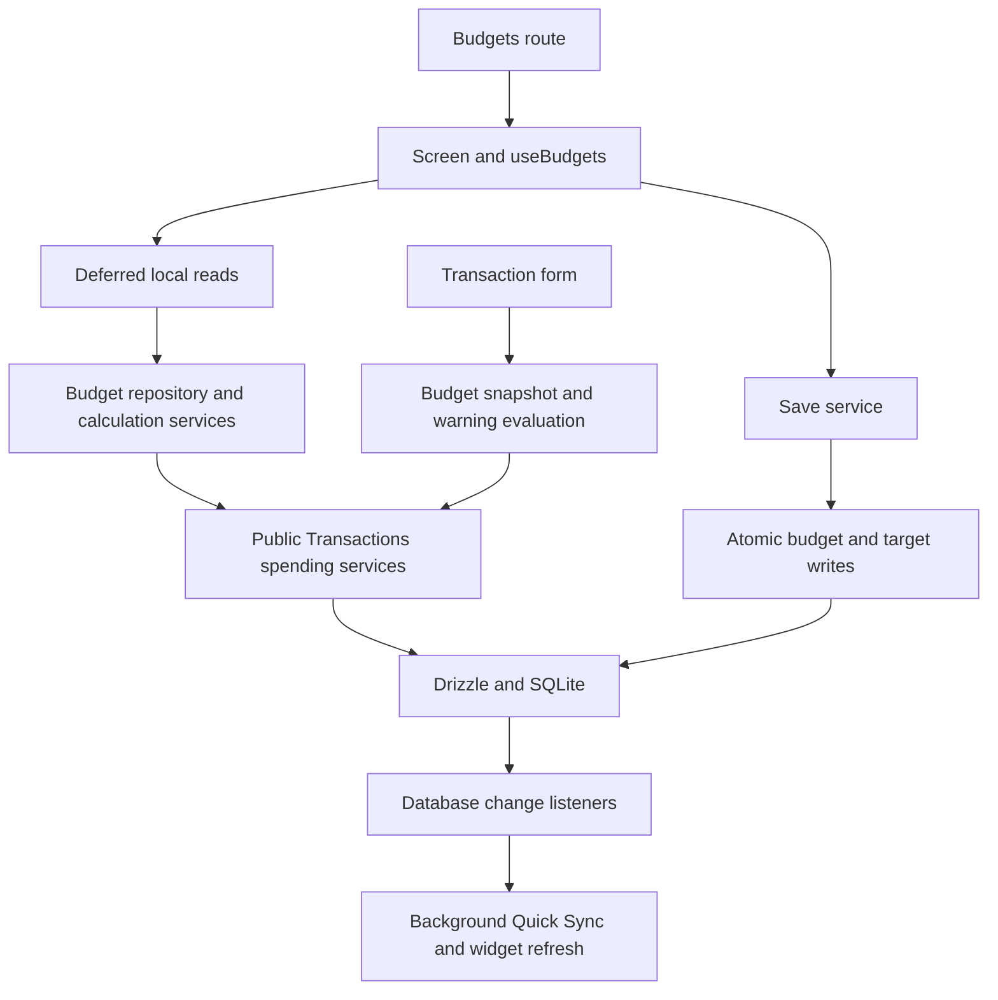

# Budgets audit — v1.8.0

**Date:** November 24, 2026 — Asia/Manila

**Reviewed commit:** `c73f893` (clean working tree before this audit).

**Stage:** Remediation in progress — BUD-F01 through BUD-F04 implemented with automated regression coverage. Other findings, full regression expansion, and native validation remain pending.

**Result:** **NOT READY FOR FEATURE SIGN-OFF.** Existing tests pass, but targeted fixtures confirm warning/card inconsistencies, incorrect rollover previews during date edits, and an incorrect widget amount label. Source tracing also identifies currency input, drill-down, draft preservation, recovery, architecture, localization, and performance gaps.

**Changes made:** Initial pass added this audit only. BUD-F01 updates budget currency handling; BUD-F02 adds exact-period/category drill-downs; BUD-F03 checks complete expenses and lists all exceeded budgets before saving. BUD-F04 aligns zero-limit previews, confirmations, cards, and alerts. All four have automated regression coverage. No migrations or stored-value conversions. Release notes skipped at the user's request; versions remain unchanged pending a version decision.

## 1. Workflow and current status

This follows the inventory, ownership, action review, findings, performance, and validation structure of the [Dashboard](dashboard-audit-v1.8.0.md), [Transactions](transactions-audit-v1.8.0.md), and [Accounts](accounts-audit-v1.8.0.md) audits. Their historical sign-off claims are not evidence that Budgets passes its own checks.

| Stage                           | Status      | Deliverable                                                                                                                                            |
| ------------------------------- | ----------- | ------------------------------------------------------------------------------------------------------------------------------------------------------ |
| 1. Audit Budgets                | Complete    | Feature inventory, ownership map, financial examples, prioritized findings, and performance assessment.                                                |
| 2. Validate Budgets             | Partial     | Existing suites executed; four database-backed defect probes and one extracted UI-handler probe executed. Additional regression cases specified below. |
| 3. Review findings and policies | Pending     | Agree on rollover history, mixed-frequency summaries, notification behavior, and privacy scope.                                                        |
| 4. Remediate findings           | In progress | BUD-F01 through BUD-F04 implemented and regression-tested; manual verification pending. Other findings remain open.                                    |
| 5. Feature sign-off             | Pending     | Financial/UI parity, failure recovery, localization, and measured device performance.                                                                  |

### Evidence used

| Check                                                             | Result in this pass                                                                                              | What it establishes / limits                                                                                                                                                                                                                                                                                                                |
| ----------------------------------------------------------------- | ---------------------------------------------------------------------------------------------------------------- | ------------------------------------------------------------------------------------------------------------------------------------------------------------------------------------------------------------------------------------------------------------------------------------------------------------------------------------------- |
| Budget summary and hook suites, plus budget walkthrough suite     | **13 passed**, zero failures/skips; approximately 7 seconds                                                      | Six real SQLite summary/snapshot tests, four simulated hook-lifecycle tests, and three walkthrough step-generation tests. Not a native rendering test.                                                                                                                                                                                      |
| BUD-F01 form-currency regression suite                            | **10 passed** after remediation; eight failures before the fix                                                   | Executes actual TSX and calculator keypad handlers for PHP/USD/JPY/KWD; checks save payloads, reopened fixtures, custom totals, stable draft currency, and closed-form gating. Native children and persistence callbacks are stubbed; device/database round-trip remains a manual check.                                                    |
| BUD-F01 follow-up combined regression run                         | **46 passed**, zero failures/skips; approximately 10.2 seconds                                                   | Ten new currency cases plus the 36 existing budget/walkthrough and related cases above. TypeScript also passed after the production fix.                                                                                                                                                                                                    |
| BUD-F02 follow-up regression run                                  | **157 passed**, zero failures/skips; approximately 18.6 seconds                                                  | All Budgets, Transactions, and Walkthrough suites. Includes 16 BUD-F02 cases and an extended existing 10,000-row fixture; TypeScript passed. Tests cover actual SQLite allocations, period/ownership parity, routes, privacy labels, scope clearing, and CSV fields. Native rendering/FPS remain unmeasured.                                |
| BUD-F03 follow-up regression run                                  | **184 passed**, zero failures/skips; approximately 30.6 seconds                                                  | Budgets, Transactions, Walkthroughs, Widgets, and Notifications suites. Includes 13 new BUD-F03 cases: actual grouped SQLite checks, edit/currency parity, chunking, deferred-read cancellation/retry, confirmation content, localization, and single-submit behavior. TypeScript passed; native layout and frame timing remain unmeasured. |
| BUD-F04 follow-up regression run                                  | **191 passed**, zero failures/skips; approximately 28 seconds                                                    | All Budgets, Transactions, Notifications, Widgets, and Walkthrough suites, including seven new zero-limit cases. TypeScript passed. Native notification delivery, layout, and frame timing remain pending.                                                                                                                                  |
| Related refund, split, form, widget, and reminder-settings suites | **23 passed**, zero failures/skips; approximately 5.7 seconds                                                    | Refund aggregation, split persistence, save guards, daily/biweekly DST boundaries, widget configuration, and reminder settings. Does not establish split-warning or widget financial-display correctness.                                                                                                                                   |
| `npx tsc --noEmit`                                                | **Passed, exit 0**                                                                                               | Repository-wide compile-time integrity.                                                                                                                                                                                                                                                                                                     |
| Isolated actual-service probes                                    | **Four mismatches reproduced**                                                                                   | Zero target, shared-parent split checks, moving an expense from the previous period, and widget remaining/over direction. Uses Drizzle and in-memory SQLite with the existing migration-backed budget harness.                                                                                                                              |
| Extracted `handleApplyBaseToAll` execution                        | **Other-year target discarded**                                                                                  | Executes the current handler with a 2025 target and a 2026 editor. Does not simulate native taps or a complete save.                                                                                                                                                                                                                        |
| SQL count and `EXPLAIN QUERY PLAN`                                | **8 statements** for the two-monthly-budget summary fixture                                                      | Unsplit aggregate uses category/date and entry-parent indexes, but also a temporary B-tree for `GROUP BY`. Not a device benchmark or a universal query count.                                                                                                                                                                               |
| Source tracing                                                    | Routes, budget files, transaction consumers, notifications, widgets, category loading, backup/reset registration | Establishes execution paths and code-level gaps. UI findings without executable fixtures are explicitly labeled below.                                                                                                                                                                                                                      |
| Native UI, notifications, restore, release-device frame timing    | **Not run**                                                                                                      | No claim of measured 60–120fps, complete restore parity, or physical-device sign-off.                                                                                                                                                                                                                                                       |

Commands executed from the repository root:

```powershell
node --test --test-reporter=spec src/modules/budgets/__tests__/budget-form-currency.test.cjs
node --test --test-reporter=spec src/modules/transactions/__tests__/budget-drill-down.test.cjs
node --test --test-reporter=spec src/modules/budgets/__tests__/budgets-summary.test.cjs src/modules/budgets/__tests__/over-budget-warning-modal.test.cjs src/modules/transactions/__tests__/form-integrity.test.cjs
node --test --test-reporter=spec src/modules/budgets/__tests__/budgets-summary.test.cjs src/modules/budgets/__tests__/use-budgets.test.cjs src/modules/walkthrough/__tests__/budgets-walkthrough.test.cjs
node --test --test-concurrency=2 --test-reporter=spec src/modules/transactions/__tests__/category-expense-refunds.test.cjs src/modules/transactions/__tests__/transactions-split.test.cjs src/modules/transactions/__tests__/form-integrity.test.cjs src/modules/widgets/__tests__/widgets.test.cjs src/modules/notifications/__tests__/reminder-settings.test.cjs
npx tsc --noEmit
```

The database probes reused `setupTestDb` / `setupParentBudget` from the existing budget test harness without editing tracked files. The temporary probe script is `%TEMP%/finance-budgets-audit-v1.8.0-probes.cjs`; its assertions characterize current defects, rather than assert the desired behavior. The fixtures and outputs below preserve the substantive evidence; permanent regression tests are still needed.

Reviewed the required [Expo SDK 57 reference](https://docs.expo.dev/versions/v57.0.0/) and [SDK 57 SQLite documentation](https://docs.expo.dev/versions/v57.0.0/sdk/sqlite/). The installed package declaration is `expo: ~57.0.25`. Deferring synchronous database work changes when it runs; it does not move that work off the JavaScript thread.

## 2. What Budgets should guarantee

1. A budget is a local spending limit for one category, denominated in its stored currency. The form, calculator, custom targets, card, and warning must agree on that denomination and minor-unit precision.
2. Spending derives from the local ledger: expenses increase it, expense refunds reduce it, transfers and deleted rows do not contribute, and split entries replace their parent for category allocation.
3. A parent includes its direct spending and children without their own enabled budgets. An enabled child owns its spending; a paused child falls back to the enabled parent.
4. Current-period bounds must agree across cards, preview, confirmation, notifications, and transaction drill-downs. Period calculations use local calendar boundaries; biweekly periods use the stored anchor.
5. A pending transaction must be assessed as one complete operation. Split lines consuming the same budget must be combined, and an edited transaction must be removed from every affected baseline before previewing its replacement.
6. Pausing preserves configuration and displayed history while excluding the budget from active totals. Removing a budget removes its monthly targets and leaves transactions intact.
7. Saves and custom-target replacements must be atomic. A failed operation must preserve the user's draft and provide an actionable recovery path.
8. Opening/focusing the screen must paint an interactive shell and skeleton before substantial synchronous work. Typing an amount must execute zero SQLite queries.
9. Closed forms must not mount domain hooks. Active refreshes must coalesce, cancel on blur/unmount, and commit rows, totals, and loading together.
10. All visible and accessibility strings must support English, Filipino, and Spanish. Cross-domain capabilities must use public services.

### Independent money fixture

Use November 15, 2026 at local noon, PHP budgets, and no FX initially. Set Dining's monthly target to PHP 5,000, with Groceries and Restaurants as children.

| Operation / configuration                                          | Parent spending |             Child spending | Active summary spending |
| ------------------------------------------------------------------ | --------------: | -------------------------: | ----------------------: |
| Groceries expense 4,500; neither child has a budget                |           4,500 |                          — |                   4,500 |
| Add Restaurants expense 300 and Groceries expense 300 in one split |       **5,100** |                          — |               **5,100** |
| Enable a separate Groceries budget                                 |             300 |                      4,800 |                   5,100 |
| Pause the Groceries budget                                         |           5,100 | 4,800 shown on paused card |                   5,100 |
| Refund 200 to Groceries while child remains paused                 |           4,900 | 4,600 shown on paused card |                   4,900 |

The split must trigger an enabled over-budget confirmation before saving: its combined PHP 600 consumes the same parent budget. Separately checking PHP 300 twice incorrectly sees PHP 4,800 twice.

For rollover, set the target to PHP 5,000 and previous-period spending to PHP 3,000. Current effective target is PHP 7,000 under the existing one-period rule. When that previous-period expense is moved into the current period and changed to PHP 8,000, the replacement baseline should have no previous spending: target PHP 10,000, spending PHP 8,000, remaining PHP 2,000. Current preview incorrectly uses a PHP 7,000 target.

## 3. Where the behavior lives

| Layer / consumer                   | File                                                                                                                                                                                                                                                                                                                                                                   | Responsibility                                                                                                |
| ---------------------------------- | ---------------------------------------------------------------------------------------------------------------------------------------------------------------------------------------------------------------------------------------------------------------------------------------------------------------------------------------------------------------------- | ------------------------------------------------------------------------------------------------------------- |
| Route                              | [budgets.tsx](../../src/app/budgets.tsx)                                                                                                                                                                                                                                                                                                                               | Thin adapter for `action=new` and `categoryId` edit links.                                                    |
| Screen                             | [budgets-screen.tsx](../../src/modules/budgets/screens/budgets-screen.tsx)                                                                                                                                                                                                                                                                                             | Overview, frequency filters, cards, create/edit/delete, walkthroughs, Pro guard, and error host.              |
| Hook                               | [use-budgets.ts](../../src/modules/budgets/hooks/use-budgets.ts)                                                                                                                                                                                                                                                                                                       | Deferred focus refresh, transaction event subscription, category map, sorting, totals, mutation state.        |
| Form / custom targets              | [budget-form-modal.tsx](../../src/modules/budgets/components/budget-form-modal.tsx), [custom-monthly-editor.tsx](../../src/modules/budgets/components/custom-monthly-editor.tsx)                                                                                                                                                                                       | Collect configuration, annual overrides, dirty state, calculators, and premium options.                       |
| Card                               | [budget-card.tsx](../../src/modules/budgets/components/budget-card.tsx)                                                                                                                                                                                                                                                                                                | Budget-currency metrics, rollover/status presentation, toggle, edit, and ledger link.                         |
| Save / toggle / delete             | [save service](../../src/modules/budgets/services/save-category-budget.service.ts), [toggle service](../../src/modules/budgets/services/toggle-category-budget.service.ts), [delete service](../../src/modules/budgets/services/delete-category-budget.service.ts)                                                                                                     | Validate supported inputs and invoke budget persistence. Save controls the default database transaction.      |
| Repository / schema                | [category-budgets.repository.ts](../../src/modules/budgets/repositories/category-budgets.repository.ts), [budgets.ts](../../src/infrastructure/database/schema/budgets.ts)                                                                                                                                                                                             | Unique budget per category, target hydration/replacement, foreign keys, checks, and cascades.                 |
| Periods / calculation              | [budget-period.ts](../../src/modules/budgets/utils/budget-period.ts), [calculate-category-budget.service.ts](../../src/modules/budgets/services/calculate-category-budget.service.ts)                                                                                                                                                                                  | Eight frequencies, previous period, targets, rollover, active-child exclusions, grouped spending reads.       |
| Summary                            | [get-budgets-summary.service.ts](../../src/modules/budgets/services/get-budgets-summary.service.ts)                                                                                                                                                                                                                                                                    | Widget-facing active totals converted into home currency. Hook maintains a second summary implementation.     |
| Transaction preview / confirmation | [single-category snapshot](../../src/modules/budgets/services/check-budget-exceeded.service.ts), [complete-expense checks](../../src/modules/budgets/services/check-expense-budgets.service.ts), [live indicator](../../src/modules/budgets/components/budget-live-indicator.tsx), [warning modal](../../src/modules/budgets/components/over-budget-warning-modal.tsx) | Resolve own/parent budgets, evaluate pending allocations, and show all enabled exceeded-budget confirmations. |
| Ledger aggregation owner           | [expense summary service](../../src/modules/transactions/services/get-category-expense-summary.service.ts), [unsplit totals repository](../../src/modules/transactions/repositories/category-expense-totals.repository.ts), [split totals repository](../../src/modules/transactions/repositories/transaction-entries.repository.ts)                                   | Signed refund-aware SQL aggregation with date/category bounds and chunked category IDs.                       |
| Other consumers                    | [transaction form](../../src/modules/transactions/components/transaction-form-modal.tsx), [instant alerts](../../src/modules/notifications/services/check-instant-alerts.service.ts), [widget snapshot](../../src/modules/widgets/services/widget-snapshot.service.tsx), [general search](../../src/modules/search/hooks/use-general-search.ts)                        | Save warnings, OS alerts, home-screen totals, and links to matching budgets.                                  |



## 4. Action-by-action audit

| User action                      | Current execution / result                                                                                                                          | Audit assessment                                                                                                                                                   |
| -------------------------------- | --------------------------------------------------------------------------------------------------------------------------------------------------- | ------------------------------------------------------------------------------------------------------------------------------------------------------------------ |
| Open / refocus / pull to refresh | Category hook loads first; `useBudgets.refresh` defers budget hydration/calculation, sorts exceeded/near-limit first, and commits totals with rows. | Cancellation and coalescing covered by tests. Category-load error is dropped; device timing pending.                                                               |
| Filter by frequency              | In-memory filter and one-pass count map over loaded statuses. Overview remains all active budgets.                                                  | No new SQL per filter. Whether overview should follow the filter is a policy question.                                                                             |
| Create                           | Screen applies free-budget-count guard, opens gated form, chooses first unbudgeted top-level expense category.                                      | Picker still allows an already-budgeted category; repository updates it by category. Decide whether this create-as-update behavior is intended.                    |
| Edit / change frequency          | Existing category is locked; form submits stored currency and current fields; non-custom saves clear monthly targets.                               | BUD-F01 currency mismatch fixed. Background snapshots can still reset the draft. Clearing overrides on frequency change needs explicit policy.                     |
| Edit custom monthly targets      | Current year only; missing overrides fall back to base amount; monthly and annual totals shown.                                                     | “Apply default to all” replaces the entire multi-year array. Other-year overrides are lost on save.                                                                |
| Enable rollover                  | Pro-guarded UI; calculation adds previous base/custom target minus previous spending, with optional deficit.                                        | One-period, not cumulative. Start date only anchors biweekly periods; creation/history policy requires agreement.                                                  |
| Pause / resume                   | Single local update then hook refresh. Paused cards retain calculations; active totals skip them.                                                   | Existing tests protect paused history and child fallback. No need to remove paused-card calculations as a speculative optimization.                                |
| Remove                           | Confirmation calls local delete; FK cascade removes monthly targets.                                                                                | Screen ignores returned failure and closes edit/confirmation even when delete fails.                                                                               |
| View transactions                | Passes the displayed period and exact budget-owned category IDs through a validated scope parameter.                                                | BUD-F02 fixed. Scoped rows expose category shares; daily totals use those shares while inspection/editing retain full transactions.                                |
| Type an expense                  | Indicator memoizes a snapshot by category/date/currency/exclusion, then evaluates amounts in pure JS.                                               | Zero-query amount typing is covered; initial snapshot still queries during render. Refund indicator uses expense semantics.                                        |
| Save an expense / split          | Form defers one complete-expense check after paint, grouping lines by owning budget and presenting all applicable warnings before save.             | BUD-F03 fixed. BUD-F04 aligns zero-limit checks; BUD-F05 fixed date edits and previous-period rollover exclusion.                                                  |
| Receive threshold notification   | Post-commit transaction path invokes notification service without awaiting it.                                                                      | Month-based deduplication conflicts with non-monthly periods; split transactions with null parent category bypass this path.                                       |
| Inspect Android widget           | Widget snapshot calls public summary service and formats in home currency.                                                                          | “Over” direction can contradict remaining amount; monthly label includes other frequencies.                                                                        |
| Search / deep link               | Non-empty debounced general search enables `useBudgets`; existing budget link opens edit form.                                                      | Empty search skips reads. Non-empty search calculates all budget statuses despite consuming only budget records.                                                   |
| Walkthrough / Pro options        | Form has outer visibility guard; walkthrough step builders tested; count, rollover, and alert controls use Pro UI guards.                           | No native entitlement/tap validation. Shared intro defaults `autoTrigger=false`, so its dormant interaction blocker is not reported as an active startup deadlock. |

## 5. Database relationships and side effects

- `categories → category_budgets` uses `ON DELETE CASCADE`; `category_budgets → budget_monthly_targets` also cascades. Removing a budget cannot delete ledger transactions through these relationships.
- Unique indexes enforce one budget per category and one override per budget/year/month. Schema checks constrain nonnegative targets, valid frequencies/rollover modes, and month 1–12.
- Save upserts by **category ID**, not input budget ID. Existing category configuration is updated; passing a new ID does not create a second budget for that category.
- `saveCategoryBudget` wraps budget writes and delete/reinsert of targets in `db.transaction` for the default context. An explicitly supplied context takes the direct path; callers supplying a transaction handle own its boundary. Failure-injection coverage for target replacement is still needed.
- Budget saves, toggles, and deletes contain no remote request. Budget/target tables are registered through [user-data-tables.ts](../../src/infrastructure/database/user-data-tables.ts) for backup/reset and Quick Sync watching. There is no basis to add a second feature-specific remote queue merely for this audit.
- [WidgetSyncProcessor](../../src/modules/widgets/components/widget-sync-processor.tsx) watches budget and target tables, debounces database events, and excludes settings to avoid snapshot self-invalidation. Widget updates check for active widgets before computing snapshots.
- The focused budget hook subscribes to `FINANCE_APP_TRANSACTION_MUTATED`; it does not mutate transactions, so lack of a transaction `sourceId` self-echo filter is not itself a duplicate-write-refresh defect here.
- Category changes propagate through `useCategories`; budget configuration changes have no dedicated hook subscription. Focus/local mutation refreshes cover the ordinary screen flow, but concurrent hosts and database replacement need lifecycle validation.

## 6. Prioritized findings

**BUD-F01 through BUD-F04 are implemented and automatically verified; manual verification remains pending. All other findings are OPEN.** “Executable” means actual code was exercised in the isolated harness; “source-confirmed” identifies a concrete code path, with native or integrated reproduction still pending. Original defect evidence below describes the pre-fix implementation.

| ID      | Priority | Finding                                                                                  | Evidence                                                                                                       |
| ------- | -------- | ---------------------------------------------------------------------------------------- | -------------------------------------------------------------------------------------------------------------- |
| BUD-F01 | High     | Input currency/precision differs from stored budget currency                             | Fixed; 10 regression tests pass; manual check pending                                                          |
| BUD-F02 | Medium   | Transaction drill-down does not explain budget spending                                  | Fixed; automated period/ownership/SQL parity verified; manual check pending                                    |
| BUD-F03 | High     | Split lines bypass a shared budget warning                                               | Fixed; grouped checks and confirmation workflow verified automatically; manual check pending                   |
| BUD-F04 | Medium   | Zero effective targets suppress over-budget checks                                       | Fixed; seven regression cases pass; manual check pending                                                       |
| BUD-F05 | Medium   | Moving an expense out of the previous period leaves it in rollover preview               | Resolved; edit exclusion applied to previous-period spending query; regression tests pass                      |
| BUD-F06 | Medium   | Background refresh resets an open form draft                                             | Resolved; draft state session-initialized; supporting data refresh preserves form state; regression tests pass |
| BUD-F07 | Medium   | Apply-all discards other-year custom targets                                             | Resolved; other-year overrides preserved on apply-all; regression tests pass                                   |
| BUD-F08 | Medium   | Failure paths hide category errors and discard delete recovery context                   | Resolved; category readiness/error surfaced and retried; delete context preserved on failure; regression tests pass |
| BUD-F09 | Medium   | Widget labels remaining money as overspending                                            | Resolved; aggregate overspend separated from category alert; signed remaining preserved; regression tests pass |
| BUD-F10 | Medium   | Notification identity uses months instead of budget periods; splits skip delivery checks | Resolved; period-scoped deduplication and dynamic period labels applied; split allocations dispatched; regression tests pass |
| BUD-F11 | Medium   | Summary service deep-imports the Categories repository                                   | Resolved; public getCategoryCatalogMap service introduced; deep repository import eliminated; regression tests pass |
| BUD-F12 | Medium   | Render-time snapshot queries and unstable row callbacks weaken frame-budget discipline   | Source-confirmed; device cost unmeasured                                                                       |
| BUD-F13 | Medium   | Core budget UI and period labels bypass localization                                     | Source-confirmed                                                                                               |
| BUD-F14 | Medium   | Refund live preview predicts extra spending                                              | Source-confirmed                                                                                               |

### [BUD-F01] Form and calculators use PHP while saves use the budget currency — FIX IMPLEMENTED

- **Problem / evidence:** [BudgetFormModal:469](../../src/modules/budgets/components/budget-form-modal.tsx#L469) hardcodes `currencyCode="PHP"`. Its calculator at line 668 omits currency, whose shared default is PHP. [CustomMonthlyEditor:125](../../src/modules/budgets/components/custom-monthly-editor.tsx#L125) and line 136 also format PHP; its calculator omits currency too. Save at form lines 283–284 instead uses the existing budget currency or home currency.
- **Cause / impact:** New USD budgets show peso input; JPY/KWD also use the wrong minor-unit exponent. For example, entering 1,000 through a two-decimal PHP calculator yields 100,000 minor units, which a JPY budget interprets as JPY 100,000. Existing non-PHP edits are affected as well.
- **Smallest fix:** Resolve effective budget currency once in the form and pass it to the field, both calculators, and custom editor. No conversion of stored amounts or new currency framework is needed.
- **Regression proof:** Create/edit PHP, USD, JPY, and KWD budgets and custom targets; assert displayed amounts, calculator output, stored minor units, and card values. Changing home currency must not relabel an existing budget.
- **Performance:** Scalar prop plumbing; no additional database reads or root context changes.

**Implemented fix — November 24, 2026:** The form captures `initialBudget.currencyCode` for an edit or the current default currency for a new session. That stable value feeds the main field/calculator, custom editor/month calculator, monthly/annual formatting, and save payload. Existing keyed form content and visibility gating reset the currency for each new session. Existing saved amounts are not converted. The only production changes are in the two budget components; shared calculator behavior is reused.

**Automated proof:** [budget-form-currency.test.cjs](../../src/modules/budgets/__tests__/budget-form-currency.test.cjs) checks PHP/USD/JPY/KWD entry precision, existing-currency precedence after home-currency changes, custom month entry and annual totals, save payloads and reopened fixtures, currency preference updates during a draft, and closed-form preference-hook gating. Before the production fix, eight cases failed and two passed. All ten pass after the fix.

**Manual verification guide:**

1. Load the updated app. In currency settings, set **Default currency → JPY**. Create a new monthly budget on an unused expense category, with rollover disabled.
2. Open the amount calculator and enter **1,000**. The field and calculator must identify JPY, with no fractional yen. Save: the card must show **JPY 1,000**, not JPY 100,000. Close/reopen the form and confirm the same amount, then save again.
3. Change the default currency to **PHP**, then reopen that JPY budget. Its field and calculator must still use JPY and show 1,000. Save/reopen once more to confirm the denomination persists. The overview may convert totals into PHP; assess the individual budget card for this check.
4. Set the default currency to **KWD**. Create another budget on an unused category. Enter **10.125**: all three decimal places must survive calculator confirmation, save, and reopening. Repeat with **PHP 1,000.00** and **USD 1,000.00** to verify two-decimal currencies.
5. For a KWD budget, select **Custom (12-Mo)**, set default monthly amount **10.125**, and give the current month **20.250**. All twelve month amounts, the month calculator, and annual total must use KWD. With no other overrides, annual total must be **131.625**. Save/reopen: current month remains 20.250 and other months remain 10.125; keep rollover disabled when comparing the current card target.
6. Close/discard the form, change the default currency, and open a fresh new-budget session. It must use the new default. Reopening existing budgets must retain their own currencies.

These steps verify native display and actual persistence; they have not been run on a device in this remediation pass. Budgets created with the earlier defect keep their stored values and may need the user to correct their intended amounts manually.

### [BUD-F02] “View transactions” always opens this month and includes separately budgeted children — FIX IMPLEMENTED

- **Problem / evidence:** [BudgetsScreen:528](../../src/modules/budgets/screens/budgets-screen.tsx#L528) always sends `datePreset=this_month`, ignoring `status.periodStart` / `periodEnd`. It also omits an expense filter and exclusions for children with their own enabled budgets.
- **Cause / impact:** On November 15, a daily card covers November 15 but the link includes November 1–30. A parent card excludes separately budgeted children; normal parent-category transaction filtering includes them. The opened records cannot reliably explain the card amount.
- **Smallest fix:** Pass the actual period and expense/category scope through the existing transaction route/filter contract, adding only missing route inputs. Preserve refund rows and split attribution; a split parent amount may need allocation-aware presentation to explain a partial-category total.
- **Regression proof:** All eight frequencies, boundary-spanning weeks, parent/child enabled and paused states, fees, refunds, and mixed-category splits. Assert both matching IDs and attributed spending, not just route text.
- **Performance:** Keep filtering in bounded SQLite queries using the existing paginated feed; do not fetch a full ledger to reconcile in JS.

**Implemented fix — November 24, 2026:** [get-budget-transaction-scope.service.ts](../../src/modules/budgets/services/get-budget-transaction-scope.service.ts) snapshots the card's actual local dates and eligible categories without database reads. Cards and drill-downs share one category-ownership helper. The existing Transactions route remains a thin adapter; the screen validates the scope and initializes exact category, custom date, and expense filters. Invalid scopes resolve to an empty result rather than an all-time feed. Opening another budget link refreshes the snapshot; changing a child's enabled state is reflected when opening a new link from Budgets.

Scoped SQL includes unsplit expenses or matching split allocations, excludes deleted rows and transfer principal, and retains positive expense refunds. Split parents do not match solely through a legacy parent category when none of their allocations belong to the scope. Page results gain a separate signed, account-currency `categoryAmountMinorUnits`; original amounts, balances, split entries, edit/duplicate data, and amount-sort cursors remain intact. Both row layouts and accessibility labels expose a localized **Category share**. A localized hint explains that row amounts are full transactions and daily totals use category shares. CSV retains full original values and appends **Selected Category Amount** only for a scoped export. Clearing filters or navigating to ordinary Transactions removes scoped presentation.

**Automated proof:**

- [budget-drill-down.test.cjs](../../src/modules/transactions/__tests__/budget-drill-down.test.cjs): all eight frequencies, cross-month weeks, child ownership, malformed dates/links, actual navigation callback, route reset/clear, and private share-label formatting.
- [budgets-summary.test.cjs](../../src/modules/budgets/__tests__/budgets-summary.test.cjs): actual card-versus-exported-share parity across all eight frequencies and both child-budget states, including split allocations and refunds; link generation performs zero SQL.
- [paginated-transactions.test.cjs](../../src/modules/transactions/__tests__/paginated-transactions.test.cjs): keyset paging, unchanged original amounts/balances, transfer fees, refunds, legacy split parents, exact bounds, CSV shares, and 1,002 selected IDs. The existing 10,000-row test now also verifies scoped pages: 50 returned rows, at most 12 statements, the active-feed index, and no temporary sorting B-tree. The two new SQL cases failed before implementation and pass afterward.
- All 157 Budgets/Transactions/Walkthrough tests pass. Full TypeScript check passes. Physical-device rendering, touch behavior, and frame timing remain pending.

**Performance:** Scope generation is O(budgets + children) at tap time and adds no query, context provider, or route subscription. Scoped allocation projection reuses hydrated split entries only for the returned page; it adds no SQL statements. Category-chip labels use one memoized Map rather than repeatedly rebuilding the category tree for every selected ID. Category IDs use parameterized JSON membership, avoiding an unbounded list of SQL bind variables; SQLite documents this table-valued lookup in [its JSON reference](https://www.sqlite.org/json1.html#jeach). Query-plan assertions establish bounded/indexed work for the fixtures, not measured 60–120fps on a phone. Ordinary CSV headers and unscoped feed amounts retain their existing behavior.

**Manual verification guide:** Use PHP accounts and budgets, with rollover off, to compare amounts directly. Expenses appear negative in Transactions; a daily net of **−PHP 200** corresponds to **PHP 200 Spent** on the budget card.

1. **Daily dates:** On an unused expense category, create a PHP 1,000 daily budget. Add PHP 200 today and PHP 300 on a different day within the same month. The card shows Spent 200. Its **View transactions** link shows today's expense only; inspect the Custom Dates filter to confirm both dates equal today.
2. **Parent ownership:** Create a Food expense group with Dining and Groceries children. Add monthly budgets of PHP 5,000 for Food and PHP 2,000 for Groceries. Record PHP 300 Dining and PHP 800 Groceries this month. Food shows Spent 300; its link includes Dining and excludes the separate Groceries expense. Groceries' link shows its own PHP 800.
3. **Split contribution:** Record one PHP 1,000 split expense: PHP 300 Dining and PHP 700 Groceries. Food now shows Spent 600. Food's link includes the full PHP 1,000 split row with **Category share: −PHP 300**; its day's net uses the PHP 300 contribution. Tap that row: transaction details/edit must still contain the complete PHP 1,000 transaction and both allocations. Check compact and detailed row layouts.
4. **Refund:** Record a positive PHP 50 expense refund under Dining. Food shows Spent 550. Its link includes the refund with a positive PHP 50 share; if the Dining expenses and refund are on one day, that day's net is −PHP 550. A refund is an expense with a positive sign, not an income record.
5. **Paused child:** Return to Budgets, pause Groceries' budget, and open Food's link again. Its spending now includes both children: PHP 2,050 for the fixture above. Resume Groceries and reopen Food's link; Food returns to PHP 550. Each new link should agree with the current card.
6. **Other periods:** Repeat with a weekly budget spanning a month boundary and quarterly/yearly budgets. Custom Dates must match the period printed on each card, rather than always selecting this month.
7. **Normal navigation/export:** In the scoped list, use **Clear all**: the category-share labels and hint disappear and the normal feed returns. Open ordinary Transactions from navigation and confirm no budget filter remains. Scoped CSV has full transaction amounts plus a Selected Category Amount column; an ordinary export keeps the standard columns.

These manual steps have not yet been executed on a native device. Daily totals retain the existing account-currency/mixed-currency conversion conventions; category-share labels and CSV shares use each transaction's account currency, while budget cards may use a different budget currency. Compare like currencies when checking totals.

### [BUD-F03] Splits consuming one budget are checked independently — FIX IMPLEMENTED

- **Problem / reproduction:** Parent target 500,000, existing spending 450,000; two pending child split lines of 30,000 each. Current checks return new spending **480,000 / 480,000**, both `exceeds=false`. Saving the complete split produces **510,000**, over budget.
- **Cause:** [TransactionFormModal:1805](../../src/modules/transactions/components/transaction-form-modal.tsx#L1805) invokes `checkBudgetExceeded` separately per line. Each invocation reads the same pre-save baseline and sees none of the other pending lines.
- **Smallest fix:** Resolve lines to their owning budgets, aggregate amounts per budget, and evaluate each budget once. Put the multi-line calculation in a focused Budgets service exported through its public API; it is business logic needed by a transaction consumer.
- **Regression proof:** Same-category lines, sibling fallback to a parent, separately budgeted children, mixed currencies, edits excluding an old split, and multiple exceeded budgets. Verify warning cancellation/proceed does not duplicate ledger writes.
- **Performance:** Reuse one snapshot per affected budget and Map-based grouping, O(number of lines), rather than repeat baseline reads per line.

**Implemented fix — November 24, 2026:** [check-expense-budgets.service.ts](../../src/modules/budgets/services/check-expense-budgets.service.ts) coalesces repeated category lines, loads category/parent metadata through the public Categories service, and resolves enabled child budgets or parent fallback. It groups amounts by budget ID and reuses the existing snapshot/evaluation logic once per owner. Combined amounts are converted into each budget's currency once. The existing bulk budget repository lookup now chunks both category IDs and monthly-target budget IDs at 500.

The transaction form calls the public complete-expense checker for ordinary and split expenses, excludes the edited transaction, and passes every exceeded result with alerts enabled to the confirmation. The scrollable confirmation shows each budget's limit, existing spending, pending allocation, new total, and excess before one **Proceed Anyway** action. **Cancel & Edit** writes nothing. Existing save guards prevent same-frame duplicate submissions; existing atomic persistence remains unchanged. Warning and read-error copy exists in English, Filipino, and Spanish. Zero-target policy, previous-period rollover-edit exclusion, and split OS-notification dispatch remain separate open findings.

**Loading and lifecycle:** Budget reads run through `runDeferredSyncQuery` after the existing native-driven form skeleton can paint. During the check, the form remains mounted but hidden/inaccessible beneath that skeleton, retaining its draft, scroll state, and memoized live indicator. Closing cancels the pending read through its current ref, even before a loading-state render; unmount also cancels it. Request ownership prevents stale warnings/writes. Read errors return a localized retry message and release the submit guard. Confirmation dismissal/proceed dismisses the keyboard.

**Automated proof:**

- [budgets-summary.test.cjs](../../src/modules/budgets/__tests__/budgets-summary.test.cjs): PHP 4,500 + combined PHP 600 yields one PHP 5,100 check and PHP 100 excess; enabled children remain independent; paused children fall back; same-period edits exclude old split entries; pending dates select the correct month; currency rounding occurs after aggregation; empty/missing/paused budgets fast-exit; alert opt-out survives; 1,001 budgets and their targets use six bounded lookup statements.
- The shared-parent fixture asserts at most 12 read statements and exactly one unsplit plus one split aggregate for its non-rollover baseline. Replacing two input lines with 2,000 repeated lines produces identical results and statement count. The child lookup uses `categories_parent_id_index` without a temporary B-tree. Checks execute SELECTs only.
- [form-integrity.test.cjs](../../src/modules/transactions/__tests__/form-integrity.test.cjs): the pre-fix handler incorrectly invoked persistence before confirmation. The fixed handler defers reads, presents all eligible exceeded budgets, passes the edit exclusion, cancels without writing, submits once after repeated Proceed taps, cancels on close/unmount, recovers after read failure, and skips extra-expense checks for refunds.
- [over-budget-warning-modal.test.cjs](../../src/modules/budgets/__tests__/over-budget-warning-modal.test.cjs): both budget breakdowns/currencies render in a bounded scroll area; closed warnings mount no subtree; pending actions block dismissal/proceed; keyboard dismissal and three-language interpolation keys are verified.
- Broad regression: 184 passed. Final focused follow-up after retaining the mounted form: 23 passed. Full TypeScript check passes. Tests stub native views, so physical-device layout, scroll retention, and FPS still require manual validation.

**Performance:** Pending-line grouping is O(lines), metadata lookups are chunked, and spending reads scale with unique affected budgets rather than repeated lines. There are zero new mount/focus/typing queries and no new root providers or subscriptions. Deferring synchronous reads allows the skeleton/header to paint; it does not make SQLite asynchronous or certify 8.3–16.6ms execution. Rollover adds its existing previous-period reads per owner; large numbers of independent budgets still need release-device profiling. Closed confirmation hooks remain visibility-gated, and its repeated breakdown components are memoized.

**Manual verification guide:** Use PHP accounts and budgets, keep all example transactions in one month, disable rollover, and enable the budget's **Over-Budget Alert** (currently a Pro option). An opted-out budget intentionally does not request confirmation.

1. Create a Food expense group with Dining and Groceries children. Give Food an enabled monthly PHP 5,000 budget; leave both children without budgets. Record a PHP 4,500 Dining expense. Food must show Spent 4,500 and Remaining 500.
2. Start a new PHP 600 expense. Enable **Split by category** (enable the Split form field in field preferences if hidden). Allocate Dining 300 and Groceries 300. Tap Save. A brief skeleton may appear before **Budget Exceeded**. The warning must show Food, limit **5,000**, current spending **4,500**, this expense **600**, new total **5,100**, and over by **100**. Nothing is saved yet.
3. Tap **Cancel & Edit**. Verify the PHP 600 draft and both PHP 300 lines remain; check that the form keeps its scroll position. Close/discard and confirm no new transaction exists and Food remains at 4,500. Re-enter the same split, save, and choose **Proceed Anyway**. Exactly one PHP 600 transaction should appear, with two allocations, and Food becomes 5,100. Repeated Proceed taps must not create duplicates.
4. Edit that saved split without changing its amount or date. Its warning must still show current spending 4,500 and new total 5,100, rather than counting the old PHP 600 a second time. Cancel or save as appropriate.
5. In a separate fixture, give Food a PHP 5,000 budget with current Dining spending 4,500, and Groceries its own PHP 1,000 budget with current spending 900. Enable both alerts. Enter one PHP 800 split: Dining 600 and Groceries 200. The same confirmation must list **both** Food (new total 5,100, excess 100) and Groceries (new total 1,100, excess 100), with the action buttons reachable below the scrollable breakdowns. Confirm once and verify one complete PHP 800 transaction.
6. Turn off one budget's alert and repeat: only the other exceeded budget should be listed. Pause the Groceries budget and try another split: its allocation should instead consume Food's budget. Ordinary unsplit expenses should still warn when they exceed an enabled budget; positive expense refunds should not trigger these save-time expense warnings.
7. Start Save with the keyboard open: it should dismiss before the check. Verify Cancel/backdrop/back dismisses the warning on the first tap. Switch to Filipino/Spanish and confirm its labels/actions translate. Device-check the skeleton, retained draft/scroll position, and small-screen/landscape scrolling; these native behaviors were not exercised by the automated harness.

### [BUD-F04] Zero effective targets are exceeded on cards but never in warnings — FIX IMPLEMENTED

- **Problem / reproduction:** With effective target zero and existing spending 450,000, adding 10,000 returns `newSpentCents=460000`, **`exceeds=false`**, while summary reports **one exceeded budget**.
- **Cause:** [evaluateBudgetSnapshot:191](../../src/modules/budgets/services/check-budget-exceeded.service.ts#L191) forces `exceeds=false` when target is zero. Status calculation instead compares `spentCents > effectiveTargetCents`. Zero targets are reachable through custom monthly amounts and full deficit rollover, even though ordinary form amounts must be positive.
- **Fix policy:** Zero is a real limit for an enabled budget. Positive net spending exceeds it; zero or negative net spending does not. No-budget and disabled-budget checks still return false. Positive targets retain strict greater-than comparison for save warnings and the existing inclusive 80%/100% notification thresholds.
- **Performance:** O(1) comparison; zero new SQL statements, subscriptions, mount/focus queries, or per-keystroke database work. Baseline acquisition and the existing deferred save workflow are unchanged. BUD-F12's render-time baseline acquisition remains open; no device FPS claim is made.

**Implemented fix — November 24, 2026:** `evaluateBudgetSnapshot` compares new spending directly with the effective target after its existing no-budget/disabled guard. The live indicator uses no percentage for a zero limit and cannot mark zero spending as near the limit. The confirmation and card show monetary excess without a fictitious 100% suffix. Notifications handle zero-limit overspending before percentage calculations, show the actual monetary excess and period, and respect permissions, global threshold settings, and the zero-limit budget's alert opt-out. Positive-limit notification behavior is preserved.

The existing notification deduplication key and post-commit dispatch remain unchanged. Period/sibling/split delivery gaps are still BUD-F10, and full localization is still BUD-F13. No migration, stored-value conversion, release note, or version change is included.

**Automated proof:**

- [budgets-summary.test.cjs](../../src/modules/budgets/__tests__/budgets-summary.test.cjs): real SQLite custom zero monthly targets and full rollover clamping to zero; combined sibling split amounts; preview/post-save summary parity; pure zero/credit/equality/one-minor-unit-over boundaries; disabled/no-budget guards; repeated evaluations add no SQL.
- [over-budget-warning-modal.test.cjs](../../src/modules/budgets/__tests__/over-budget-warning-modal.test.cjs): actual confirmation, live indicator, and card rendering use monetary amounts for zero limits; zero spending is not near-limit; positive-limit percentages remain; amount changes reuse the indicator baseline.
- [budget-threshold.test.cjs](../../src/modules/notifications/__tests__/budget-threshold.test.cjs): stubbed native scheduler verifies zero-limit content, post-commit amount zero, existing deduplication, zero/credit/disabled/opt-out silence, permission/global/web guards, and positive 80%/100% thresholds. No real notifications are sent by tests.
- Before production changes, targeted assertions reproduced the incorrect comparison, false 100% display, zero-limit near warning, and suppressed notification. All seven new cases pass after the fix. The full 191-test regression run and `npx tsc --noEmit` pass.

**Manual verification guide (native app):**

1. Use a test account and an unused expense category with no applicable parent budget or existing current-month spending. The amounts below assume PHP; a new budget inherits Settings → Currency Setup → Default Currency when its form opens. Existing budgets retain their saved currency.
2. In Budgets, create an enabled budget for that category. Set the default amount to **1,000**, choose **Custom (12-Mo)**, then tap the current month's target and confirm **0** in its calculator. Leave **Rollover Budget** off. Enable **Over-Budget Alert** (Pro required), and save. Reopen it once to confirm the current-month target is still zero.
3. Create a normal expense of **100**, dated today, using the same category and a PHP account. Before saving, the live indicator should say the budget is exceeded by **PHP 100**, showing a zero limit. It must not say near-limit, 100% used, NaN, or Infinity.
4. Tap Save. Expect a confirmation showing **Budget Limit 0**, **Current Spending 0**, **This Expense 100**, **New Total 100**, and **Over by 100**, with no percentage after the excess. Choose **Cancel & Edit**: no transaction should have been saved. Save again and choose **Proceed Anyway**: exactly one transaction should appear; the budget card should show **Spent 100**, **Budget 0**, and **Over by 100**, without a 100% suffix in its warning.
5. For a notification check, start with a fresh test category/budget that has not already sent a budget alert this month. Enable **Settings → Reminders → Budget Threshold Warnings**, grant system notification permission, and repeat the normal expense save with the budget's Over-Budget Alert enabled. Expect one **Budget Exceeded** notification mentioning the category, period, and **100** monetary excess, with no percentage. Another expense in that category/month should not produce another threshold-100 notification in the same app process. Use an unsplit expense here; split dispatch is separately tracked by BUD-F10.
6. Repeat with **Over-Budget Alert** off: the live indicator/card should still identify the excess, while the save confirmation and zero-limit notification stay silent. Pausing the budget should suppress its checks; resume it for subsequent tests.
7. Rollover alternative (Pro): use a fresh monthly budget of **1,000**, starting no later than the previous month. Enable **Rollover Budget → Full (Include Deficit)**. Add **2,500** spending in the previous month; the current effective target should clamp to **0**. A new current-month expense of **100** must produce the same zero-limit warning and saved-card result.
8. Positive-limit regression: use another fresh budget of **1,000**, with rollover off. A proposed total of **1,000** must not trigger the save confirmation; **1,000.01** must warn. Native threshold notifications still trigger at **800** and **1,000**, subject to permissions/settings and their existing deduplication.
9. Check that typing remains responsive and that the save-time skeleton/header remain responsive. Use React Native DevTools Profiler and a release build with large fixtures to measure the 8.3–16.6ms frame budget; automated tests do not establish device frame rates.

### [BUD-F05] Date edits do not exclude the old transaction from previous-period spending — FIX IMPLEMENTED

- **Problem / reproduction:** Previous expense 300,000, target 500,000, rollover enabled. Move that expense into November and change it to 800,000. Preview reports target **700,000** and exceeded; after the update, actual summary target is **1,000,000** and not exceeded.
- **Cause:** [calculateCategoryBudgetStatus:85](../../src/modules/budgets/services/calculate-category-budget.service.ts#L85) omits `excludeTransactionId` from the previous-period query, although the current-period query passes it at line 118.
- **Smallest fix:** Apply the edit exclusion to the previous-period aggregation too. This fixes the old-row baseline without changing the rollover policy.
- **Regression proof:** Previous-to-current moves, same-period edits, current-to-previous moves, category/currency changes, split parents, and both rollover modes. Compare preview against the actual saved replacement.
- **Performance:** Adds an exclusion predicate to an existing query; no additional statement or history scan.

### [BUD-F06] Refreshing data can erase unsaved form changes — FIX IMPLEMENTED

- **Problem / source reproduction:** Open an edit form, change its amount, then trigger a focused transaction mutation or category refresh. The parent receives new `budgets` / `categories` arrays while the form remains mounted outside the screen's loading branch.
- **Cause:** [BudgetFormModal:192](../../src/modules/budgets/components/budget-form-modal.tsx#L192) reinitializes every field and dirty snapshot whenever `categories` or `existingBudgets` changes (dependency list at line 241). The wrapper already keys content by budget ID, but the effect still resets the same session.
- **Smallest fix:** Initialize draft state once per open/entity session; do not overwrite a dirty draft when supporting data refreshes. Handle initial category readiness explicitly for new forms.
- **Regression proof:** Edit/new drafts survive transaction refresh, category rename, and supporting-array identity changes. Reopening or selecting another budget resets correctly; dirty-close protection remains accurate.
- **Performance:** Reduces redundant state updates and render work; no database changes.

### [BUD-F07] Apply-all removes overrides belonging to other years — FIX IMPLEMENTED

- **Problem / reproduction:** Execute current [handleApplyBaseToAll:62](../../src/modules/budgets/components/custom-monthly-editor.tsx#L62) in the 2026 editor with a stored December 2025 override. Output contains exactly twelve 2026 entries and **no 2025 entry**.
- **Cause / impact:** Handler calls `onChange(all12)` instead of preserving other-year entries. Save repository deletes all existing targets and inserts the submitted array at [lines 234–253](../../src/modules/budgets/repositories/category-budgets.repository.ts#L234). Saving can therefore alter historical targets and January rollover.
- **Smallest fix:** Replace only the selected year's overrides; preserve all other years. No schema migration is necessary.
- **Regression proof:** Carry at least two years of overrides, apply defaults to one year, save/reload, and verify untouched years and January's previous-December target.
- **Performance:** One O(number of targets) filter plus twelve replacements; no extra read.

### [BUD-F08] Load/delete failures lose useful recovery state — FIX IMPLEMENTED

- **Category-load path:** [useBudgets:90](../../src/modules/budgets/hooks/use-budgets.ts#L90) takes only categories/loading from `useCategories`, dropping its error. A failed initial category read can leave persisted budgets with no statuses and zero totals, without surfacing the actual failure. Budget `refresh` also does not retry the category read.
- **Delete path:** [handleConfirmDelete:307](../../src/modules/budgets/screens/budgets-screen.tsx#L307) ignores `deleteBudget`'s boolean and closes both confirmation and form even when the write failed. The error host exists, but edit/retry context is discarded.
- **Smallest fixes:** Propagate category readiness/error and expose a coordinated retry; gate form/selection cleanup on successful delete. These are two localized recovery fixes, not grounds for a new global error layer.
- **Regression proof:** Inject category read failure and recover through retry; never display a successful zero summary for unresolved categories. Inject delete failure, retain selection/draft, retry once, and verify budget/target deletion with transactions unchanged.
- **Performance:** Keep retries deferred and coalesced; no extra reads on the successful path.

### [BUD-F09] Widget confuses one exceeded category with total overspending — FIX IMPLEMENTED

- **Problem / reproduction:** Two targets of 500,000; first spends 600,000, second spends zero. Summary correctly has **400,000 remaining**, one exceeded category, and 60% utilization. Widget logic labels the 400,000 as **“Over.”**
- **Cause:** [widget-snapshot.service:60](../../src/modules/widgets/services/widget-snapshot.service.tsx#L60) sets `isBudgetExceeded` when any category is exceeded, but stores absolute aggregate remaining. [MonthlyBudgetWidget:55](../../src/modules/widgets/components/monthly-budget-widget.tsx#L55) uses that flag to select the amount's “Over” suffix.
- **Smallest fix:** Separate aggregate remaining/overspent direction from the category warning badge. Preserve signed remaining until the amount label is selected.
- **Regression proof:** One exceeded category with positive aggregate remaining, aggregate overspend, exact zero, no active budgets, paused budgets, and refunds. Assert rendered text and accessibility description against actual summary values.
- **Performance:** O(1) presentation changes, no new summary query.

### [BUD-F10] Notification deduplication and dispatch do not follow budget scope — FIX IMPLEMENTED

- **Problem / source evidence:** [checkAndNotifyBudgetThreshold:47](../../src/modules/notifications/services/check-instant-alerts.service.ts#L47) keys deliveries by input category and year/month. Two daily or weekly periods in one month reuse a key and suppress the later alert; sibling inputs can produce multiple keys for the same parent budget. Text always says “this month.” The Set is process-local.
- **Additional concrete gap:** [recordTransaction:95](../../src/modules/transactions/services/record-transaction.service.ts#L95) only dispatches when the saved parent has `categoryId`. The form submits null for active splits, so split category thresholds skip this delivery check.
- **Smallest fix:** Expose owning budget identity and actual period bounds from Budgets; use them for deduplication/text. Resolve distinct affected budgets from saved split allocations before notification evaluation. Decide persistence/retry policy before adding storage.
- **Regression proof:** Two daily/weekly cycles in one month, one yearly cycle spanning months, sibling categories, split save, failed delivery/retry, and process restart. Stub permissions/scheduler; do not send real notifications in unit tests.
- **Performance:** Post-commit and non-awaited; group affected budgets and avoid repeated permission/settings/baseline reads.

### [BUD-F11] Cross-module category repository import violates the public boundary — FIX IMPLEMENTED

- **Evidence:** [get-budgets-summary.service.ts:3](../../src/modules/budgets/services/get-budgets-summary.service.ts#L3) imports `@/modules/categories/repositories/categories.repository` directly.
- **Cause / impact:** Widget-facing summary bypasses the Categories public API and couples Budgets to its persistence implementation. Ordinary transaction spending access correctly uses public Transactions services.
- **Smallest fix:** Add or reuse a focused Categories public service for the needed category catalog with `DbContext` support. Do not export the repository itself or introduce empty layers throughout the app. Consider the existing import catalog only if its semantics match.
- **Regression proof:** Actual summary values and hierarchy exclusions remain identical; static boundary check rejects cross-feature repository imports. Preserve the passed transaction/database context.
- **Performance:** Keep one category read and O(category count) map construction; no extra query or provider subscription.

### [BUD-F12] Initial live snapshot queries run during render; card memoization receives unstable callbacks — FIX IMPLEMENTED

- **Evidence:** [BudgetLiveIndicator:31](../../src/modules/budgets/components/budget-live-indicator.tsx#L31) executes `getBudgetLiveSnapshot` in `useMemo`, synchronously on first appearance or category/date/currency change. Existing snapshot tests assert up to twelve statements in their fixture. Amount-only changes correctly run zero SQL.
- **Other render work:** [BudgetsScreen:523](../../src/modules/budgets/screens/budgets-screen.tsx#L523) eagerly maps every card inside a scroll view and supplies three fresh callbacks to memoized rows. This defeats parent-driven memoization even when statuses are unchanged. Data size and device impact have not been measured.
- **Smallest fix:** Defer snapshot acquisition after paint with loading/error state, cancellation, and request ownership; keep amount evaluation pure. Stabilize row callbacks/props. Introduce virtualization only if measured supported budget counts justify it.
- **Regression proof:** No snapshot queries during render; no SQL per amount keystroke; changing category/date cancels stale work. Profile card updates during unrelated screen state changes and stress large ledgers on a release device.
- **Performance:** These are Section 19 gaps, not evidence of a measured dropped-frame count. Deferral alone cannot guarantee the eventual synchronous work fits 8.3–16.6ms.

### [BUD-F13] Core feature strings and period labels remain English

- **Evidence:** Frequency labels/descriptions, overview metrics, empty/loading states, form/help text, warnings, custom-month editor, error fallbacks, and accessibility labels are hardcoded across the budget files. [budget-period.ts](../../src/modules/budgets/utils/budget-period.ts) owns English month arrays and “Today.” Some Pro and walkthrough strings already use `t`.
- **Cause / impact:** Selecting Filipino or Spanish does not translate the core workflow; interpolated period names also remain English in consumers.
- **Smallest fix:** Use all three dictionaries for UI copy and localize period formatting without introducing React/localization hooks into financial services. Retain existing date bounds as calculation data.
- **Regression proof:** Key parity in `en.ts`, `fil.ts`, `es.ts`; localized all-frequency periods, warning interpolation, and accessibility labels. Verify numeric/date bounds do not change with language.
- **Performance:** Format labels once per resolved period; no per-row database reads or new root state.

### [BUD-F14] Positive expense refunds show an expense-style live warning

- **Evidence / source reproduction:** [TransactionFormModal:2786](../../src/modules/transactions/components/transaction-form-modal.tsx#L2786) mounts the live indicator for expense mode and a positive absolute amount without checking `amountSign`. It passes `postedExpenseMinorUnitsAbs`. [evaluateBudgetSnapshot:158](../../src/modules/budgets/services/check-budget-exceeded.service.ts#L158) takes the absolute value and adds it to spending.
- **Impact:** With PHP 4,500 spent and a PHP 5,000 target, a PHP 1,000 refund previews PHP 5,500 and an over-budget warning, although the saved ledger should reduce spending to PHP 3,500. Save-time warning checks correctly require `amountSign === "-"`; the live indicator does not share that guard.
- **Smallest fix:** Gate the expense-only indicator by sign, or deliberately support a signed refund preview. Do not change correct refund-aware SQL to accommodate the preview.
- **Regression proof:** Expense/refund sign toggle while creating/editing, refund larger than prior spending, and actual saved summary parity. Preserve the existing unsplit/split refund tests.
- **Performance:** Sign guard or pure arithmetic; no new query. Also validate progress-bar lower bounds for legitimate negative net spending (`Math.min` currently only caps the upper bound).

## 7. Policy questions requiring agreement

These are observable current behavior, not automatically defects requiring new infrastructure:

| Topic                              | Current behavior                                                                                                                                              | Decision needed                                                                                                             |
| ---------------------------------- | ------------------------------------------------------------------------------------------------------------------------------------------------------------- | --------------------------------------------------------------------------------------------------------------------------- |
| Rollover lifetime                  | Uses only the previous period's base/custom target minus spending; no recursive accumulated carry.                                                            | Is rollover one-period or cumulative? Do not build unbounded historical recursion by assumption.                            |
| First period / start date          | Newly created rollover budgets can inherit surplus from a period before creation. Start date only changes biweekly anchoring.                                 | Does creation establish the first eligible period, or deliberately apply limits retrospectively?                            |
| Historical edits / pausing         | Current configuration and currently enabled child budgets determine historical aggregation and rollover.                                                      | Are historical configurations expected to be frozen? This would require a separate product/data-model decision.             |
| Mixed-frequency overview           | Adds each active budget's current period, even if daily/yearly windows differ. Frequency filter affects cards only. Widget calls the result “Monthly Budget.” | Keep a clearly labeled active-period total, filter summary, or define a true monthly normalization? Never silently prorate. |
| Warning thresholds                 | Card/indicator near-limit is 85%; notification/widget near-limit is 80%. Save warning is strictly above target; notification fires at 100%.                   | Which distinctions are intentional? Document or align them before changing constants.                                       |
| Per-budget versus global alerts    | Save confirmation honors `notifyOnExceeded`; OS delivery uses global reminder preference and does not inspect that flag.                                      | Separate switches for confirmations/OS alerts, or one shared budget-level intent?                                           |
| Premium settings                   | UI guards enablement; stored rollover/alert settings can remain active after entitlement changes.                                                             | Retain existing configuration or suspend premium execution on expiry? Do not add service checks without policy.             |
| Existing category in Create        | Picker permits it; upsert changes the existing budget.                                                                                                        | Allow intentional replacement, warn, or exclude already-budgeted categories?                                                |
| Custom overrides / year navigation | Only current year is editable; switching away from custom monthly submits an empty target array.                                                              | Preserve overrides across frequency changes? Allow selecting another year?                                                  |
| Stealth Mode                       | Budget cards/overview do not use privacy masking.                                                                                                             | Confirm whether Budgets is an explicit inspection surface or a glanceable surface requiring masks.                          |

## 8. Runtime performance assessment — 60–120fps

**No device FPS claim is made.** Required frame budgets are approximately 16.6ms at 60Hz and 8.3ms at 120Hz. Host test duration and query count cannot establish frame compliance.

### Mount, focus, and query bounds

- The main hook has one focus-owned read pipeline, not competing mount/focus effects. It uses `runDeferredSyncQuery`, forces a skeleton even with cached results, and retains cancellation/request-ID guards. Existing lifecycle tests verify focus, mutation bursts, blur/unmount, stable date values, and read errors.
- Categories load separately; budgets wait for category readiness. Supporting settings/currency/Pro/walkthrough hooks add their own work, so the **eight-statement** service fixture is not the full screen's mount count. Whole-screen tracing remains pending.
- Nonempty budget hydration reads budgets and all monthly targets: O(B + T) rows for B budgets and T overrides. Empty budget tables exit after one budget query. Targets are not bounded to the two periods needed by status calculation, so accumulated historical overrides should be included in scale fixtures.
- Spending is grouped by actual date window and target currency, including paused-card calculations. For K requested category IDs, each group invokes unsplit and split aggregate statements with IDs chunked at 500, plus currency-rate reads. Total work scales with distinct current/previous groups and matching ledger rows; it is not universally “one or two SQL queries.”
- Category map construction and ordinary totals are linear; status sort is O(B log B). Repeated `.find` over each budget's custom targets adds work proportional to its target history; parent-child traversals add work proportional to included relationships. No full ledger is hydrated into JS for these totals.

### Query plan evidence

For the two-monthly-budget, same-currency fixture, the actual unsplit aggregate reported:

```text
SEARCH transactions USING INDEX transactions_category_occurred_at_index
CORRELATED SCALAR SUBQUERY 1
SEARCH transaction_entries USING INDEX transaction_entries_transaction_id_index
SEARCH accounts USING INDEX sqlite_autoindex_accounts_1
USE TEMP B-TREE FOR GROUP BY
```

The correlated entry exclusion explicitly qualifies the outer transaction ID. The category/date index bounds ledger reads. However, the temporary grouping B-tree is real; this audit does **not** certify the Section 19 zero-temporary-work target. Measure realistic grouped queries before proposing a named index migration; an index may not eliminate grouping across joined account currencies. No migration was generated.

### Render, modal, and input work

- `BudgetFormModal` has the required outer `if (!props.visible) return null` gate. No budget form domain hooks mount while closed. `OverBudgetWarningModal` has only theme/layout hooks and no database/domain loader; absence of a visibility wrapper there is not an eager-query finding.
- `BudgetCard` and custom editor are memoized; theme factories are at module scope. Fresh screen callbacks still force card rerenders (BUD-F12).
- Live amount evaluation is O(1), with zero SQL after snapshot acquisition. Acquiring the snapshot in render remains a frame-blocking risk on first amount entry or category/date changes. Baseline reads also have no local failure UI in the indicator.
- No new provider, `usePathname` subscription, or context fan-out is proposed. Form draft reinitialization adds avoidable state work (BUD-F06).
- General search already debounces 150ms and suppresses budget queries for empty input. With text entered it loads full budget status calculations just to search budget records. Profile that path before extracting a lightweight catalog read; do not add another abstraction solely for symmetry.
- Main data reads and local writes are synchronous SQLite work even when deferred. Large-period/yearly fixtures and multiple period/currency groups must be measured on release builds.

### Device checks still required

Use React Native DevTools Highlight Updates / Profiler and release builds with 1k–10k+ transactions, varied split density, many budgets, multiple anchors/currencies, and multi-year targets. Verify first frame, focus transitions, opening forms, category/date changes, amount typing, scrolling, mutation bursts, resume, and idle widget processing. Confirm native-driven skeleton behavior rather than infer it from hook tests.

## 9. Necessary complexity and smallest cross-module changes

Keep category ownership, signed refund aggregation, custom targets, local calendar periods, currency conversion, atomic writes, and cancellation guards. These implement actual product behavior. Do not replace them with precomputed mutable spending balances or a budget-specific ledger.

| Owning area   | Necessary scope if remediation proceeds                                                                                   | Avoid                                                                        |
| ------------- | ------------------------------------------------------------------------------------------------------------------------- | ---------------------------------------------------------------------------- |
| Budgets       | Currency props, calculation parity, draft lifecycle, target preservation, recovery, copy, scoped batch warning capability | Global state framework or module-wide rewrite.                               |
| Transactions  | Call batch warning service and pass correct sign; support exact drill-down scope/date inputs                              | Duplicate budget ownership math in the form or full-ledger client filtering. |
| Categories    | Public catalog service preserving context and existing category semantics                                                 | Exporting repositories as the public API.                                    |
| Widgets       | Correct aggregate amount direction; settle monthly labeling                                                               | Recalculating spending independently.                                        |
| Notifications | Owning-budget/period identity and split dispatch; settle alert preferences                                                | Awaiting OS scheduling before local save success.                            |
| Localization  | All three dictionaries and locale-aware period presentation                                                               | React hooks in persistence/calculation code.                                 |

The duplicated active-summary reducers in the hook and summary service deserve parity tests. Extract a shared pure helper only if remediation touches both or duplication causes drift; this is not justification for a general reporting layer. BUD-F03 activates `findCategoryBudgetsByCategoryIds` with explicit 500-ID chunks for both budgets and monthly targets, verified by the 1,001-budget fixture.

## 10. Stage 2 regression expansion

Add focused cases to the existing budget suites and the owning consumers' suites. Existing tests are a baseline, not a replacement for these cases.

| Area             | Required proof                                                                                                                                                                                              |
| ---------------- | ----------------------------------------------------------------------------------------------------------------------------------------------------------------------------------------------------------- |
| Currency input   | Same displayed/entered/saved amount for PHP/USD/JPY/KWD, including custom targets and existing budgets after home-currency changes.                                                                         |
| Warnings         | Combined same-budget split lines, independent child budgets, multiple warnings, zero effective targets, and refund sign behavior.                                                                           |
| Edit parity      | Date/category/currency/split edits compare preview against the actual committed replacement, including previous-period rollover.                                                                            |
| Rollover policy  | Approved one-period/cumulative behavior, creation boundary, surplus/deficit, zero clamping, January, leap years, and custom previous targets.                                                               |
| Frequencies      | All eight modes with exact inclusive bounds and previous-period adjacency; retain daily/biweekly DST regression coverage.                                                                                   |
| Persistence      | Create/update/reload; injected failure during monthly target replacement rolls back both budget and targets; delete cascades targets while preserving transactions.                                         |
| Draft/recovery   | Supporting-data refresh cannot erase dirty form; load failures retry correctly; failed save/delete keeps actionable UI state.                                                                               |
| Drill-down       | Exact period, expense/refund scope, child exclusions, and split-attributed total explain the card.                                                                                                          |
| Widget           | Real service summary feeds rendered amount direction and accessibility copy, including one exceeded category with overall funds remaining.                                                                  |
| Notifications    | Period/budget deduplication, siblings, splits, configured opt-outs, scheduling failure, and approved restart behavior.                                                                                      |
| React lifecycle  | Deferred baseline acquisition; no synchronous query during indicator render, no SQL per keystroke, no stale commit, no duplicate focus read.                                                                |
| SQL scale        | Real SQLite bounded statement counts and plans at 500/501/1,001 category IDs; multiple periods/currencies, paused rows, large ledgers, and target histories. Explain any remaining temporary grouping work. |
| Backup/workspace | Round trip budgets, currency, anchors, flags, all years of overrides; reset/restore invalidates open snapshots. Registration alone is insufficient proof.                                                   |
| Localization/UI  | Dictionary parity, all visible/accessibility copy, 44px effective header/dismiss targets, keyboard dismissal, back/cancel, dirty-close confirmation, and premium controls.                                  |

## 11. Mandatory pre-change gate for remediation

The initial audit was documentation-only. BUD-F01 through BUD-F04 remediation answered these four questions before production edits and first reproduced issues with failing regression tests. Before each further production fix, explicitly answer the four Section 20 questions using the corresponding finding:

1. **What is the actual problem?** State the exact incorrect amount/interaction and show a failing regression or the concrete source/executable evidence above. Convert source-only UI scenarios into a focused reproduction before changing behavior.
2. **Why does the implementation cause it?** Identify the cited function and complete caller path. For split warnings, for example: transaction form loop → independent snapshot checks → same unchanged ledger baseline.
3. **What is the smallest reasonable fix?** Use the proposed localized changes. A new batch-warning service is justified by a multi-line business operation; a public category service is justified by domain ownership. Unrelated abstractions, formatting, and restructuring are not justified.
4. **How will we prove other features remain correct?** Add the focused Stage 2 regression, rerun the existing 36 tests and TypeScript check, and validate affected native paths. Profile performance work on release devices before claiming 60–120fps.

When actual fixes/features are implemented, update active release notes in English, Filipino, and Spanish and ask whether to retain v1.8.0 or bump the appropriate patch/minor version and Android version code. An audit document alone does not require a release/version change.

## 12. Feature sign-off checklist

- [x] Feature inventory and ownership paths traced.
- [x] Required versioned Expo reference reviewed.
- [x] Existing Budgets/walkthrough tests: 13 passed.
- [x] Selected related regression tests: 23 passed.
- [x] Repository TypeScript check passed.
- [x] Targeted executable defect evidence and SQL-plan limits recorded.
- [ ] Financial warning/card/drill-down/widget mismatches remediated and regression-tested.
- [ ] Currency entry and custom targets preserve denomination and historical data.
- [ ] Dirty drafts and failure recovery verified through actual UI flows.
- [ ] Rollover, summary, alerts, premium, and privacy policies agreed.
- [ ] Public module boundaries and complete localization verified.
- [ ] Backup/workspace replacement and notification delivery behavior validated.
- [ ] Query scale, row updates, native keyboard/touch behavior, and 60–120fps measured on release builds.
- [ ] Findings resolved or explicitly accepted with documented scope; product sign-off recorded.
