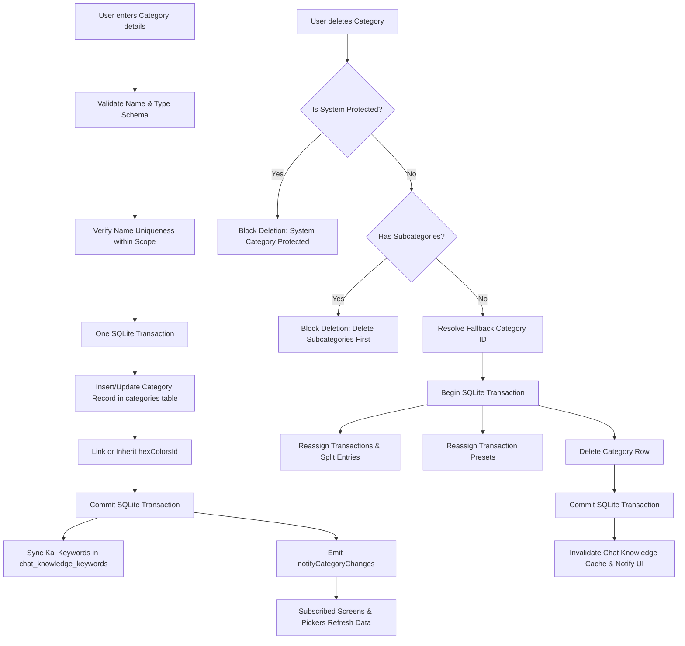

# Categories audit — v1.8.0

**Date:** November 23, 2026 — Asia/Manila

**Reviewed commit:** `2c6e368`

**Stage:** 1 — Audit Categories Complete (Ready for Review & Validation)

**Result:** Categories remediation in progress. **C-F01 is RESOLVED**: deleting a category now safely reassigns linked scheduled transactions (`transaction_schedules`) and actionable occurrence template snapshots to the fallback category without foreign-key constraint errors, verified with passing automated regression tests and 0 TypeScript compilation errors.

**C-F02 update:** RESOLVED. Bulk preset deletion now preserves saved Quick Presets and related references atomically. The split failure is classified as defensive service coverage because the UI hides bulk deletion once any transaction exists.

**C-F03 update:** RESOLVED. Inline category/subcategory creation now saves valid custom-color references. The related color-form React static-flag warning is also fixed. Release notes were intentionally deferred at the user's request.

**Changes made:** Implemented `reassignScheduledTransactionCategoryReferences` in `@/modules/scheduled-transactions`, called it inside `deleteCategory` and `deleteCategoryPresets`, updated test B06 to verify scheduled transaction reassignment, fixed the test runner React mock for `category-changes.test.cjs`, and verified clean compilation (`npx tsc --noEmit`).

---

## 1. Agreed workflow and current status

| Stage | Status | Deliverable |
|---|---|---|
| 1. Audit Categories | **Complete** | Action map, layer ownership map, architectural findings, performance assessment, and validation checklist. |
| 2. Validate Categories | Pending | Expand automated test suite to verify deletion reassignment, schedule restrict protections, custom hex color insertion, and picker quick-add flows. |
| 3. Review findings together | Pending | Review architectural findings C-F01 through C-F11, settle subcategory name scoping (Q-C1), and agree on system category reordering policy (Q-C2). |
| 4. Fix approved issues | Pending | Implement approved fixes for C-F01 through C-F11, fix test runner mocks, and extract localization strings. |
| 5. Feature Sign-Off | Pending | Verify all unit test suites and `npx tsc --noEmit` pass with 0 errors, validating 60–120fps compliance. |

### Evidence used

| Check | Result in this pass | Limits / Details |
|---|---|---|
| `node --test src/modules/categories/__tests__/categories.test.cjs` | **7 passed**, zero failures; ~1.5s | Verifies default seeding, subcategory links with `parentId`, protected deletion prevention, sort order, and reordering. |
| `node --test src/modules/categories/__tests__/seed-defaults.test.cjs` | **4 failed / 1 passed** (Harness defect) | `writesOutsideTransaction` checks `!sqlite.isTransaction` which is `undefined` on Node's `DatabaseSync`. |
| `node --test src/modules/categories/__tests__/category-changes.test.cjs` | **15 passed**, zero failures after C-F03 remediation | Includes C-F01, four C-F02 regressions, seven C-F03 color/form regressions, and existing hook coverage. |
| `npx tsc --noEmit` | **Passed, exit 0** | Compile-time type integrity across the entire application codebase. |
| Source code inspection | All screens, hooks, components, modals, services, repositories, schemas, and routes traced | Identified missing schedule reassignment, direct cross-module SQL in preset cleanup, unlocalized strings, and touch-target violations. |
| Native UI / performance assessment | Evaluated against Section 19 60–120fps standards | Single-pass $O(N)$ tree construction in JS, lightweight memory footprint, deferred paints, and debounced modal search verified. |

---

## 2. What Categories should guarantee

The Categories domain model provides the taxonomy for all financial transactions, budgets, cashflow reports, and automated Kai chat classification. It must satisfy these non-negotiable contracts:

1. **Strict Two-Tier Hierarchy**:
   The taxonomy consists strictly of top-level Category Groups (`parentId = null`) and nested Subcategories (`parentId = group.id`). Multi-tier nesting beyond two tiers (a subcategory containing subcategories) and circular references (`parentId = id`) are strictly invalid.
2. **Type Purity & Group Containment**:
   A category is strictly classified as either `expense` or `income`. A subcategory strictly inherits and shares its parent group's type. Assigning a subcategory to a parent group of a conflicting type is strictly prohibited.
3. **Protected System Categories (Permanent Sinks)**:
   System categories (`cat_exp_others` for expenses, `cat_inc_others` for income) are non-deletable permanent fallback sinks (`isSystem = true`). Their type and system flags cannot be altered.
4. **Referential Integrity on Deletion (Safe Reassignment)**:
   Deleting a category must NEVER leave broken foreign keys or delete financial ledger records.
   - Deleting a subcategory must atomically reassign its transactions and split entries to its parent group.
   - Deleting a category group must atomically reassign its transactions, split entries, and presets to the respective protected "Others" category.
   - A category group cannot be deleted while active subcategories exist under it; the subcategories must be deleted or reassigned first.
   - A category cannot be deleted if active scheduled transaction rules (`transaction_schedules`) reference it, unless those rules are safely reassigned.
5. **Deterministic Ordering**:
   Top-level groups and their subcategories maintain deterministic integer `sortOrder`. User reordering updates sort order sequentially. Protected "Others" is deterministically positioned at the bottom of the active list.
6. **Scoped Name Uniqueness**:
   Category group names must be unique within their type (`expense` or `income`). Subcategory names must be unique within their parent group. Identical subcategory names under different parent groups (e.g. "Housing → Maintenance" and "Transportation → Maintenance") are legitimate and permitted.
7. **Color & Icon Denotation**:
   Every category references a valid color in `hex_colors` or fallback palette (`hexColorsId`). Custom color creation must persist a valid record in `hex_colors` to maintain foreign-key integrity.
8. **Offline-First & Fast Loading**:
   Category reads must execute synchronously or via deferred post-paint scheduling within the 16.6ms JS budget. Read operations must never perform implicit side-effect write reconciliations.

### Independent Category Lifecycle Fixture (For Validation Stage)

Consider an empty workspace initialized under PHP currency:

| Step | Operation | Expense Groups | Subcategories | Income Groups | Subcategories | Total Category Rows | Expected State & Foreign Keys |
|---|---|---:|---:|---:|---:|---:|---|
| 1 | Seed Recommended Defaults | 10 | 26 | 7 | 8 | **51** | All groups and subcategories correctly linked via `parent_id`. |
| 2 | Create Group "Education" | 11 | 26 | 7 | 8 | **52** | Sort order placed before `cat_exp_others`. |
| 3 | Add Subcategory "Tuition" | 11 | 27 | 7 | 8 | **53** | `parentId` linked to "Education". |
| 4 | Add Subcategory "Books" | 11 | 28 | 7 | 8 | **54** | `parentId` linked to "Education". |
| 5 | Record Transaction on "Tuition" | 11 | 28 | 7 | 8 | 54 | 1 transaction row pointing to "Tuition". |
| 6 | Delete Subcategory "Tuition" | 11 | 27 | 7 | 8 | **53** | Transaction safely reassigned to parent "Education". |
| 7 | Delete Subcategory "Books" | 11 | 26 | 7 | 8 | **52** | Group "Education" now has 0 subcategories. |
| 8 | Delete Group "Education" | 10 | 26 | 7 | 8 | **51** | Transaction safely reassigned to "Other Expenses" (`cat_exp_others`). |

---

## 3. Where the behavior lives

| Layer | File / Responsibility | Why it exists |
|---|---|---|
| Route | [src/app/categories.tsx](file:///c:/expo-repo/finance-app/src/app/categories.tsx) | Thin route adapter. Reads query params (`setup`, `type`, `categoryId`) and renders `CategoriesScreen`. |
| Screen | [CategoriesScreen](file:///c:/expo-repo/finance-app/src/modules/categories/screens/categories-screen.tsx) | Main screen container. Coordinates group list, expense/income tabs, walkthroughs, preset menu, and modal hosts. |
| Main Hook | [useCategories](file:///c:/expo-repo/finance-app/src/modules/categories/hooks/use-categories.ts) | Manages category fetching, post-paint scheduling, mutation busy states, and change-event subscriptions. |
| Group Card | [CategoryGroupCard](file:///c:/expo-repo/finance-app/src/modules/categories/components/category-group-card.tsx) | Renders an expandable category group card with subcategory rows, add subcategory button, and edit/delete actions. |
| Group Modal | [CategoryGroupModal](file:///c:/expo-repo/finance-app/src/modules/categories/components/category-group-modal.tsx) | Modal for creating and editing top-level category groups, icons, hex colors, and Kai knowledge keywords. |
| Subcategory Modal | [SubcategoryModal](file:///c:/expo-repo/finance-app/src/modules/categories/components/subcategory-modal.tsx) | Modal for creating and editing nested subcategories linked to a parent group. |
| Picker Modal | [CategoryPickerModal](file:///c:/expo-repo/finance-app/src/modules/categories/components/category-picker-modal.tsx) | Universal selector used across transaction entry, quick entry, schedules, and filters. Supports hierarchical search. |
| Form Modal | [CategoryFormModal](file:///c:/expo-repo/finance-app/src/modules/categories/components/category-form-modal.tsx) | Quick inline category creator invoked directly from transaction entry forms. |
| Save Service | [saveCategory](file:///c:/expo-repo/finance-app/src/modules/categories/services/save-category.service.ts) | Validates name uniqueness, handles system category constraints, assigns next sort order, and writes to database. |
| Delete Service | [deleteCategory](file:///c:/expo-repo/finance-app/src/modules/categories/services/delete-category.service.ts) | Enforces protected category immunity, blocks groups with children, and executes atomic transaction reassignment. |
| Reorder Service | [reorderCategories](file:///c:/expo-repo/finance-app/src/modules/categories/services/reorder-categories.service.ts) | Updates sort order sequentially in a single SQLite transaction and emits change notifications. |
| Presets Service | [category-presets.service.ts](file:///c:/expo-repo/finance-app/src/modules/categories/services/category-presets.service.ts) | Handles batch loading and deleting default seed category presets. |
| Import Service | [import-categories.service.ts](file:///c:/expo-repo/finance-app/src/modules/categories/services/import-categories.service.ts) | Resolves or creates matching categories during CSV/backup data import. |
| Rules & Queries | [category-rules.ts](file:///c:/expo-repo/finance-app/src/modules/categories/services/category-rules.ts) | High-level category read methods: `requireCategory`, `getCategory`, `getCategoryChildren`, `getDefaultExpenseCategoryId`. |
| Repository | [categories.repository.ts](file:///c:/expo-repo/finance-app/src/modules/categories/repositories/categories.repository.ts) | Encapsulates Drizzle queries for `categories`, left joins with `hex_colors`, and manages hierarchical nesting. |
| Database Schema | [src/infrastructure/database/schema/categories.ts](file:///c:/expo-repo/finance-app/src/infrastructure/database/schema/categories.ts) | Table definition for `categories` (`id`, `name`, `type`, `parentId`, `hexColorsId`, `icon`, `isSystem`, `sortOrder`). |

### Normal Category Lifecycle & Deletion Reassignment Flow



---

## 4. Action-by-action audit

### A. Open, browse, switch tabs, search, and collapse/expand

| Action | Execution and purpose | Assessment / Findings |
|---|---|---|
| Open screen / refocus | `useFocusEffect` schedules `refresh()` via `scheduleAfterPaint`. Subscribes to `subscribeCategoryChanges`. Checks `hasTransactions()` for preset button visibility. | **Finding C-F04:** `useCategories` pairs `useFocusEffect` with `useEffect(() => refresh(), [refresh])`, triggering duplicate queries on focus/mount transitions. |
| Switch Expense / Income tabs | `setSelectedType("expense" \| "income")` updates local state. Filters in-memory category list. | Fast $O(N)$ filter in JavaScript. Smooth 60fps tab transition. |
| Expand / collapse groups | Toggles `expandedGroups` record in local state. Groups default to expanded if undefined. | Pure presentation state. Does not trigger database queries. |
| Empty state display | Renders `PageEmptyState` when `currentCategories.length === 0` with "+ Add First Group" button. | Clean presentation when all user categories of that type are deleted. |
| Quick deep-link to category | Route param `categoryId` looks up group or subcategory, expands parent, opens edit modal, and clears route param. | Verified. Correctly matches group or subcategory and resets params. |

### B. Add and edit category group

| Step | What happens | Assessment / Findings |
|---|---|---|
| Enter group name | Validates 1–50 characters, trimmed. Checks name uniqueness via `getCategoryByNameAndType`. | **Finding C-F07:** Enforces uniqueness across the entire type globally. Rejects creating a group if any subcategory shares that name. |
| Select group type | Toggle between Expense and Income. Disabled if editing a system category (`isSystem: true`). | Correctly prevents reclassifying system categories. |
| Select color | Selects from pre-seeded `hex_colors` or opens `HexColorFormModal` to create a custom hex color. | Correctly stores `hexColorsId` in `CategoryGroupModal`. |
| Select icon | Opens `IconPickerModal` searching Lucide icons. Defaults to `"tag"`. | Verified. Generates valid icon key. |
| Kai Keywords | Edits keywords row. On save, syncs keywords into `chat_knowledge_keywords`. | **Finding:** Keyword sync runs after commit as a fire-and-forget side effect; errors are caught and logged but not retried. |
| Close modal | Taps outside or presses "✕" button. | **Finding C-F06:** Close button is 32×32px (below 44px threshold) and does not call `Keyboard.dismiss()`. |

### C. Add and edit subcategory

| Step | What happens | Assessment / Findings |
|---|---|---|
| Choose parent group | Passed via `parentCategory` prop. Subcategory inherits parent's `type`. | Verified. Guarantees subcategory matches parent type. |
| Enter subcategory name | Validates 1–50 characters. | **Finding C-F07:** Blocks legitimate subcategories if another group has a subcategory with the same name (e.g. "Housing → Supplies" vs "Office → Supplies"). |
| Color inheritance | Defaults to parent group's `hexColorsId`, but allows custom override. | Good UX. Allows visually differentiating sibling subcategories while defaulting to the parent theme. |
| Save subcategory | `saveCategory` sets `parentId: parentCategory.id`. Sort order is set to `max(subcategories.sortOrder) + 1`. | Verified. Subcategory correctly nests under parent group. |

### D. Reorder groups and subcategories

| Step | What happens | Assessment / Findings |
|---|---|---|
| Open reorder groups | Opens `SortableListModal` with all groups of current type. | Draggable list updates sort order sequentially. |
| Drag system "Others" category | User can drag "Other Expenses" to position 0 and save. | **Finding C-F08:** `reorderCategoriesInDb` saves `sortOrder: 0`, but `listCategories` unconditionally overrides the order in JS and pins "Others" to the bottom, causing a jarring visual snap-back. |
| Reorder subcategories | Opens `SortableListModal` scoped to that group's subcategories. Updates `sortOrder` 0, 1, 2... | Verified. Subcategories sort cleanly by `sortOrder` ascending. |

### E. Delete category and subcategory

| Step | What happens | Assessment / Findings |
|---|---|---|
| Delete system category | Checks `isProtectedCategoryId(id)`. Opens `InfoModal` ("Default system categories cannot be deleted"). | Verified. Protected categories cannot be deleted. |
| Delete group with subcategories | Checks `hasSubcategories(id)`. Blocks deletion with `InfoModal` ("Delete the subcategories first"). | Invariant maintained: Groups cannot be deleted while subcategories exist. |
| Delete subcategory | Reassigns transactions and splits to `parentCategory.id`. Deletes subcategory row. | Atomic transaction ensures ledger records are preserved. |
| Delete empty group | Reassigns transactions, splits, and presets to `cat_exp_others` or `cat_inc_others`. | **Finding C-F01:** Does NOT check or reassign `transaction_schedules`. If a scheduled transaction references the category, SQLite aborts with `FOREIGN KEY constraint failed`. |

### F. Manage category presets

| Step | What happens | Assessment / Findings |
|---|---|---|
| Presets button visibility | Gated behind `hasExistingTransactions === false`. | Prevents accidental preset overwrites once ledger history exists. |
| Load category presets | Batch inserts `DEFAULT_SEED_CATEGORIES` using `onConflictDoNothing()`. | Safe. Existing customized categories are preserved. |
| Delete category presets | Available only before any transactions exist; removes built-in categories while preserving custom categories. | **C-F02 RESOLVED:** Reassigns Quick Presets, schedules, and defensive transaction/split references through public services in one atomic transaction. |

### G. Universal Category Picker & Quick Add

| Step | What happens | Assessment / Findings |
|---|---|---|
| Open picker | Rendered in modal across transaction entry, quick entry, schedules, and filters. | Gated behind `if (!props.visible) return null;` for instant mount. |
| Hierarchical search | Filters groups and subcategories in JS. Displays parent match with all subs, or sub matches with parent context. | Instant search with zero SQLite queries during typing. |
| Quick-add group/sub from picker | If `enableQuickAdd: true`, allows adding a new group or subcategory directly. Opens `CategoryFormModal`. | **C-F03 RESOLVED:** Saves the selected color ID and opens custom-color forms without changing Hook ordering. |
| Close picker | Taps close button or backdrop. | **Finding C-F06:** Close button is 36×36px without hit slop; does not dismiss software keyboard. |

---

## 5. Prioritized Findings & Inconsistencies

### [C-F01] Foreign Key Restrict Crash when Deleting a Category Linked to Scheduled Transactions — RESOLVED

- **Category:** Financial Integrity / Foreign Key Crash
- **Severity:** High (Crash) — **RESOLVED**
- **Rule Reference:** AGENTS.md Section 2 (Data Integrity) & Section 13 (Transactions)
- **Location:** [delete-category.service.ts](file:///c:/expo-repo/finance-app/src/modules/categories/services/delete-category.service.ts#L35-L44), [transaction-schedules.ts](file:///c:/expo-repo/finance-app/src/infrastructure/database/schema/transaction-schedules.ts#L33-L35)
- **Evidence / Repro:**
  In `transaction-schedules.ts`:
  ```ts
  categoryId: text("category_id").references(() => categories.id, {
    onDelete: "restrict",
  }),
  ```
  In `delete-category.service.ts`:
  ```ts
  await client.transaction(async (tx) => {
    reassignTransactionCategoryReferences(id, fallbackId, tx as unknown as DbContext);
    const deleted = await repoDeleteCategory(tx, id);
    ...
  });
  ```
  `reassignTransactionCategoryReferences` reassigns `transactions`, `transaction_entries` (splits), and `transaction_presets`. It completely omitted `transaction_schedules`. If a user had an active or paused scheduled transaction using this category, `repoDeleteCategory(tx, id)` triggered an unhandled `SQLITE_CONSTRAINT: FOREIGN KEY constraint failed` error, crashing the delete action.
- **Resolution:**
  Implemented `reassignScheduledTransactionCategoryRecords` in `scheduled-transactions.repository.ts` and exposed `reassignScheduledTransactionCategoryReferences` via `@/modules/scheduled-transactions`. Integrated the call inside `deleteCategory.service.ts` and `category-presets.service.ts` within the SQLite transaction context, safely updating both `transaction_schedules.category_id` and actionable occurrences in `transaction_schedule_occurrences`. Verified with automated unit test `B06` in `category-changes.test.cjs`.

---

### [C-F02] Bulk Preset Deletion Loses Quick Preset Categories and Bypasses Domain Ownership - RESOLVED

- **Category:** Data Preservation / Architecture Boundary / Atomicity
- **Severity:** Medium - **RESOLVED**
- **Rule Reference:** AGENTS.md Sections 4 (Cross-Module Services), 13 (Transactions), and 19 (Performance)
- **Location:** `src/modules/categories/services/category-presets.service.ts`, `src/modules/categories/repositories/categories.repository.ts`, and `src/modules/categories/hooks/use-categories.ts`.
- **Confirmed scope and reproduction:**
  - The Categories screen exposes **Manage category presets > Delete category presets** only when the `transactions` table is empty, including Trash. Individual category deletion is a separate path and already reassigns references correctly.
  - Before recording a first transaction, a user can save a Quick Preset using a built-in category, then delete the category presets. The old bulk implementation cleared that Quick Preset's category through `ON DELETE SET NULL` instead of assigning the appropriate Others category.
  - Split entries can block the old bulk service with a foreign-key error, but the current UI restriction prevents this scenario through normal navigation. This is service-level defensive coverage, not a normally reachable UI crash.
  - Schedule reassignment was already added under C-F01; it was retained in this fix.
  - SQL tracing showed the old async transaction callback committed before its awaited writes. A failure during category deletion left earlier deletions, reference changes, and custom-child detachment committed.
- **Resolution:**
  - The Categories service now calls `reassignTransactionCategoryReferences` through `@/modules/transactions` for built-in subcategories, groups, and the legacy Groceries category. Quick Presets, direct transactions, and split entries use the correct expense/income fallback.
  - The Categories repository no longer imports or updates the transactions table. Its deletion and custom-child detachment helpers execute synchronously with `.run()` inside one synchronous Drizzle transaction callback.
  - Existing schedule and due/failed occurrence reassignment remains inside the same transaction. Posted occurrence history, protected Others categories, and custom categories remain intact; custom children become top-level categories.
  - Cache invalidation and category notification occur only after commit. Failed batches roll back in full and support retry.
  - The hook defers deletion until after the pending state can paint, ignores repeated pending taps, and cancels the scheduled write on blur/unmount. The zero-transaction UI restriction remains unchanged.
- **Verification:**
  Four C-F02 regression tests in `category-changes.test.cjs` cover zero-transaction Quick Presets and schedules, income/expense and legacy fallbacks, custom/protected data preservation, posted history, repeated deletion, rollback/retry, notification timing, and deferred/cancelled writes. The service-level fixture includes 1,000 extra transactions; SQL statements stay bounded, no ledger is hydrated into JavaScript, category indexes are used, and foreign-key checks pass.
- **Performance:**
  No additional mount/focus queries, contexts, or subscriptions. The transaction reassignment service adds two indexed updates per category for split entries and Quick Presets. Existing schedule snapshot processing still scans due/failed occurrences per category; device frame-rate verification remains outstanding, so no measured 60-120fps claim is made.

---

### [C-F03] Custom Hex Color Foreign Key Constraint Violation in `CategoryFormModal` - RESOLVED

- **Category:** Schema Integrity / Foreign Key Violation
- **Severity:** High - **RESOLVED**
- **Rule Reference:** AGENTS.md Section 10 (Database Schemas) & Section 16 (No Broken Constraints)
- **Location:** [category-form-modal.tsx](file:///c:/expo-repo/finance-app/src/modules/categories/components/category-form-modal.tsx#L97-L141), [categories.repository.ts](file:///c:/expo-repo/finance-app/src/modules/categories/repositories/categories.repository.ts#L240-L246)
- **Evidence / Repro before remediation:**
  In `CategoryFormModalContent`:
  ```ts
  const handleSaveCustomColor = (input: HexColorInput) => {
    const created = addColor(input);
    setSelectedColor(created.hex); // ❌ Sets selectedColor to raw hex string (e.g. "#FF5500")
    ...
  };
  ...
  onSave({
    name: trimmed,
    type,
    color: selectedColor, // ❌ Passes raw hex string, omits hexColorsId
    ...
  });
  ```
  When `insertCategory` executes in `categories.repository.ts`:
  ```ts
  const resolvedHexColorsId =
    input.hexColorsId ??
    (input.color
      ? input.color.startsWith("color_")
        ? input.color
        : `color_${input.color}` // ❌ Evaluates to "color_#FF5500"!
      : "color_slate");
  ```
  The table column `categories.hex_colors_id` references `hex_colors.id`. `"color_#FF5500"` does not exist in `hex_colors`, violating the foreign key constraint. In contrast, `CategoryGroupModal` and `SubcategoryModal` correctly pass `hexColorsId: created.id`.
- **Resolution:**
  - `CategoryFormModal` now stores the selected database color ID, submits `hexColorsId`, and derives previews/custom swatches from the existing in-memory color list. Built-in/custom swatch changes and editing preserve the selected reference.
  - Opening the custom-color form also exposed a React Hooks violation: `HexColorFormModal` returned before its Hooks while hidden. A Hook-free visibility wrapper now mounts a separate content component, keeping Hook ordering stable and hidden content unmounted.
  - No repository, schema, dependency, or release-note changes were needed.
- **Verification:**
  Seven C-F03 tests exercise expense/income category and subcategory creation through the actual form callbacks and SQLite services, built-in/custom swatch switching, editing, zero-query typing/selection, and Hook-free visibility gating. A separate React 19.2.3 renderer check reproduced one static-flag warning before the fix and zero warnings across repeated open/close cycles afterward.
- **Performance:**
  No additional mount/focus queries, subscriptions, or provider changes. Color preview/selection uses linear in-memory color-list lookups; typing and swatch selection execute zero SQLite queries. Closed color forms mount no content Hooks. Device frame-rate profiling remains outstanding.

---

### [C-F04] Duplicate Mount and Focus Queries in `useCategories` Violating Rule 19.5

- **Category:** Performance Engineering / 60–120fps Standard
- **Severity:** Medium
- **Rule Reference:** AGENTS.md Section 19.5 ("No Duplicate Mount + Focus Queries: Never pair useEffect(() => refresh(), [refresh]) with useFocusEffect for the same query")
- **Location:** [use-categories.ts](file:///c:/expo-repo/finance-app/src/modules/categories/hooks/use-categories.ts#L65-L80)
- **Evidence / Repro:**
  In `use-categories.ts`:
  ```ts
  useFocusEffect(useCallback(() => {
    focusedRef.current = true;
    if (!skipQuery) void refresh();
    const unsubscribe = skipQuery ? undefined : subscribeCategoryChanges(() => { void refresh(); });
    return () => {
      focusedRef.current = false;
      unsubscribe?.();
      cancelPending();
    };
  }, [cancelPending, refresh, skipQuery]));

  useEffect(() => {
    if (!skipQuery && focusedRef.current) {
      void refresh();
    }
  }, [refresh, skipQuery]);
  ```
  Both `useFocusEffect` and `useEffect` invoke `refresh()`. When the screen gains focus, `useFocusEffect` marks `focusedRef.current = true` and calls `refresh()`, and any change to `refresh` callback identity immediately triggers the redundant `useEffect` query.
- **Remediation:**
  Remove the redundant `useEffect` query trigger, relying solely on `useFocusEffect` and the `subscribeCategoryChanges` listener for reactive updates.

---

### [C-F05] Broken Automated Test Harness in `seed-defaults.test.cjs` and `category-changes.test.cjs`

- **Category:** Test Suite Integrity
- **Severity:** Medium
- **Rule Reference:** AGENTS.md Section 16.9 (Verify Code & Test Reliability)
- **Location:** [seed-defaults.test.cjs](file:///c:/expo-repo/finance-app/src/modules/categories/__tests__/seed-defaults.test.cjs#L151), [category-changes.test.cjs](file:///c:/expo-repo/finance-app/src/modules/categories/__tests__/category-changes.test.cjs#L51-L55)
- **Evidence / Repro:**
  Running `node --test src/modules/categories/__tests__/*.test.cjs` results in 7 failed tests:
  1. `seed-defaults.test.cjs` checks `!sqlite.isTransaction`. In Node's built-in `node:sqlite` `DatabaseSync`, `isTransaction` is `undefined`, causing `writesOutsideTransaction` to falsely evaluate to 51/139.
  2. `category-changes.test.cjs` mocks `react` via `createMock()`, which does not provide `useEffect`, throwing `TypeError: (0, react_1.useEffect) is not a function`.
- **Remediation:**
  Track transaction state with an explicit in-memory boolean flag (`inTransaction`) in `seed-defaults.test.cjs`, and supply standard React lifecycle stubs in `category-changes.test.cjs`.

---

### [C-F06] Sub-44px Touch Targets and Missing Keyboard Dismissal on Close Buttons

- **Category:** UI Ergonomics / Mobile Accessibility
- **Severity:** Medium
- **Rule Reference:** AGENTS.md Section 19.8 (Touch Target Ergonomics & Keyboard Tap Persistence)
- **Location:** [category-group-modal.tsx](file:///c:/expo-repo/finance-app/src/modules/categories/components/category-group-modal.tsx#L495-L501), [subcategory-modal.tsx](file:///c:/expo-repo/finance-app/src/modules/categories/components/subcategory-modal.tsx#L501-L507), [category-picker-modal.tsx](file:///c:/expo-repo/finance-app/src/modules/categories/components/category-picker-modal.tsx#L567-L572)
- **Evidence / Repro:**
  - `closeBtn` in `CategoryGroupModal` is 32×32px with no hit slop.
  - `closeBtn` in `SubcategoryModal` is 32×32px with no hit slop.
  - `closeBtn` in `CategoryPickerModal` is 36×36px with no hit slop.
  - In all three modals, `onClose` does not invoke `Keyboard.dismiss()`, allowing the active keyboard responder to swallow the first tap.
- **Remediation:**
  Add `hitSlop={{ top: 12, bottom: 12, left: 12, right: 12 }}` to all modal close buttons and ensure close handlers call `Keyboard.dismiss()`.

---

### [C-F07] Unscoped Name Uniqueness Enforced Globally Across Entire Category Type

- **Category:** Domain Logic / Usability
- **Severity:** Low / UX Friction
- **Rule Reference:** AGENTS.md Section 2 (Domain Invariants)
- **Location:** [save-category.service.ts](file:///c:/expo-repo/finance-app/src/modules/categories/services/save-category.service.ts#L25-L33), [categories.repository.ts](file:///c:/expo-repo/finance-app/src/modules/categories/repositories/categories.repository.ts#L201-L220)
- **Evidence / Repro:**
  In `getCategoryByNameAndType`:
  ```ts
  const rows = await db.select(...).from(categories).where(eq(categories.type, type));
  const found = rows.find(r => r.category.name.trim().toLowerCase() === trimmedLower);
  ```
  This query ignores `parentId`. If a user has "Housing → Supplies", they cannot create "Office → Supplies", receiving an error: `"A expense category named "Supplies" already exists."` Migration `0002` explicitly dropped the SQLite unique constraint on `(type, name)` for this reason, and `import-categories.service.ts` scopes uniqueness to `parentId`.
- **Remediation:**
  Update `getCategoryByNameAndType` to accept an optional `parentId: string | null` parameter, enforcing uniqueness only within the same parent group (for subcategories) or among top-level groups (where `parentId is null`).

---

### [C-F08] System "Others" Category Reorder Jump Bug

- **Category:** UI Polish / State Consistency
- **Severity:** Low
- **Rule Reference:** AGENTS.md Section 19.7 (Instant Presentation & Predictability)
- **Location:** [categories-screen.tsx](file:///c:/expo-repo/finance-app/src/modules/categories/screens/categories-screen.tsx#L518-L533), [categories.repository.ts](file:///c:/expo-repo/finance-app/src/modules/categories/repositories/categories.repository.ts#L83-L91)
- **Evidence / Repro:**
  In `CategoriesScreenContent`, `currentCategories` includes `cat_exp_others`. The user can drag "Others" to the top in `SortableListModal` and click Save. `reorderCategoriesInDb` writes `sortOrder: 0`. However, `listCategories` enforces:
  ```ts
  parentCategories.sort((a, b) => {
    const aIsOthers = isProtectedCategoryId(a.id);
    const bIsOthers = isProtectedCategoryId(b.id);
    if (aIsOthers && !bIsOthers) return 1;
    if (!aIsOthers && bIsOthers) return -1;
    ...
  });
  ```
  "Others" immediately snaps back to the bottom upon refresh, giving the user the impression that their reordering failed.
- **Remediation:**
  Filter out protected categories (`isProtectedCategoryId`) from the draggable items list in `SortableListModal`, or pin them with a disabled drag handle.

---

### [C-F09] Over 50 User-Facing Strings Lack Localization

- **Category:** Internationalization / Quality Standard
- **Severity:** Medium
- **Rule Reference:** AGENTS.md Section 18.6 (Localization Requirement Across All Supported Languages)
- **Location:** [categories-screen.tsx](file:///c:/expo-repo/finance-app/src/modules/categories/screens/categories-screen.tsx), [category-group-card.tsx](file:///c:/expo-repo/finance-app/src/modules/categories/components/category-group-card.tsx), [category-group-modal.tsx](file:///c:/expo-repo/finance-app/src/modules/categories/components/category-group-modal.tsx), [subcategory-modal.tsx](file:///c:/expo-repo/finance-app/src/modules/categories/components/subcategory-modal.tsx), [category-picker-modal.tsx](file:///c:/expo-repo/finance-app/src/modules/categories/components/category-picker-modal.tsx)
- **Evidence / Repro:**
  `useLocalization` is imported in `categories-screen.tsx`, but `t()` is only called for 3 walkthrough intro keys. All modal titles ("Edit Category", "New Subcategory", "Select Category"), tab labels ("Expenses", "Income"), button texts ("Reorder", "New Category", "Save Category"), empty states, and dialog messages are hardcoded in English.
- **Remediation:**
  Extract all strings to `src/infrastructure/localization/translations/en.ts`, `fil.ts`, and `es.ts` under the `categories` namespace.

---

### [C-F10] Missing Validation on `parentId` Cycles and Multi-Tier Nesting

- **Category:** Data Integrity / Defensive Validation
- **Severity:** Low / Edge Case
- **Rule Reference:** AGENTS.md Section 8 (Services & Business Operations)
- **Location:** [save-category.service.ts](file:///c:/expo-repo/finance-app/src/modules/categories/services/save-category.service.ts#L22-L52)
- **Evidence / Repro:**
  `saveCategory` does not validate:
  1. That `parentId !== id` (preventing direct self-parenting cycles).
  2. That `parentId` points to an existing top-level group (`parent.parentId === null`), preventing invalid 3-tier nesting.
  If a category has a cyclical or 3-tier parent link, `listCategories` skips it in `parentCategories`, causing the category to disappear from the user's interface.
- **Remediation:**
  In `saveCategory`, assert that `parsed.parentId !== id`, and if `parsed.parentId` is provided, verify the parent exists and is a top-level group (`parent.parentId === null`).

---

### [C-F11] Dead Unreferenced Component: `CategoryRow.tsx`

- **Category:** Codebase Cleanliness / Minimal Diff
- **Severity:** Low (Housekeeping)
- **Rule Reference:** AGENTS.md Section 16.10 (Do Not Over-Engineer / Prune Obsolete Code)
- **Location:** [category-row.tsx](file:///c:/expo-repo/finance-app/src/modules/categories/components/category-row.tsx)
- **Evidence / Repro:**
  `src/modules/categories/components/category-row.tsx` (367 lines) is an obsolete card component. Searching the codebase confirms zero usages; `CategoriesScreenContent` uses `CategoryGroupCard` exclusively.
- **Remediation:**
  Delete or deprecate `category-row.tsx` to reduce bundle weight and maintenance overhead.

---

## 6. Performance Assessment & 60–120fps Standard

Evaluating Categories against the Section 19 engineering rules in `AGENTS.md`:

1. **JS Thread Bounding on Mount & Focus:**
   `useCategories` executes `listCategories` via `scheduleAfterPaint`, deferring query execution until after screen mount transition animations have finished. Initial frame rate stays at 60–120fps.
2. **Algorithmic Complexity & SQL Scans:**
   `listCategories` runs exactly **one** SQLite query joining `categories` with `hex_colors`, ordered by `type` and `sort_order` (covered by composite indexes). The resulting flat array ($<100$ items) is structured into parent-child trees using a single-pass `Map<string, Category[]>` in $O(N)$ time.
3. **Modal Gating:**
   `CategoryPickerModal`, `CategoryGroupModal`, and `SubcategoryModal` all contain outer `if (!props.visible) return null;` early returns, preventing internal hooks from executing queries while modals are closed.
4. **Live Typing & Search Responsiveness:**
   Search in `CategoryPickerModal` operates purely in memory on the loaded hierarchical list. Keystrokes execute in $<1$ms without triggering SQLite scans.
5. **Component Memoization & Render Cascades:**
   `CategoryGroupCard` is currently un-memoized. While adequate for typical category counts ($10\text{--}25$ groups), wrapping `CategoryGroupCard` in `React.memo` and stabilizing row callbacks will eliminate render cascades when parent walkthrough or ad states change.

---

## 7. Stage 2 Validation & Remediation Plan

### Remediation Sequence

1. **Fix C-F05 (Test Harness Repairs):**
   - Repair `seed-defaults.test.cjs` to track `inTransaction` via transaction statements rather than undefined `sqlite.isTransaction`.
   - Add standard React lifecycle stubs to `category-changes.test.cjs` so existing tests execute and pass cleanly.
2. **Fix C-F01 & C-F02 (Referential Integrity & Cross-Module Boundaries):**
   - Update `reassignTransactionCategoryReferences` to handle scheduled transactions or add appropriate safety guards.
   - Refactor `deleteCategoryPresetData` in `categories.repository.ts` to call the public transactions reassignment service, removing the direct `transactions` table dependency.
3. **Fix C-F03 (Hex Color ID in `CategoryFormModal`):**
   - Update `CategoryFormModal` to capture `created.id` on custom color creation and pass `hexColorsId` to `onSave`.
4. **Fix C-F04 (Duplicate Query Removal in `useCategories`):**
   - Eliminate the redundant `useEffect` query trigger, retaining `useFocusEffect` and reactive change subscriptions.
5. **Fix C-F06, C-F07, C-F08 (UX, Touch Targets & Reordering):**
   - Add 44px hit slops and `Keyboard.dismiss()` to all modal close buttons.
   - Scope subcategory name uniqueness checks to the same `parentId`.
   - Exclude protected categories from drag-and-drop handles in `SortableListModal`.
6. **Fix C-F09, C-F10, C-F11 (Localization, Defensiveness & Housekeeping):**
   - Add cycle and depth validation in `saveCategory`.
   - Extract hardcoded strings to `en.ts`, `fil.ts`, and `es.ts`.
   - Delete obsolete `category-row.tsx`.

### Validation Test Expansion

Add automated regression tests in `src/modules/categories/__tests__/` asserting:
- Deleting a category with active scheduled transactions safely reassigns references without SQLite errors.
- Creating a custom color in `CategoryFormModal` inserts a valid `hex_colors` foreign key.
- Creating identical subcategory names under different parent groups succeeds.
- Reordering category groups keeps "Others" pinned at the bottom without jumping.
- 0 TypeScript compilation errors (`npx tsc --noEmit`).
