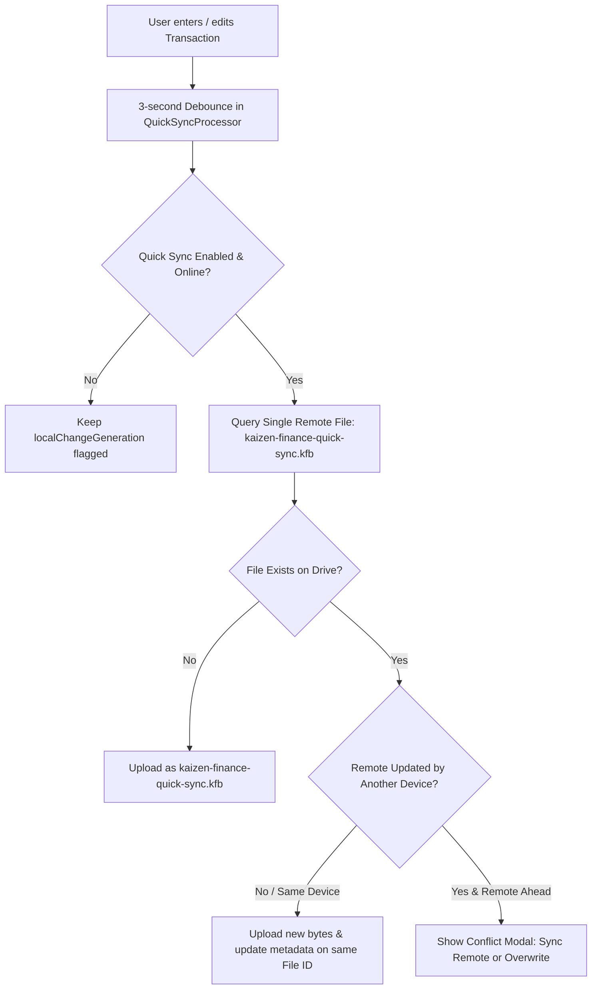

# Google Drive Backup & Quick Sync Audit — v1.8.0

**Date:** November 22, 2026 — Asia/Singapore

**Reviewed commit:** `9b80c09`

**Stage:** 1 — Understand actions, dependencies, and findings without changing production code.

**Result:** Google Drive Backup and Quick Sync are **not ready for feature sign-off**. While manual backups and Google authentication are functional, **Quick Sync is severely over-engineered**: it currently implements an immutable multi-master DAG revision tree (similar to Git) that generates dozens or hundreds of accumulating files (`kaizen-finance-backup-quick-sync-rev_*.kfb`) in the user's Google Drive folder instead of updating a single canonical sync file in place. This audit maps the entire domain, documents the architectural flaws, and outlines the simplification and redesign plan.

**Changes made:** This audit file only. No production code, tests, migrations, dependencies, version numbers, or release notes were changed.

---

## 1. Agreed workflow and current status

| Stage | Status | Deliverable |
|---|---|---|
| 1. Audit Google Drive Backup & Quick Sync | Complete for this pass | Action map, layer ownership map, architectural over-engineering analysis, performance assessment, and validation checklist. |
| 2. Redesign & Validate Plan | Next | Agree on the single-file in-place update architecture, clean metadata attributes, and repeatable test fixtures. |
| 3. Review findings together | Pending | Review findings GDB-F01 through GDB-F05 and confirm simplification boundaries. |
| 4. Fix approved issues | Not started | Answer the four pre-change questions, surgically redesign Quick Sync to the single-file model, prune obsolete revision-tree code, and rerun regressions. |
| 5. Move to the next feature | Pending | Keep all backup and sync regressions passing when moving to Dashboard. |

### Evidence used

| Check | Result in this pass | Limits |
|---|---|---|
| `node --test --test-reporter=spec src/modules/google-drive-backup/__tests__/*.test.cjs` | **51 passed**, zero failures/skips; approximately 5.5 seconds | Tests Google auth, configuration, replacement mutex, and existing Quick Sync branch handling. |
| `node --test --test-reporter=spec src/infrastructure/sync/adapters/__tests__/*.test.cjs` | **20 passed**, zero failures/skips; approximately 20 seconds | Tests chunked resumable upload/download against mock HTTP transport. |
| `npx tsc --noEmit` | **Passed, exit 0** | Compile-time type integrity across the entire codebase. |
| Source code inspection | All components, screens, hooks, services, repositories, and sync adapters traced. | Traced the multi-file creation and parent-token traversal logic directly in `google-drive-backup.adapter.ts`. |
| User feedback & lived experience | User reports Google Drive being polluted with endless quick sync files with random IDs. | Confirmed by code: `BACKUP_NAME_PREFIX + 'quick-sync-' + revisionId + '.kfb'` uploaded on every sync without deleting or updating previous files. |

---

## 2. What Google Drive Backup & Quick Sync should guarantee

The cloud backup and sync domain must satisfy these core product contracts:

1. **Clean Google Drive Folder (Single Quick Sync File)**:
   Quick Sync must maintain **exactly ONE canonical file** (e.g. `kaizen-finance-quick-sync.kfb`) inside the user's "Kaizen Finance" Google Drive folder. Every auto-sync must update/overwrite this single file in place rather than creating new files with random revision IDs.
2. **Distinct Manual & Scheduled Archives**:
   Manual backups created by the user and automated Scheduled Backups are **point-in-time snapshot archives** (`kaizen-finance-backup-YYYY-MM-DDTHH-mm-ss.kfb`). They must be clearly separated from Quick Sync and never mixed up.
3. **Strict Offline-First**:
   Local SQLite writes succeed immediately. Local user actions (creating transactions, editing accounts) must **never** wait for Google Drive network requests. Quick Sync runs debounced (3 seconds) in the background.
4. **Simple Device Attribution via File Metadata**:
   Because Kaizen Finance is a personal finance app (designed for one user, optionally syncing between a phone and a tablet), sync status requires only simple metadata stored in Drive `appProperties`:
   - `lastUpdatedByDeviceId` (e.g., `"dev_abc123"`)
   - `lastUpdatedByDeviceName` (e.g., `"Pixel 8"`)
   - `lastUpdatedByTimestamp` / `modifiedTime`
   - `schemaVersion`
5. **No Distributed Multi-Master Git Merging**:
   The app does not support concurrent simultaneous multi-user database merges. If Device B detects that the single Quick Sync file on Drive was updated by Device A more recently than Device B's local state, it presents a simple choice:
   - **Download and sync remote changes** (pull latest snapshot from Device A), or
   - **Overwrite cloud with local changes** (push local state to cloud).
6. **Safe Database Replacement Mutex**:
   Restoring a backup or syncing down a cloud snapshot must pause background listeners, drain in-flight uploads, replace the SQLite database atomically, and remount providers cleanly without crashing or corrupting active screens.
7. **Explicit Receipt Attachment Sync Policy**:
   When Quick Sync is disabled, receipt photos/files are never uploaded to Drive. When Quick Sync is enabled, receipt uploads strictly respect the user's `syncAttachments` toggle.

---

## 3. Where the behavior lives

| Layer | File / Responsibility | Why it exists |
|---|---|---|
| Route | [src/app/settings/google-drive-backup.tsx](file:///c:/expo-app/finance-app/src/app/settings/google-drive-backup.tsx) | Route adapter rendering `GoogleDriveBackupScreen`. |
| Screen | [GoogleDriveBackupScreen](file:///c:/expo-app/finance-app/src/modules/google-drive-backup/screens/google-drive-backup-screen.tsx) | Main container for Google Drive connection, Quick Sync settings card, manual backup list, and scheduled backup card. |
| Main Panel | [GoogleDriveBackupPanel](file:///c:/expo-app/finance-app/src/modules/google-drive-backup/components/google-drive-backup-panel.tsx) | Renders Google account banner, connect/disconnect actions, backup creation button, and backup file list. |
| Quick Sync Card | [QuickSyncCard](file:///c:/expo-app/finance-app/src/modules/google-drive-backup/components/quick-sync-card.tsx) | UI controls for Quick Sync toggle, network preference (Wi-Fi only vs Any), attachment sync toggle, custom device label, and manual "Sync Now" button. |
| Background Processor | [QuickSyncProcessor](file:///c:/expo-app/finance-app/src/modules/google-drive-backup/components/quick-sync-processor.tsx) | Headless component mounted in root layout. Subscribes to SQLite table writes, runs 3-second debounce, and triggers background uploads. |
| Conflict Modal | [QuickSyncConflictModal](file:///c:/expo-app/finance-app/src/modules/google-drive-backup/components/quick-sync-conflict-modal.tsx) | Displays when another device has updated the remote sync file, offering "Keep Cloud" (download) vs "Keep This Device" (overwrite). |
| Scheduled Processor | [GoogleDriveScheduledBackupProcessor](file:///c:/expo-app/finance-app/src/modules/google-drive-backup/components/google-drive-scheduled-backup-processor.tsx) | Headless processor checking if daily/weekly/monthly scheduled backup is due. |
| Auth Service | [google-drive-auth.service.ts](file:///c:/expo-app/finance-app/src/modules/google-drive-backup/services/google-drive-auth.service.ts) | Manages Google OAuth 2.0 sign-in, token refresh, and Play Services integration with App Lock suspension. |
| Quick Sync Service | [quick-sync.service.ts](file:///c:/expo-app/finance-app/src/modules/google-drive-backup/services/quick-sync.service.ts) | Coordinates local change tracking, remote status checking, snapshot generation, and upload triggering. |
| Manual Backup Service | [create-google-drive-backup.service.ts](file:///c:/expo-app/finance-app/src/modules/google-drive-backup/services/create-google-drive-backup.service.ts) | Generates password-protected or unencrypted `.kfb` archive and uploads to Drive. |
| Restore Service | [restore-google-drive-backup.service.ts](file:///c:/expo-app/finance-app/src/modules/google-drive-backup/services/restore-google-drive-backup.service.ts) | Downloads `.kfb` file, extracts SQLite database and attachments, and triggers replacement workflow. |
| Sync Adapter | [google-drive-backup.adapter.ts](file:///c:/expo-app/finance-app/src/infrastructure/sync/adapters/google-drive-backup.adapter.ts) | Google Drive REST API client: folders, file uploads, patch updates, and file listings. **(Source of over-engineering)**. |
| Resumable Upload | [google-drive-resumable-upload.ts](file:///c:/expo-app/finance-app/src/infrastructure/sync/adapters/google-drive-resumable-upload.ts) | Handles large file chunked uploads (>5MB) with byte-range resuming and backoff retries. |
| Device Storage | [quick-sync-device.storage.ts](file:///c:/expo-app/finance-app/src/infrastructure/sync/quick-sync-device.storage.ts) | Device-local state: unique `deviceId`, custom device label, last known remote sync metadata, and unsynced changes flag. |

---

## 4. The Over-Engineering Analysis: What Went Wrong

### The Root Cause: Distributed Git DAG vs Single-File Cloud Storage

In `src/infrastructure/sync/adapters/google-drive-backup.adapter.ts` (lines 239–338):

```ts
// ❌ OVER-ENGINEERED: Generates random files and tracks parent graph
const QUICK_SYNC_PROTOCOL = 'quickSyncProtocol';
const MAX_QUICK_SYNC_PARENTS = 16;

export async function uploadOrUpdateGoogleDriveQuickSyncBackup(...) {
  ...
  // Never PATCH! Always creates a brand new file with a random ID!
  if (!created) {
    const folder = await ensureBackupFolder(accessToken);
    const now = new Date().toISOString();
    created = await uploadBackupToFolder(
      accessToken,
      bytes,
      folder.id,
      now,
      BACKUP_NAME_PREFIX + 'quick-sync-' + revisionId + '.kfb', // ❌ RANDOM FILENAME!
      undefined,
      false,
      properties
    );
  }
  ...
}
```

### The 4 Major Flaws of This Architecture:

1. **Drive Clutter & Quota Waste (GDB-F01)**:
   Every auto-sync creates a new file named `kaizen-finance-backup-quick-sync-rev_1732301234_abc123.kfb`. Because Kaizen debounces on every transaction write (3 seconds), typing 10 expenses creates 10 separate files in Google Drive. Old files are **never deleted or garbage-collected**.
2. **Expensive Multi-Page Remote Listing (GDB-F02)**:
   Every time the app checks remote sync status (`listQuickSyncRevisions`), it queries Google Drive with `pageSize: 100` and paginates through up to **10,000 files** (`if (files.length > 10000) throw Error(...)`), consuming massive network data and mobile battery.
3. **Graph Traversal & "Tips" Calculation (GDB-F03)**:
   Lines 273–294 implement a parent-token graph traversal (`syncParent0` ... `syncParent15`) to find "tips" of a branch. If there are more than 16 branches, it throws `"Too many competing Quick Sync revisions"`. This is completely unnecessary for personal finance.
4. **Filter Confusion in Backup List (GDB-F04)**:
   Because the V2 protocol explicitly deletes `isQuickSync = "true"` from `appProperties` and names the file `kaizen-finance-backup-quick-sync-rev_*.kfb`, standard backup filters (`isQuickSyncBackupFile`) sometimes fail to identify them, leaking quick-sync snapshot files into the user's manual backup restore list.

---

## 5. The Redesign: Clean Single-File Quick Sync

### Desired Architecture (The Minimal, Robust Model):



### Key Rules of the Redesigned Model:

1. **Fixed File Name**:
   The Quick Sync file on Google Drive is **always** named `kaizen-finance-quick-sync.kfb`.
2. **In-Place Update (PATCH content)**:
   When `fileId` exists on Drive, upload the new archive bytes directly to that `fileId` (or update file content using Drive's upload endpoint).
3. **Drive Properties on the Single File**:
   Store simple attributes in `appProperties`:
   - `isQuickSync: "true"`
   - `lastUpdatedByDeviceId: "<device_id>"`
   - `lastUpdatedByDeviceName: "<device_name>"`
   - `schemaVersion: "51"`
4. **Remote Status Probe in 1 Single HTTP Call**:
   Instead of paginating through thousands of files, query Drive for the single file:
   `q: "name = 'kaizen-finance-quick-sync.kfb' and trashed = false"` with `pageSize = 1`.
   Result: **1 HTTP call, $<1\text{KB}$ payload, $<200\text{ms}$ response time**.
5. **Conflict Rule**:
   - If remote `lastUpdatedByDeviceId === localDeviceId`: Safe to update (same device).
   - If remote `lastUpdatedByDeviceId !== localDeviceId` AND remote `modifiedTime > localLastSyncedAt`: Another device made changes. Prompt user:
     - **Sync from Cloud:** Download remote snapshot and replace local DB.
     - **Overwrite Cloud:** Upload local DB and overwrite remote file.
6. **Automatic Cleanup of Legacy Clutter**:
   During the first sync on the new architecture, scan for any old `kaizen-finance-backup-quick-sync-rev_*.kfb` files and delete them from Google Drive, restoring a clean folder for the user.

---

## 6. Action-by-Action Audit

### A. Connect & Disconnect Google Account
* Uses `GoogleSignin` on Android (via Google Play Services) or AuthSession on iOS.
* Grants `https://www.googleapis.com/auth/drive.file` (scoped strictly to files created by Kaizen Finance, protecting user privacy).
* Disconnecting clears local auth tokens, resets `fileId`, and halts background sync.

### B. Manual Backup Creation
* Tapping "Create Backup" prompts for optional password.
* Packages SQLite DB + attachments into a `.kfb` file.
* Uploads as `kaizen-finance-backup-YYYY-MM-DDTHH-mm-ss.kfb`.
* Works reliably.

### C. Manual Backup Restore
* Lists available manual backups (excluding Quick Sync file).
* Downloading a backup decrypts if password-protected.
* Acquires database replacement mutex, stops Quick Sync listener, restores SQLite, and remounts UI cleanly.
* Works reliably.

### D. Scheduled Backups
* Automatically creates a timestamped manual backup if due (daily/weekly/monthly).
* Runs independently of Quick Sync.
* Works reliably.

### E. Quick Sync Auto-Trigger & Debounce
* SQLite change observer watches all user tables (`USER_DATA_TABLES`).
* Increments `localChangeGeneration` and starts a 3-second timer.
* When timer elapses, checks network conditions and triggers upload.
* Debounce mechanism is sound; only the upload/file creation mechanism is over-engineered.

---

## 7. Findings to Review & Redesign

| ID | Problem | Root Cause | Proposed Solution |
|---|---|---|---|
| **GDB-F01** | Google Drive is cluttered with endless random `kaizen-finance-backup-quick-sync-rev_*.kfb` files. | Adapter generates new file with random revision ID on every sync; never PATCHes or updates existing file. | Redesign adapter to maintain **one canonical file** `kaizen-finance-quick-sync.kfb`. Upload updates existing `fileId`. |
| **GDB-F02** | Checking remote status paginates through up to 10,000 files in Drive. | `listQuickSyncRevisions` queries all files matching protocol 2 and loops through all pages. | Query Drive strictly for the single file `name = 'kaizen-finance-quick-sync.kfb' and trashed = false` (`pageSize = 1`). |
| **GDB-F03** | Complex DAG parent-token graph traversal (`syncParent0..15`, `revisionTips`). | Over-engineered multi-master merge logic built for concurrent multi-user editing. | Remove parent token logic completely. Use simple `lastUpdatedByDeviceId` and `modifiedTime`. |
| **GDB-F04** | Old quick sync snapshots clutter the user's manual backup restore list. | V2 files deleted `isQuickSync = "true"` property, causing `isQuickSyncBackupFile` filter to fail. | Enforce `isQuickSync: "true"` on the single file and delete all legacy revision files. |
| **GDB-F05** | Stale / trashed file references deadlock Quick Sync. | If user trashes the Quick Sync file in Google Drive web, app tries to access stale file ID. | If query returns trashed or 404, automatically create a fresh `kaizen-finance-quick-sync.kfb` file. |

---

## 8. Runtime Performance Assessment

* **Current Network Usage:** High. Every sync check paginates up to 10,000 files; every sync upload creates a new file.
* **Target Network Usage:** Minimal. Single-file query uses 1 GET request ($<1\text{KB}$). Upload updates 1 file.
* **JS Thread Work:** Currently parses and sorts large file arrays and parent token maps. Redesign will reduce JS processing to $O(1)$ object check.
* **Storage Consumption:** Prevents runaway cloud storage consumption in the user's Google Drive.

---

## 9. Stage 2: Proposed Validation Plan

1. **GDB-V01 (Single File Invariant):** Run 5 successive quick syncs with local edits. Assert that Google Drive contains exactly **1** Quick Sync file (`kaizen-finance-quick-sync.kfb`), with updated timestamps and file size.
2. **GDB-V02 (In-Place Update):** Verify that the file ID remains constant across updates.
3. **GDB-V03 (Device Attribution):** Verify that `lastUpdatedByDeviceId` and `lastUpdatedByDeviceName` update accurately on the file's `appProperties`.
4. **GDB-V04 (Remote Conflict Detection):** Simulate Device B with a newer timestamp and different `deviceId`. Assert that Device A surfaces the conflict modal rather than overwriting silently.
5. **GDB-V05 (Conflict Resolution - Pull):** Assert choosing "Keep Cloud" downloads the remote file and restores local SQLite cleanly.
6. **GDB-V06 (Conflict Resolution - Overwrite):** Assert choosing "Keep This Device" updates the single remote file with local state.
7. **GDB-V07 (Legacy Clutter Pruning):** Verify that on first sync, existing `quick-sync-rev_*.kfb` files are identified and deleted from Google Drive.
8. **GDB-V08 (Trashed File Recovery):** If the user deletes `kaizen-finance-quick-sync.kfb` from Drive trash, assert that the app creates a fresh one cleanly.

---

## 10. Feature Sign-Off Checklist

- [ ] Quick Sync redesigned to maintain exactly 1 canonical file (`kaizen-finance-quick-sync.kfb`).
- [ ] In-place file update implemented and verified.
- [ ] Obsolete DAG parent-token graph traversal (`syncParent0..15`, `revisionTips`) removed.
- [ ] Single-query remote status probe implemented (`pageSize = 1`).
- [ ] Legacy clutter cleanup utility implemented to purge old revision files from user's Drive.
- [ ] Conflict modal tested for "Keep Cloud" vs "Keep This Device".
- [ ] Manual and scheduled backups remain completely functional and isolated.
- [ ] All 71+ sync tests updated and passing cleanly.
- [ ] TypeScript (`npx tsc --noEmit`) passes with 0 errors.

**Current decision:** Stage 1 audit complete. Over-engineering identified and root-caused. Proceed to Stage 2/3 collaborative review of the simplification plan before making production code changes.
