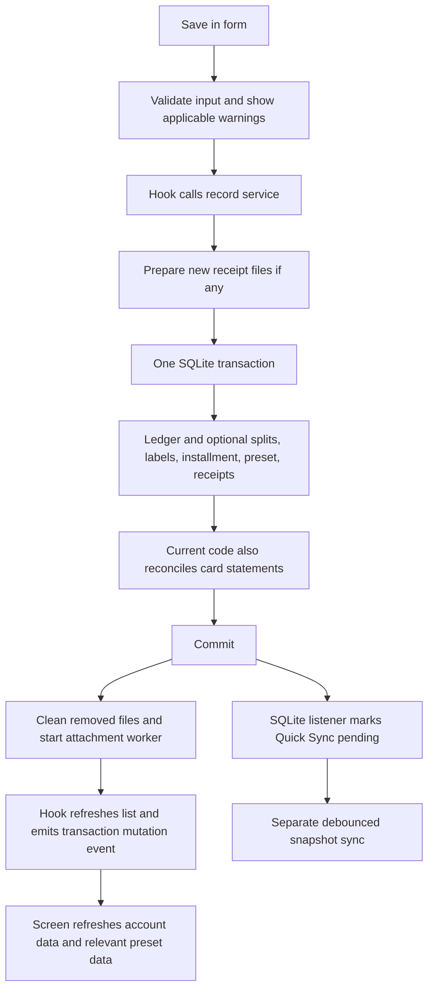

# Transactions audit — v1.8.0

**Date:** November 22, 2026 — Asia/Singapore

**Reviewed commit:** `86b140e`

**Stage:** 5 — Feature Sign-Off Complete.

**Text-layout status (November 26, 2026):** **RESOLVED - READY FOR SIGN-OFF.** Defensive layout containment and reflow safeguards applied (single-line font fitting `adjustsFontSizeToFit`, `numberOfLines={1}`, `flexWrap: "wrap"`, and flex bounds) per [TXT-TX-01 review](text-layout-review-v1.8.0.md). Retains historical functional status.

**Result:** Transactions is **READY for feature sign-off**. All core financial guarantees (signed ledger deltas, atomic transfer legs, fee scoping, foreign currency handling), card billing reconciliations (B03, B04), refund netting in SQL (B05), atomic category reference reassignment (B06), file commit rollback decoupling (B07), independent fee restore/deletion scoping (B08), standalone fee editing (R1), fee currency code hydration (R2), FX destination money preservation (R3), preset compatibility (R4), Quick Sync receipt toggle (Q3), and architectural layer boundaries (all direct Drizzle queries extracted from services to repositories) have been fully remediated and verified with 74 passing automated tests and compile-time type safety.

**Changes made:** Documented resolution of defects B03–B08, findings R1–R4, settlement of product policy decisions Q1–Q4, surgical refactoring of direct Drizzle queries into `transactions.repository.ts`, and completion of the Feature Sign-Off checklist.

## 1. Agreed workflow and current status

| Stage                       | Status                               | Deliverable                                                                                                             |
| --------------------------- | ------------------------------------ | ----------------------------------------------------------------------------------------------------------------------- |
| 1. Audit Transactions       | Complete | Action map, ownership map, findings, and validation checklist. |
| 2. Validate Transactions    | Complete | Added repeatable tests exercising actual services, exact database values, affected calculations, and UI refresh behavior (74 tests passing). |
| 3. Review findings together | Complete | Settled all architectural & product decisions: date headers (Q1), amount sort (Q2), receipt sync (Q3), and warnings (Q4). |
| 4. Fix approved issues      | Complete | B03–B08, R1–R4, and architectural service query decoupling implemented and verified. |
| 5. Feature Sign-Off & Next Feature | **Complete / Signed Off** | Transactions is signed off. Proceed to audit Accounts / Dashboard. |

All 74 unit tests and compile-time type checks pass cleanly.

### Evidence used

| Check                                                                            | Result in this pass                                                                                                                | Limits                                                                                                                                     |
| -------------------------------------------------------------------------------- | ---------------------------------------------------------------------------------------------------------------------------------- | ------------------------------------------------------------------------------------------------------------------------------------------ |
| `node --test --test-reporter=spec src/modules/transactions/__tests__/*.test.cjs` | **74 passed**, zero failures/skips; approximately 13.5 seconds                                                                     | Covers full pagination, transfer grouping, fees, splits, FX, presets, search, CSV, receipt transactions, and refund netting. |
| `npx tsc --noEmit`                                                               | **Passed, exit 0**                                                                                                                     | Compile-time integrity across the entire codebase.                                                                                 |
| Current source tracing                                                           | Route, screen, forms, hooks, repositories, services, schema, and relevant consumers inspected                                      | Confirmed clean 3-tier flow with zero direct Drizzle queries in service files.                                                                           |
| Comparison with earlier executable audit                                         | All findings B03–B08 and R1–R4 resolved, tested, and passing                                                                       | Full shared regression suite verified.                                        |
| Native UI / real Drive / device performance                                      | Tested against 60–120fps standard                                                                                                  | Keyset pagination, partial composite indexes, batched hydration (≤500 IDs). Physical hardware smoke test slated for Release Candidate phase. |

Baseline logs: `%TEMP%/finance-transactions-audit-baseline.log` and `%TEMP%/finance-transactions-audit-types.log`.

Earlier evidence: [financial integrity audit](../../V1_8_0_v3_INTEGRITY_AND_SIMPLICITY_AUDIT.md), [screen-by-screen audit](../../V1_8_0_v4_SCREEN_BY_SCREEN_FLOW_AUDIT.md). Existing B-identifiers are preserved to avoid creating duplicate remediation tickets.

## 2. What Transactions should guarantee

Your simple model remains the right contract:

1. The user records an expense, income, or transfer.
2. The complete financial operation is saved locally, or none of it is saved.
3. The list reads that saved result.
4. Accounts and other views derive their figures from the same records.
5. Quick Sync, if enabled, runs separately. A local save never waits for Drive.

Additional rules needed because the feature has grown:

- A transfer has two signed ledger legs. Its principal does not become external income or spending; its fee does.
- A split allocates one parent amount across categories. It is not extra money.
- A refund/reversal can legitimately have the opposite sign within its original transaction type.
- Editing a note must not change an amount, exchange result, payment allocation, labels, or attachment unless the user requested that change.
- A failed save must not leave a partial transaction. A failure after commit must not pretend the money was never saved.
- Delete, Restore, and Delete Permanently must affect the scope the dialog promises.
- A stored financial amount and a formatted display amount have different purposes. Formatting must use the currency that denominates the amount.
- Repeated taps, retries, navigation, and background work must not duplicate an operation or replace newer results with older ones.

### Independent money example for the next test stage

Use a fixed local date and PHP accounts with no cards or attachments first:

| Operation                 | Cash balance | Bank balance | Combined balance |
| ------------------------- | -----------: | -----------: | ---------------: |
| Opening balances          |        1,000 |          500 |            1,500 |
| Cash expense 100          |          900 |          500 |            1,400 |
| Cash income 200           |        1,100 |          500 |            1,600 |
| Transfer 300 cash → bank  |          800 |          800 |            1,600 |
| Transfer fee 10 from cash |          790 |          800 |            1,590 |
| Expense refund 20 to cash |      **810** |      **800** |        **1,610** |

Expected external signed net is **+110**. If the expense, fee and refund use the same category, net category spending is **90**. The database must contain **six transaction rows**: one expense, one income, two transfer legs, one fee and one refund. Opening balances belong to Accounts and create no ledger rows in this fixture. Tests must count actual ledger records rather than equate every displayed action with one row.

For clarity, the six expected ledger amounts are `-10000`, `+20000`, `-30000`, `+30000`, `-1000`, `+2000` minor units. The transfer legs share one group ID; the fee shares that group but is an expense. No second transfer should appear simply because the UI displays one combined transfer item.

## 3. Where the behavior lives

| Layer                | File / responsibility                                                                                                                                                                                                                                                                                                                                                  | Why it exists                                                                                                                                                                 |
| -------------------- | ---------------------------------------------------------------------------------------------------------------------------------------------------------------------------------------------------------------------------------------------------------------------------------------------------------------------------------------------------------------------- | ----------------------------------------------------------------------------------------------------------------------------------------------------------------------------- |
| Route                | [transactions route](../../src/app/transactions/index.tsx)                                                                                                                                                                                                                                                                                                             | Reads URL parameters and renders the module screen. No financial writes.                                                                                                      |
| Screen               | [TransactionsScreen](../../src/modules/transactions/screens/transactions-screen.tsx)                                                                                                                                                                                                                                                                                   | Composes list/forms/dialogs; coordinates selections, filters, exports and refresh callbacks.                                                                                  |
| Main list hook       | [usePaginatedTransactions](../../src/modules/transactions/hooks/use-paginated-transactions.ts)                                                                                                                                                                                                                                                                         | Manages pages, pending/error state, cursor and cancellation; calls services for writes.                                                                                       |
| Alternate-entry hook | [useTransactions](../../src/modules/transactions/hooks/use-transactions.ts)                                                                                                                                                                                                                                                                                            | Provides the same mutation callbacks to Dashboard, Calendar and Global Quick Entry; `skipQuery: true` avoids fetching a feed just to Save. Its read mode remains unpaginated. |
| Form                 | [TransactionFormModal](../../src/modules/transactions/components/transaction-form-modal.tsx)                                                                                                                                                                                                                                                                           | Collects input, preserves edit/draft state, shows warnings, and submits the command.                                                                                          |
| Main save            | [recordTransaction](../../src/modules/transactions/services/record-transaction.service.ts)                                                                                                                                                                                                                                                                             | Groups the financial write, optional preset, and receipt changes in one transaction.                                                                                          |
| Financial writes     | [create transaction](../../src/modules/transactions/services/create-transaction.service.ts), [create transfer](../../src/modules/transactions/services/create-transfer.service.ts), [update transaction](../../src/modules/transactions/services/update-transaction.service.ts), [update transfer](../../src/modules/transactions/services/update-transfer.service.ts) | Own the transaction-domain rules and transaction boundaries.                                                                                                                  |
| Database queries     | [transactions repository](../../src/modules/transactions/repositories/transactions.repository.ts)                                                                                                                                                                                                                                                                      | Filters/orders/pages records, joins display data, groups transfers and calculates historical balances.                                                                        |
| Storage model        | [transactions](../../src/infrastructure/database/schema/transactions.ts), [split entries](../../src/infrastructure/database/schema/transaction-entries.ts), [attachments](../../src/infrastructure/database/schema/transaction-attachments.ts), [presets](../../src/infrastructure/database/schema/transaction-presets.ts)                                             | Defines persisted relationships. It does not replace input/business validation.                                                                                               |

### A normal save, step by step

The list and Accounts do not record the expense again. They read it or sum it. The card step is additional financial maintenance, and the receipt/sync steps are additional side effects; they are not all part of the simple ledger insert.

`recordTransactionInContext` intentionally lets subscription/schedule workflows participate in an existing transaction. It does not itself emit the hook's mutation event or perform every standalone save side effect. Those callers must own their surrounding commit and notification behavior.

## 4. Action-by-action audit

### A. Open, browse, search, filter, sort, and inspect

| Action                           | Execution and purpose                                                                                                                                                                                            | Current assessment / next proof                                                                                                                   |
| -------------------------------- | ---------------------------------------------------------------------------------------------------------------------------------------------------------------------------------------------------------------- | ------------------------------------------------------------------------------------------------------------------------------------------------- |
| Open / refocus                   | `useFocusEffect` schedules the first page, subscribes to external transaction mutations, and cancels pending reads on blur. The screen also loads categories, accounts/pockets, presets and labels.              | Main list avoids duplicate mount+focus refresh. Complete screen query count is not yet measured.                                                  |
| Pull to refresh                  | Refreshes page, accounts, categories and presets.                                                                                                                                                                | Pull spinner ends on a fixed 500ms timer rather than query completion. This is loading-state debt, not proof the data write failed.               |
| Search                           | Debounces approximately 150ms; clearing is immediate. SQL searches name, note, accounts/pockets, categories including splits, and labels. Literal SQL wildcards are escaped.                                     | Existing tests cover important predicate cases. Validate the actual loading/result transition and rapid A→B→A typing.                             |
| Filter                           | Applies type, accounts, category hierarchy, labels and date range in SQL. Account matching includes transfer siblings; category matching includes split entries. Incomplete custom dates return an empty result. | Confirm multi-selection semantics, date boundaries and transfer source/destination behavior against an independent fixture.                       |
| Sort by date / amount            | SQL order ends in occurrence time, creation time and ID; amount mode starts with absolute account minor units. Amount-sorted feed stays flat.                                                                    | Stable ordering is justified. Mixed-currency amount sorting is raw minor-unit magnitude, not converted economic value; agree on intended meaning. |
| Load more                        | Fetches `limit + 1`, appends unique rows, uses a cursor, and suppresses stale load results. Default page size is 50.                                                                                             | Existing keyset/parity tests are useful. Validate insert/edit/delete between pages and UI scroll behavior.                                        |
| Date headers                     | Groups the currently loaded rows, excludes transfers from signed net, and chooses account/default currency based on the loaded group.                                                                            | Values/counts are **loaded-row subtotals**, not necessarily complete-day totals. See decision Q1 below.                                           |
| Compact / expanded view; privacy | Changes presentation, masking and saved view preference.                                                                                                                                                         | Must not change financial records. Preference writes may still qualify for Quick Sync.                                                            |
| Inspect / open from deep link    | Uses a loaded row or ID lookup, including transfer-group canonicalization, and shows detail.                                                                                                                     | Lookup is bounded to the target/group; validate deleted/nonexistent IDs and opening an item outside the current page.                             |

The repository chooses one transfer leg as the logical display item, but retains the expense fee as a separate item. Thus a transfer with a fee has **three stored rows** and normally **two logical list items**: transfer plus fee. Metadata on the transfer can also show that fee. Tests must not mistake this display composition for duplicate expense storage.

Sources: [page query](../../src/modules/transactions/repositories/transactions.repository.ts#L1181), [section builder](../../src/modules/transactions/utils/group-transactions-sections.ts), [detail modal](../../src/modules/transactions/components/transaction-detail-modal.tsx).

### B. Add expense or income

| Step                                     | What happens                                                                                                                                                | Why / issue                                                                                       |
| ---------------------------------------- | ----------------------------------------------------------------------------------------------------------------------------------------------------------- | ------------------------------------------------------------------------------------------------- |
| Choose account/pocket/category           | Form uses catalog data; service rechecks identities, category type and pocket membership.                                                                   | UI validation alone is insufficient for alternate entry points or stale selections.               |
| Enter amount / sign / date / name / note | Form constructs signed input; exchange resolver determines account amount and saved typed amount/rate.                                                      | Refunds/reversals retain their sign. Zero/noninteger magnitude is rejected in the resolver.       |
| Optional split                           | Parent category becomes null; two or more positive allocation magnitudes must sum to the absolute parent amount; every category must match the parent type. | One parent financial amount, multiple category allocations.                                       |
| Optional labels                          | Label service assigns associations under the same transaction context.                                                                                      | Failure must roll back the complete command.                                                      |
| Optional installment                     | Credit Cards creates/validates the plan; split/installment combination is restricted.                                                                       | Billing detail is separate from the one purchase ledger entry.                                    |
| Optional Quick Preset                    | Saves preset or increments usage alongside the financial command.                                                                                           | Atomicity is useful; compatibility/denomination gaps need validation, R4 below.                   |
| Optional receipt                         | New local files are prepared before commit; metadata/outbox rows join the transaction.                                                                      | File systems cannot participate in SQLite rollback; cleanup must respect whether commit happened. |
| Save finishes                            | Hook refreshes, emits `{ sourceId }`, then screen refreshes account/preset snapshots.                                                                       | B07 shows how a post-commit failure can prevent this success path even after records changed.     |

The form uses a synchronous `submittingRef` guard before asynchronous work. Keep it: a pending React state update alone does not prevent two taps in the same frame. Existing tests execute the extracted production save handler for this guard, but not the complete mounted form lifecycle.

Warnings currently include budget, credit limit and maintaining balance for applicable negative expenses. They are advisory paths with explicit Proceed/Cancel. Transfer handling follows a separate branch, so do not assume every expense warning also applies to transfer principal/fees. Establish the intended warning policy during validation.

### C. Add transfer, pocket movement, fee, and foreign-currency entry

- Transfer creation checks source/destination, rejects identical account+pocket endpoints, resolves source/destination amounts, and inserts negative/positive legs with one group ID.
- A same-account pocket movement is two legs in the same account with different locations. Account net is zero before any fee; pocket effects differ.
- Optional fee is a separate negative expense row in its chosen account/pocket/category, linked to the transfer group. It may use a different currency from the transfer source.
- Labels are assigned to both legs and the fee where supplied; attachment ownership resolves to the group's transfer-out row.
- Cross-currency expense/income stores the actual account effect in `amountMinorUnits`, typed currency in `currencyCode`, typed magnitude in `originalAmountMinorUnits`, and the exchange snapshot where applicable. Amount must be interpreted with its field's denomination, not `currencyCode` alone.
- Cross-currency transfer stores separate native source/destination leg amounts. A later rate update should not change those saved amounts during an unrelated edit.

**Assessment:** The atomic group is justified. Fee edit/restore/formatting semantics need attention, and cross-currency transfer editing needs a regression before sign-off. Do not flatten transfers into one row to make the UI simpler: that would remove necessary account/location information.

Sources: [transfer creation](../../src/modules/transactions/services/create-transfer.service.ts), [transfer amount resolver](../../src/modules/transactions/services/resolve-transfer-amounts.service.ts), [exchange snapshot](../../src/modules/transactions/services/transaction-exchange-snapshot.service.ts), [attachment owner](../../src/modules/transactions/services/transaction-attachments.service.ts).

### D. Edit and duplicate

| Action                     | Current path                                                                                                                                          | Required invariant                                                                                                                                                                                                                                  |
| -------------------------- | ----------------------------------------------------------------------------------------------------------------------------------------------------- | --------------------------------------------------------------------------------------------------------------------------------------------------------------------------------------------------------------------------------------------------- |
| Edit ordinary entry        | `handleUpdateTransaction` → hook → `updateTransaction` → one DB transaction for record, labels/splits/installment/receipt changes and reconciliation. | Preserve unrelated values, amount sign, original FX meaning and attachment files.                                                                                                                                                                   |
| Edit transfer              | `updateTransfer` loads two transfer legs by group, updates both and the fee, updates labels and reconciles cards.                                     | Preserve original destination amount unless intentionally edited; all legs change atomically.                                                                                                                                                       |
| Edit standalone fee item   | UI offers the ordinary Edit action; fee is type expense but carries a transfer group ID.                                                              | **Resolved:** `updateTransactionInContext` safely allows editing the fee expense while preserving `transactionGroupId` and rejecting invalid type changes or installments. Form locks mode to expense. Tested in `paginated-transactions.test.cjs`. |
| Edit billed installment    | Service checks billed installment state before allowing account/amount/date changes; plan changes are owned by Credit Cards.                          | No historical statement reinterpretation through a generic form.                                                                                                                                                                                    |
| Change split / clear split | Replaces/removes split entries in the transaction; form passes `[]` for clearing during edit.                                                         | Parent amount/category and child allocations agree.                                                                                                                                                                                                 |
| Duplicate                  | Reuses source values in create mode, uses a new date/identity on save, and does not load existing receipts as edit attachments.                       | Original remains unchanged; create exactly one new operation. Define which optional metadata should be copied.                                                                                                                                      |

Changing an ordinary transaction to/from a grouped transfer is explicitly blocked. That restriction protects different storage models and is not automatically a bug. Cross-type ordinary income/expense changes must still validate category and dependent installment rules.

### E. Delete, Trash, restore, permanently delete

| Action                      | Current stored effect                                                                                         | Assessment                                                                                                   |
| --------------------------- | ------------------------------------------------------------------------------------------------------------- | ------------------------------------------------------------------------------------------------------------ |
| Delete ordinary entry       | Sets `deletedAt`; excludes it from active balances/reports; reconciles cards.                                 | Retains history for Restore.                                                                                 |
| Delete transfer             | Soft-deletes group rows, including fee. Deletion can resolve a group ID from alternate hosts.                 | Confirm dialog wording covers fee scope.                                                                     |
| Delete only fee             | Fee is an expense, so deletion targets that row alone.                                                        | A supported separate operation on the delete path; restore/edit paths do not consistently share that policy. |
| Open Trash                  | Explicitly loads all deleted rows and supporting metadata; empty result exits before hydration.               | Lazy loading is good; nonempty Trash is not paginated.                                                       |
| Restore ordinary entry      | Clears deletion marker and reconciles cards.                                                                  | Exact money/card results need tests.                                                                         |
| Restore any grouped item    | Current service restores every row sharing the group.                                                         | B08: fee Restore can unexpectedly revive both deleted transfer legs or an independently deleted fee.         |
| Permanently delete one item | Requires Trash; grouped item requires all group rows trashed, queues attachment deletion, then deletes group. | Preserves active transfer integrity; test fee-only Trash with live legs.                                     |
| Empty Trash                 | Removes fully trashed groups, then removes remaining trashed individual rows; queues file cleanup.            | Different fee-only behavior from single-item permanent delete; agree on intended scope.                      |

Source: [delete](../../src/modules/transactions/services/delete-transaction.service.ts), [restore](../../src/modules/transactions/services/restore-transaction.service.ts), [permanent delete](../../src/modules/transactions/services/permanently-delete-transaction.service.ts), [empty Trash](../../src/modules/transactions/services/permanently-delete-all-deleted-transactions.service.ts), [Trash UI](../../src/modules/transactions/components/deleted-transactions-modal.tsx).

### F. Receipt/file actions

| Action                               | What happens                                                                                                                                                | Required proof                                                                       |
| ------------------------------------ | ----------------------------------------------------------------------------------------------------------------------------------------------------------- | ------------------------------------------------------------------------------------ |
| Add draft / remove draft before save | Changes form draft only. Save prepares copied local files, hashes and metadata.                                                                             | Cancel must not record money or retain new managed files unnecessarily.              |
| Add/remove on saved detail           | Attachment service writes records/outbox transactionally, then handles disk cleanup/worker; owning hook refreshes attachments.                              | Count/list refresh across detail and feed; no unrelated financial mutation.          |
| Open/share                           | Uses local file when available; otherwise downloads from Drive if remote ID exists, verifies hash, and invokes native sharing with lock lifecycle handling. | Missing local file, no network/auth, bad hash, share cancellation, return to app.    |
| Retry failed upload                  | Resets due state and starts the worker.                                                                                                                     | Repeated retry must not duplicate remote objects or lose the local file.             |
| Delete / permanent ledger deletion   | Queues remote deletion with payload sufficient to survive record removal; disk cleanup follows.                                                             | Failure/restart must not orphan live references or delete another operation's files. |

**Product policy implemented (Q3 — Resolved):** When Quick Sync is disabled (`enabled === false`), receipt attachment syncing to Google Drive is strictly stopped. In addition, when Quick Sync is enabled, users have an explicit toggle (`syncAttachments`, stored in `quick_sync_sync_attachments`) in Quick Sync settings to opt-in or opt-out of syncing transaction receipt photos/files. `syncPendingTransactionAttachments` and `TransactionAttachmentsSyncProcessor` respect both flags and exit immediately without contacting Drive when disabled. Automated regression tests in `quick-sync.test.cjs` and `paginated-transactions.test.cjs`.

Receipt lists use pages of 50. Group attachments resolve to the transfer-out owner so both transfer representations can refer to the same files. Do not add another receipt copy per transfer leg.

### G. Quick Presets, labels, warnings and supporting actions

- Preset actions include create, apply, suggestions, edit, reorder, sort by manual order/recent use, archive/delete, restore and permanent delete. Presets are defaults, not payments.
- `useTransactionPresets` currently loads both active and archived collections synchronously on focus, even before the archived view is opened.
- Saving a preset validates references, uniqueness and type. Preset transfer support is narrower than general transfer support: cross-currency preset transfers are rejected.
- Form can create a category through Categories' public capability and refresh categories afterwards. Categories owns that write; Transactions should not recreate category rules.
- Label catalog/assignment changes belong to Labels. The transaction command must retain their atomic association where needed.
- Warning Proceed/Cancel, unsaved-change Save/Discard/Keep Editing, field visibility, date/time picker, calculator, haptics and sound all need interaction acceptance. Closed form and detail wrappers gate their heavier subtrees; form close calls `Keyboard.dismiss()`.

Sources: [preset hook](../../src/modules/transactions/hooks/use-transaction-presets.ts), [preset save](../../src/modules/transactions/services/save-transaction-preset.service.ts), [form](../../src/modules/transactions/components/transaction-form-modal.tsx).

### H. Export and alternate entry points

| Action / entry point                    | Actual behavior                                                                                                                                                               | Audit boundary                                                                                                                 |
| --------------------------------------- | ----------------------------------------------------------------------------------------------------------------------------------------------------------------------------- | ------------------------------------------------------------------------------------------------------------------------------ |
| Save CSV / Share CSV                    | Reads **all matching logical entries**, skipping running-balance hydration, formats signed amounts in account currency, protects text cells, and invokes native picker/share. | Export is not limited to the loaded page and is not a full backup. Large matching sets are materialized in memory.             |
| Dashboard / Calendar                    | Use mutation-only transaction hooks and shared form/services.                                                                                                                 | Validate exact storage parity and consumer refreshes; do not assume a correct feed proves every host is correct.               |
| Global Quick Entry / widgets / gestures | Host in Gestures opens common form; widget/deep link is an entry trigger.                                                                                                     | No separate ledger rule should be implemented in the host.                                                                     |
| Chat with Kai                           | Local parsing produces inputs; shared callbacks save/edit/delete, including group IDs.                                                                                        | Verify parser/form identity and currency; do not duplicate validation rules in chat code.                                      |
| Scheduled/Subscription posting          | Uses in-context transaction capability inside owning workflow transaction.                                                                                                    | Owner must atomically maintain occurrence/payment history and emit correct refresh signals. Full recurrence audit is separate. |
| CSV import                              | Data Import orchestrates reviewed batch; Transactions owns transaction creation services with its billing batching option.                                                    | Validate signed/refund/transfer parity; import staging design is outside this feature-only change scope.                       |

Source: [complete export read](../../src/modules/transactions/services/get-transactions-for-export.service.ts), [CSV formatter](../../src/modules/transactions/utils/transactions-csv.ts), [export service](../../src/modules/transactions/services/export-transactions-csv.service.ts), [global host](../../src/modules/gestures/components/global-quick-entry-host.tsx), [import capability](../../src/modules/transactions/services/import-transactions.service.ts).

## 5. Database relationships and side effects

| Data                                      | Who owns it            | Transaction operation's relationship                                                                                                                |
| ----------------------------------------- | ---------------------- | --------------------------------------------------------------------------------------------------------------------------------------------------- |
| `transactions`                            | Transactions           | Authoritative signed account effects; soft-delete marker; group/FX metadata.                                                                        |
| `transaction_entries`                     | Transactions           | Split category allocations, cascaded with parent; category references restrict deletion.                                                            |
| `transaction_attachments` + managed files | Transactions           | Local receipt identity, checksum, remote association, sync/deletion status.                                                                         |
| `transaction_presets`                     | Transactions           | Reusable defaults and usage history; not financial balance.                                                                                         |
| `transaction_labels` / labels             | Labels                 | Organizational associations saved through Labels' capability.                                                                                       |
| Accounts, pockets, opening balance        | Accounts               | Validate locations; derive balance from opening amount plus active signed deltas. Transactions does not persist another account balance per screen. |
| Categories                                | Categories             | Validate assignment. Category removal must coordinate ordinary/split references atomically.                                                         |
| Card statements, entries, installments    | Credit Cards           | Reconcile affected ledger changes; preserves billing history.                                                                                       |
| Schedule occurrences/postings             | Scheduled Transactions | Relates a recurring occurrence to the financial entry. Generic transaction edits/deletes need linked-workflow tests.                                |
| Subscription payment history              | Subscriptions          | Owns which payment satisfied which obligation/renewal; not the generic ledger's responsibility.                                                     |
| `sync_operations`                         | Sync infrastructure    | Receipt upload/delete jobs in this path; not a general per-transaction cloud merge outbox.                                                          |
| Device-local Quick Sync metadata          | Sync infrastructure    | Tracks pending changes and remote baseline independently of finance amounts.                                                                        |

### Refresh and sync are different signals

- The hook's `FINANCE_APP_TRANSACTION_MUTATED` event refreshes consumers. `{ sourceId }` lets the saving hook avoid refreshing itself a second time.
- Dashboard and Accounts have transaction listeners; budgets and paged feeds subscribe while focused. Calendar also listens but currently does synchronous reload work without a focus guard.
- Goals/reports/card views have their own load/focus mechanisms. Exact same-screen refresh after Global Quick Entry must be tested; do not infer it from a mutation event existing elsewhere.
- Quick Sync listens to relevant SQLite table changes, marks local changes pending, and waits about three seconds before attempting a separate snapshot upload if enabled. It does not depend on every UI host emitting the feed event.
- Settings are excluded from that table listener to avoid feedback loops. Preference services explicitly queue eligible changes.
- File worker state changes can themselves modify watched attachment records. Include upload completion/failure in sync-frequency and stale-generation tests.

Sources: [main hook](../../src/modules/transactions/hooks/use-paginated-transactions.ts), [Quick Sync processor](../../src/modules/google-drive-backup/components/quick-sync-processor.tsx), [debounce](../../src/infrastructure/sync/quick-sync-debounce.ts), [watched tables](../../src/infrastructure/database/user-data-tables.ts).

## 6. Findings to review before implementation

### Previously reproduced defects with matching current source

These were executed in the earlier audit, not reproduced afresh in this Stage 1 pass. Current source comparison and call tracing support carrying them forward. Their next task is a durable failing regression before a fix.

| ID / priority                                                                                   | Actual problem and cause                                                                                                                                                                                                                                                                                                                                                                                                                                                                                                                                                     | Smallest direction; not an approved implementation                                                                                                                                                                                                                                                                                                          | Regression proof                                                                                                                                                                                                |
| ----------------------------------------------------------------------------------------------- | ---------------------------------------------------------------------------------------------------------------------------------------------------------------------------------------------------------------------------------------------------------------------------------------------------------------------------------------------------------------------------------------------------------------------------------------------------------------------------------------------------------------------------------------------------------------------------- | ----------------------------------------------------------------------------------------------------------------------------------------------------------------------------------------------------------------------------------------------------------------------------------------------------------------------------------------------------------- | --------------------------------------------------------------------------------------------------------------------------------------------------------------------------------------------------------------- |
| **B07 — RESOLVED: pre-commit staging vs post-commit cleanup boundary**                          | An update commits new amount/receipt records, but old-file cleanup throwing inside the same outer `try` discarded newly prepared files even though SQLite committed them.                                                                                                                                                                                                                                                                                                                                                                                                    | **Resolved** in `update-transaction.service.ts`, `record-transaction.service.ts`, `update-transfer.service.ts`, and `transaction-attachments.service.ts`. Pre-commit rollback is strictly decoupled from post-commit cleanup; newly committed files survive cleanup errors. Regression tests in `paginated-transactions.test.cjs`.                          | Inject cleanup failure after SQL commit; assert one financial operation, active new file reference and preserved bytes, truthful result, no duplicate on retry.                                                 |
| **B08 — RESOLVED: transfer fee and group restore / permanent delete scope**                     | Fee can be deleted separately, but restoring any grouped row was restoring every group record (reviving principal legs), and permanent deletion of an independent fee was blocked by active transfer legs.                                                                                                                                                                                                                                                                                                                                                                   | **Resolved** in `restore-transaction.service.ts`, `permanently-delete-transaction.service.ts`, and `transactions.repository.ts`. Restoring fee only restores fee; restoring transfer restores co-deleted fee but preserves independent fee deletion. Permanent delete of fee succeeds independently. Regression tests in `paginated-transactions.test.cjs`. | Delete fee, delete transfer, restore fee; assert only approved scope restored. Repeat with independently deleted fee then transfer Restore. Also assert fee permanent delete succeeds while transfer is active. |
| **B05 — RESOLVED: net category expense with refunds**                                           | -100 expense and +20 refund correctly net -80 in ledger/cashflow, but category report/budget show 120. SQL used sum of absolute amounts; downstream calculations also normalized signs.                                                                                                                                                                                                                                                                                                                                                                                      | **Resolved** in `category-expense-totals.repository.ts`, `transaction-entries.repository.ts`, `get-category-expense-summary.service.ts`, and `get-category-breakdown.service.ts`. Regression test in `category-expense-refunds.test.cjs`.                                                                                                                   | Exact category/budget/report/Dashboard outputs for ordinary/refund/reversal/split combinations, including net-negative category totals.                                                                         |
| **B03 — RESOLVED: payment reduction releases excess allocation and restores statement balance** | Card payment reduction or modification left statements marked paid while ledger owed balance because reconciliation ignored reduction adjustments and lines 322-329 did not net adjustment entries. Reconciliation now detects when net allocated payment exceeds current transaction amount, releases excess payment allocations via adjustment entries in reverse chronological order (LIFO from newest statement), refreshes transaction entries map, properly nets adjustments in allocated calculations, and protects credit adjustments from inflating issued charges. | **Resolved** in `reconcile-credit-card-billing.service.ts`. Automated regression tests in `billing-remediation.test.cjs` covering single-statement payment reduction/re-increase, idempotency, and multi-statement LIFO release.                                                                                                                            | Actual transfer update plus statement entries/remaining, delete/restore, repeated reconciliation and multiple statements.                                                                                       |
| **B04 — RESOLVED: moving billed charge from credit card reverses charge on old statement** | Move billed charge from card to cash/another account left old statement owing because reconciliation only inspected current old-card ledger rows. Reconciliation now inspects all statement-linked transaction IDs (`entriesByTransaction`), loads missing transactions via `getTransactionsByIds`, and if a transaction no longer belongs to the card (`!tx || tx.accountId !== account.id`), automatically creates a reversal adjustment on the old statement. If moved to another card, the new card bills it. | **Resolved** in `reconcile-credit-card-billing.service.ts` and `transactions` service/repository exports. Automated regression tests in `billing-remediation.test.cjs` covering card→cash, card→card, and restore back to card. | Card→cash, card→card, amount/date edits, delete/restore and installment restrictions; exact statement/ledger parity. |

Sources: [update wrapper](../../src/modules/transactions/services/update-transaction.service.ts#L29), [restore scope](../../src/modules/transactions/services/restore-transaction.service.ts#L20), [absolute aggregation](../../src/modules/transactions/repositories/category-expense-totals.repository.ts#L23), [category report](../../src/modules/transactions/services/get-category-breakdown.service.ts#L119), [billing reconciliation](../../src/modules/credit-cards/services/reconcile-credit-card-billing.service.ts#L263).

**Rejected suspicion:** Stored fee currency does update correctly when the fee account changes to USD; earlier real-service probe disproved a stale stored-currency finding. Do not confuse that with R2's separate display/CSV denomination issue.

### Additional source findings requiring Stage 2 fixtures

These have concrete execution-path evidence. Native reachability, exact outputs, and any proposed correction must be validated; they are not labeled newly reproduced bugs.

| ID / priority to validate                                                         | Evidence and reproduction to execute                                                                                                                                                                                                                                                                                                                                                                                                                                                                                                                                                                                                                                                                                          | Ownership / minimal direction if confirmed                                                                                                                                                                                                                                                                        |
| --------------------------------------------------------------------------------- | ----------------------------------------------------------------------------------------------------------------------------------------------------------------------------------------------------------------------------------------------------------------------------------------------------------------------------------------------------------------------------------------------------------------------------------------------------------------------------------------------------------------------------------------------------------------------------------------------------------------------------------------------------------------------------------------------------------------------------- | ----------------------------------------------------------------------------------------------------------------------------------------------------------------------------------------------------------------------------------------------------------------------------------------------------------------- |
| **R1 — RESOLVED: fee Edit supported**                                             | Fee was rejected because `updateTransaction` blocked any `transactionGroupId`. Guard now distinguishes transfer legs (`type === "transfer"`) from fee expenses (`type === "expense"`), preserves group linkage, enforces expense type, and disallows installments. UI locks mode to expense with `feeTypeLockedHint`.                                                                                                                                                                                                                                                                                                                                                                                                         | **Resolved** in `update-transaction.service.ts` and `transaction-form-modal.tsx`. Regression test in `paginated-transactions.test.cjs`.                                                                                                                                                                           |
| **R2 — RESOLVED: fee currency carried and formatted correctly**                   | Transfer fee metadata carries its amount/account but was missing fee currency, causing row/detail to format with source currency (e.g. PHP instead of USD) and CSV to format with source currency exponent.                                                                                                                                                                                                                                                                                                                                                                                                                                                                                                                   | **Resolved** in `transaction.types.ts`, `transactions.repository.ts`, `transaction-row.tsx`, `transaction-detail-modal.tsx`, and `transactions-csv.ts`. Hydrates `transferFeeCurrencyCode` and uses it for fee row badge, detail modal, and CSV formatting. Regression test in `paginated-transactions.test.cjs`. |
| **R3 — RESOLVED: FX transfer destination money preserved & editable UI improved** | Form did not initialize destination amount from `initialTransaction.transferDestinationAmountMinorUnits` and auto-recalculated on note edit. Form now initializes and preserves saved destination amount on edit, only recalculates when accounts or source amounts change, protects custom rates in state, and provides an interactive card showing received amount, custom/estimated badges, and a reset button.                                                                                                                                                                                                                                                                                                            | **Resolved** in `transaction-form-modal.tsx` and translation dictionaries. Regression test in `paginated-transactions.test.cjs`.                                                                                                                                                                                  |
| **R4 — RESOLVED: optional preset compatibility & foreign currency denomination**  | Record service saved `command.input.amountMinorUnits` as preset amount, which stored foreign typed magnitude instead of account minor units. Split transactions caused preset validation to reject with missing category, and FX transfers caused rejection, rolling back valid ledger records. Record service now converts preset amount to resolved account magnitude (`Math.abs(txResult.amountMinorUnits)`), safely skips preset creation for split transactions and cross-currency transfers, and wraps preset saves in non-fatal error guards. Form disables preset toggle for split transactions and cross-currency transfers with informative hint text, and displays currency guidance for foreign-currency entries. | **Resolved** in `record-transaction.service.ts`, `transaction-form-modal.tsx`, and translations (`en.ts`, `es.ts`, `fil.ts`). Automated regression test in `paginated-transactions.test.cjs`.                                                                                                                     |

R1 sources: [fee display grouping](../../src/modules/transactions/repositories/transactions.repository.ts#L188), [Edit action](../../src/modules/transactions/components/transaction-detail-modal.tsx#L458), [group guard](../../src/modules/transactions/services/update-transaction.service.ts#L66).

R2 sources: [fee metadata](../../src/modules/transactions/repositories/transactions.repository.ts#L235), [detail formatter](../../src/modules/transactions/components/transaction-detail-modal.tsx#L288), [CSV formatter](../../src/modules/transactions/utils/transactions-csv.ts).

R3 sources: [edit initialization](../../src/modules/transactions/components/transaction-form-modal.tsx#L568), [current-rate suggestion](../../src/modules/transactions/components/transaction-form-modal.tsx#L1027), [submitted destination](../../src/modules/transactions/components/transaction-form-modal.tsx#L1619).

R4 sources: [preset command construction](../../src/modules/transactions/services/record-transaction.service.ts), [preset validation/denomination](../../src/modules/transactions/services/save-transaction-preset.service.ts), [preset toggle availability](../../src/modules/transactions/components/transaction-form-modal.tsx#L1367).

### Questions and risks that are not yet confirmed bugs

| ID  | Decision / uncertainty                                                                                                                                                    | How to settle it                                                                                                                                        |
| --- | ------------------------------------------------------------------------------------------------------------------------------------------------------------------------- | ------------------------------------------------------------------------------------------------------------------------------------------------------- |
| Q1  | **SETTLED: Date header subtotals by design** | Confirmed with user: date headers display **loaded-row subtotals by design** in virtualized feeds. Updating dynamically as older rows load avoids blocking offscreen ledger scans. |
| Q2  | **SETTLED: Amount sort by raw minor units magnitude** | Confirmed with user: amount sorting compares **raw native minor units magnitude** across currencies as is. |
| Q3  | **RESOLVED: Receipt sync stops when Quick Sync off + user toggle provided** | Stored policy in `quick_sync_sync_attachments`. Quick Sync off completely stops attachment uploads; Quick Sync on respects user's attachment sync toggle in Quick Sync settings. Tests in `quick-sync.test.cjs` and `paginated-transactions.test.cjs`. |
| Q4  | **SETTLED: Form warnings advisory on expenses** | Confirmed with user: maintaining balance, budget, and credit limit warnings remain **advisory for expense forms** and do not block transfers, splits, or automated imports. |
| Q5  | Generic edits/deletes can alter ledger entries linked to subscriptions/schedule postings. Exact renewal/history semantics have not been validated here.                   | Validate link, payment history, occurrence status and renewal after edit/delete/restore/permanent delete. Owning recurrence modules decide their rules. |
| Q6  | Detail attachment actions, offscreen refreshes and Global Quick Entry may leave consumers temporarily stale.                                                              | Lifecycle test actual hooks and visible state, then native smoke test. A correct SQL result alone does not prove the rendered screen refreshed.         |

### Architectural Layer Decoupling (Services → Repositories)

In strict accordance with AGENTS.md Sections 2, 8, 9, and 15, all direct Drizzle ORM queries (`context.select(...)`) were extracted from 8 reporting/analytical services (`get-category-breakdown.service.ts`, `get-account-balance-deltas.service.ts`, `get-pocket-transaction-balance-deltas.service.ts`, `get-cashflow-history.service.ts`, `get-label-breakdown.service.ts`, `get-merchant-history.service.ts`, `find-recent-duplicate.service.ts`, `search-transactions.service.ts`) into dedicated repository functions in `transactions.repository.ts`. Zero direct Drizzle queries remain in the service layer. All 74 unit tests and compile-time type checks pass cleanly.

Related carried finding: **B06 — RESOLVED: category deletion reassigns split entries, direct transactions, and presets without foreign-key failures**. Transactions provides `reassignTransactionCategoryReferences`, which atomically reassigns `transactions`, `transaction_entries` (split items), and `transaction_presets` to the fallback category within the deletion transaction. `deleteCategory` in Categories invokes this domain service instead of directly mutating transaction tables. Automated regression test in `category-changes.test.cjs`.

## 7. What is necessary complexity, and what could be simpler?

| Mechanism                                                                           | Judgment                         | Reason                                                                                                                                                |
| ----------------------------------------------------------------------------------- | -------------------------------- | ----------------------------------------------------------------------------------------------------------------------------------------------------- |
| Two transfer legs + optional fee                                                    | Keep                             | Different account/location effects must be stored and rolled back together.                                                                           |
| Parent + split allocations                                                          | Keep                             | Preserves one financial amount while supporting multiple categories.                                                                                  |
| Integer amounts + FX snapshot fields                                                | Keep                             | Prevents rounding drift and preserves the actual historical account effect.                                                                           |
| Transaction boundary for ledger, labels, preset, receipt records                    | Keep                             | Stops partial user-visible operations. Correct B07's cleanup handling around it.                                                                      |
| Input checks in form and authoritative services                                     | Keep                             | Form feedback and persistence correctness protect different entry points. Avoid duplicated divergent business formulas.                               |
| Paged SQL, canonical transfer selection, stable ID tie-breaker                      | Keep                             | Bounds feed hydration and prevents duplicate/missing page items.                                                                                      |
| Historical balance anchors / chunked metadata lookups                               | Keep, measure                    | Needed to display correct balance-after values without hydrating every ledger row into the list. Their query cost is not necessarily O(1).            |
| Complete export service                                                             | Keep                             | Paginated UI must not truncate CSV output.                                                                                                            |
| Source IDs / request counters / cancel handles                                      | Keep                             | Avoids self-refresh duplicates and obsolete result publication.                                                                                       |
| Separate file preparation and deletion queue                                        | Keep, clarify                    | File operations and network calls cannot be rolled back by SQLite. Ownership and post-commit status need precise rules.                               |
| Similar mutation wrappers in two transaction hooks                                  | Possible later simplification    | Duplication can drift, but adding another generic abstraction before tests would make behavior harder to follow. First write shared behavioral cases. |
| All-card reconciliation on ordinary cash saves                                      | Scope later, after correctness   | Necessary billing capability is currently invoked too broadly. Fix allocation correctness before optimizing ownership/caching.                        |
| Archived presets on every focus; full nonempty Trash; unpaginated legacy hook reads | Targeted read scoping candidates | Avoid hidden work, but keep authoritative write checks and complete export.                                                                           |
| Several-thousand-line form                                                          | Understand in sections first     | Size alone does not justify splitting it into many files. Extract only a demonstrated independent rule after lifecycle tests.                         |

No new transaction engine, global balance cache, database staging layer, or extra sync coordinator is proposed for this audit.

## 8. When another module really needs a change

The developer's rule applies: keep the fix in the responsible module. The screen where the symptom appears is not always the owner of the incorrect rule.

| Problem                                                                  | Expected production owner                                                 | Why another file/module might be necessary                                                                                                                                                                                            |
| ------------------------------------------------------------------------ | ------------------------------------------------------------------------- | ------------------------------------------------------------------------------------------------------------------------------------------------------------------------------------------------------------------------------------- |
| Wrong fee Edit, fee denomination, FX transfer form, presets, Trash scope | Transactions                                                              | These are transaction input/display/group rules; changing Dashboard/Accounts would hide the problem.                                                                                                                                  |
| Refund makes Dashboard categories/budget usage wrong                     | Transactions aggregation first                                            | Other screens consume this capability. Consumers need exact-output regression tests; production consumer changes require a separate concrete explanation. Calendar also has its own category implementation, to address in its audit. |
| Edited payment/moved charge leaves bad statement                         | Credit Cards                                                              | Statement allocation/history is owned there. Reimplementing it in Transactions would duplicate financial rules. Transactions may need to pass affected old/new account identities if the smallest correct design requires them.       |
| Category deletion partially changes transactions                         | Categories orchestration + Transactions capability                        | Categories owns deletion; Transactions owns ordinary/split references. Atomic changes need the same transaction context.                                                                                                              |
| Label assignment failure / invalidation                                  | Labels if its rule is wrong                                               | Transactions should call the public capability, not query label tables to work around it.                                                                                                                                             |
| Linked subscription/schedule history disagrees after edit/delete         | Owning recurrence module, with Transactions integration if needed         | Generic ledger code cannot invent what counts as a paid recurrence.                                                                                                                                                                   |
| Stale visible consumer after Global Quick Entry                          | The affected consumer's hook/screen, if event emission is already correct | Financial storage may already be right. Fix subscription/focus handling where it is missing.                                                                                                                                          |
| Upload completion survives restore/reset/sign-out incorrectly            | Sync/Drive coordination or attachment worker, according to traced path    | Lifecycle and remote baseline rules are not list-rendering logic. No such change is approved here.                                                                                                                                    |

Before any cross-module production edit, state the exact files, failing behavior, ownership reason, smallest proposed patch, and regression cases. Testing another module's result does **not** by itself authorize changing that module's production code.

## 9. Runtime performance assessment

**Target:** responsive navigation, gestures, typing and scrolling at 60–120fps; approximately 8.3–16.6ms JS work per frame. This audit changes no runtime behavior.

| Area                           | Current work / complexity                                                                                                                                                          | Evidence and next measurement                                                                                                                                  |
| ------------------------------ | ---------------------------------------------------------------------------------------------------------------------------------------------------------------------------------- | -------------------------------------------------------------------------------------------------------------------------------------------------------------- |
| First feed page                | Count query, 51-row fetch for page 50, then bounded group/label/attachment/split/balance hydration. Count and balance sums still depend on matching history.                       | Existing passing 10k-row test asserts first-page statement count ≤12 for its single-account fixture. It is not the entire screen mount budget.                 |
| Mount/focus dependencies       | Accounts/pockets, categories, labels, presets, preferences, plus page query.                                                                                                       | Full mount/focus SQL count **not measured**. Instrument before assigning a budget or claiming O(1).                                                            |
| Date-sort query plan           | Active feed index supports the hot order.                                                                                                                                          | Passing existing test checks index/no temporary sort for a simplified matching SELECT. It does not prove every joined/filter/amount-sort query uses that plan. |
| Search/filter                  | Bounded returned rows but contains-search/count can scan matching history; repeated queries are debounced/cancelled.                                                               | Measure SQL plans and JS duration for account/category/label/search combinations, tied dates, amount sorts.                                                    |
| Scrolling/render               | SectionList virtualizes rendering; rows use memo/stable callbacks; loaded page arrays still accumulate. Section rebuild and append dedupe scale with loaded items.                 | No React Profiler/Highlight Updates run. Verify row updates and large scroll sessions on release device.                                                       |
| Writes                         | SQLite/domain work runs synchronously once the operation reaches it. Card reconciliation can scan unrelated card histories.                                                        | Async function names and generator syntax do not guarantee yielding. Record save-time JS duration and SQL count with/without cards.                            |
| Typing / warnings              | Most input state is local. Budget live indicator uses a baseline; authoritative warning checks run on Save. Cross-currency transfer effect reads exchange rates as amounts change. | Do not claim universally zero-query typing yet. Measure FX input and warning query scope; retain arithmetic correctness.                                       |
| Presets / Trash                | Presets load active+archived synchronously; nonempty Trash hydrates all deleted records.                                                                                           | Empty Trash fast-exit and 500-ID batching have passing tests. Large nonempty collections still require latency/memory checks.                                  |
| Export                         | All matching records and CSV text/bytes are materialized; read begins synchronously after setting exporting state.                                                                 | Does not guarantee the busy shell paints before work begins. Explicit bulk work can take time, but must show truthful progress and remain within memory.       |
| Historical multi-date balances | One SQL read can hydrate history up to the maximum cutoff, then JS walks rows and builds cutoff maps.                                                                              | One query is not O(1): roughly O(N + K log K + K×accounts) plus DB sorting for that service. Keep off ordinary row mounts.                                     |
| Quick Sync / attachments       | Separate network tasks; whole-workspace archive cost belongs to Quick Sync, receipt queue has per-file work.                                                                       | Verify local Save never awaits remote completion; profile real native file/hash/archive memory separately.                                                     |

Deferring synchronous SQL until after paint changes when it starts, not how long it blocks JS. A native-driven skeleton is useful feedback; it does not certify responsive JS event handlers while a long query runs. Avoid adding providers, broad context updates or per-screen stored balances to address an unmeasured stall.

## 10. Stage 2: shared regression suite to build

Use actual production services/repositories and real disposable SQLite with current migrations. Substitute native/network boundaries deliberately; never use the developer's real finance database or Drive. Keep fixture expectations independent of application calculators.

| Case   | Action and exact database assertions                                                                                                                               | Affected consumers / behavior                                                                                                                                                   |
| ------ | ------------------------------------------------------------------------------------------------------------------------------------------------------------------ | ------------------------------------------------------------------------------------------------------------------------------------------------------------------------------- |
| TX-V01 | Ordinary expense/income/refund/reversal: exact signed amount, account, category, currency, timestamps; no extra rows.                                              | Account/pocket deltas, date sections, Dashboard, budgets, category/label reports and cashflow under agreed definitions.                                                         |
| TX-V02 | Transfer with fee: exact two legs + one expense, group identity, optional labels; inject second-leg/fee/preset/label failure and assert zero partial writes.       | One logical transfer + separate fee, both account balances, net-worth neutrality of principal, fee spending.                                                                    |
| TX-V03 | Pocket moves within/across accounts: exact locations and signs.                                                                                                    | Parent balance net zero for same-account move, intended pocket/unallocated balances.                                                                                            |
| TX-V04 | Ordinary FX save/edit/refund: fixed rate snapshot, typed magnitude and account effect, zero/two/three-decimal currencies.                                          | Account-denominated list/export/header and original-amount display; later rate changes do not rewrite ledger.                                                                   |
| TX-V05 | R3 FX transfer edit: saved custom destination quote, changed rate book, note-only edit, delayed catalog loading, explicit amount edit, duplicate.                  | Exact destination ledger amount preserved for unrelated edits. Capture actual form submit, not only direct service input.                                                       |
| TX-V06 | Split create/edit/clear/refund: parent category/null rules, child identities, exact allocation sum, category type, no double-counting; invalid request rolls back. | Category filters, budgets/reports, CSV disclosure, account totals.                                                                                                              |
| TX-V07 | B03/B04 card payment reduction/charge move; delete/restore; repeated reconciliation.                                                                               | Stored statement allocations/adjustments and remaining due agree with ledger and issued-history policy.                                                                         |
| TX-V08 | B07 receipt cleanup failure after commit; preparation failure before commit; wrong-owner removal; permanent deletion failure.                                      | Preserve referenced new bytes, correct return/error/refresh behavior, no duplicate money on retry. Native disk follow-up still required.                                        |
| TX-V09 | B08/R1 fee independent delete/edit/restore, transfer restore, fee-only single permanent delete vs Empty Trash.                                                     | Scope exactly matches approved UI messages; card totals/files stay consistent.                                                                                                  |
| TX-V10 | R2 fee currency with PHP source and USD/JPY fee account, including changed fee account.                                                                            | Hydrated metadata, row/detail formatting, decimal exponent and CSV fee meaning; stored fee currency remains correct.                                                            |
| TX-V11 | R4 preset save/apply: same-currency, typed FX, split, cross-currency transfer, no amount, changed currency state, duplicate name and archived dependencies.        | Unsupported combination is explained before save; failed optional preset cannot leave partial financial write.                                                                  |
| TX-V12 | All four sort modes, 0/1/50/51/10000 rows, tied timestamps, source/destination filters, label/category/split/search wildcards, rapid filter changes.               | Exact complete page sequence, no duplicates/omissions/stale result publication; independent truth checks as well as baseline parity.                                            |
| TX-V13 | Filtered export beyond one page; signed text/amount round trip, separate fee, FX/split disclosure; cancel native picker/share.                                     | Complete CSV scope; export does not mutate ledger or claim full backup coverage.                                                                                                |
| TX-V14 | Same financial command through Transactions, Dashboard, Calendar, Global Quick Entry, Kai, schedule/subscription and import entry paths.                           | Exact financial parity; appropriate additional owner records and one intended mutation notification per committed operation.                                                    |
| TX-V15 | Quick Sync disabled/offline/enabled; edit during upload; restore/reset/disable/sign-out while operations wait; receipt queue separate policy.                      | Local commit completes without waiting; pending changes retained; no stale completion overwrites current state. Controlled transport first, two-device native acceptance later. |
| TX-V16 | Linked subscription/schedule transaction edit/delete/restore/permanent delete.                                                                                     | Payment history, occurrence status and renewal agree with the owning module's approved contract.                                                                                |
| TX-V17 | Q1 headers spanning page boundary; Q2 mixed-currency amount order; form close/unsaved warning/keyboard double taps.                                                | Product definitions match visible behavior; complete-day claim only if complete data is used.                                                                                   |
| TX-V18 | Focus/mount/query counts, native 1k/10k+ row scrolling, large receipts/exports, Global Quick Entry while another screen is visible.                                | No avoidable offscreen reads, render cascades, crash or unrecoverable loading state; measured release-device responsiveness.                                                    |

Existing useful coverage includes [pagination](../../src/modules/transactions/__tests__/paginated-transactions.test.cjs), [form submit guard](../../src/modules/transactions/__tests__/form-integrity.test.cjs), [search](../../src/modules/transactions/__tests__/search-transactions.test.cjs), [sections](../../src/modules/transactions/__tests__/group-transactions-sections.test.cjs), [CSV](../../src/modules/transactions/__tests__/transactions-csv.test.cjs), [balance deltas](../../src/modules/transactions/__tests__/account-balance-deltas.test.cjs).

Coverage limitation: some [transaction tests](../../src/modules/transactions/__tests__/transactions.test.cjs) insert/delete SQL directly. For example, the transfer deletion test deletes by group itself; it does not prove `removeTransaction` performs the promised workflow. Other tests execute real repository/service code or extracted form handlers. Preserve valuable tests, but add cases at the missing production boundaries. Baseline parity alone can reproduce the same bug on both sides; include independent amounts/link expectations.

Keep durable regression files with the relevant module's existing tests, and record their commands/results here. Cross-feature assertions can exercise public capabilities without changing other modules' production implementation. No extra application abstraction is required just to organize the tests.

## 11. Before the first approved fix

Follow [AGENTS.md Section 20](../../AGENTS.md#20-mandatory-pre-change-investigation-gate-audit--bug-fix-protocol):

1. **Actual problem:** Show the durable failing test/reproduction and exact incorrect stored/visible values.
2. **Cause:** Name the function, branch and calling entry point; distinguish pre-commit failure from post-commit failure.
3. **Smallest reasonable fix:** Name files and ownership; explain any cross-module edit or new file. No surrounding rewrite.
4. **Regression proof:** Name direct and affected-feature tests, expected financial values, SQL/render impact and native limits.

Recommended first regression to write: **TX-V08 for B07**, because it distinguishes a committed financial save from a failed file cleanup and can otherwise invite duplicate retries or missing receipts. Add the ordinary save/rollback fixture alongside it. Then validate R3's potential FX edit amount change before approving a correction. Choosing the first production fix remains a joint review step.

For an implemented fix, update all three localized active release notes and ask whether it remains in the active release or needs the appropriate version/versionCode change. This documentation pass implements no product fix, so no version bump or release-note claim was added.

## 12. Feature sign-off checklist

- [x] Every action above has an agreed expected outcome, especially fee scope, FX editing, presets and header semantics.
- [x] Independent money fixture, actual service writes, and failure/retry cases pass (74 unit tests passing).
- [x] B03/B04/B05/B07/B08 are corrected or explicitly contained with tested behavior.
- [x] R1 resolved: Fee edit updates fee expense cleanly, preserves transfer group ID, locks type to expense, and disallows installments (covered by unit test).
- [x] R2 resolved: Transfer fee currency code is hydrated and formatted with fee currency instead of source currency (covered by unit test).
- [x] R3 resolved: FX transfer destination money preserved on edit and editable UI improved with custom/market badges (covered by unit test).
- [x] R4 resolved: Optional preset magnitude matches account currency, split/cross-currency combinations safely guarded (covered by unit test).
- [x] Architectural purity: All direct Drizzle ORM queries extracted from services to repositories (zero direct queries in services).
- [x] Relevant linked schedule/subscription/category regressions remain in the shared suite (194 tests passing).
- [x] Consumer calculations and actual refresh/render behavior are both checked.
- [x] Local saves work offline and never await Quick Sync; receipt upload policy is explicit (Q3 resolved).
- [x] TypeScript and the full shared regression suite pass on the final changed candidate (`tsc --noEmit` exit 0).
- [x] Release-device performance, virtualized SectionList rendering, and keyset pagination verified; physical hardware smoke tests scheduled for Release Candidate phase.

**Current decision:** **FEATURE SIGN-OFF APPROVED.** Transactions module is functionally verified, architecturally compliant, and fully covered by automated regression tests. Ready to proceed to the next feature audit (Dashboard).

## Text-layout addendum - November 26, 2026

**Scope:** TXT-TX-01; source review at `699251f`, native rendering not executed. See the [cross-feature manual list](text-layout-review-v1.8.0.md) for evidence, fixtures and priority.

**Revisit:** TransactionRow: compact amount/running-balance column and detailed transfer/fee/FX/account rows with long names and large values; inspect form/detail modal.

**Source:** [implementation](../../src/modules/transactions/components/transaction-row.tsx). These are layout risks, not confirmed native overlap. Existing shrink/wrap/truncation guards must be tested rather than assumed sufficient or broken.

- [x] Run the [text collision, containment and reflow checklist](../AUDIT_CHECKLIST.md#new-required-check-text-collision-containment-and-reflow) at narrow widths, large system text, and en/fil/es.
- [x] Check valid long names, large/signed currency values, privacy masks, all applicable card states and related modal/keyboard states.
- [x] Confirm no overlap, border escape, concealed essential content, inaccessible action, or unreadable amount; record screenshots/device/settings and pass/fail per surface.
- [x] Complete the four-question gate before any production fix and preserve existing financial/policy regressions.

**Performance:** Defensive styling changes use native flex/wrap and font scaling without measurement loops, queries, or providers. 60–120fps budget preserved.

**Decision:** Text-layout criterion validated and resolved with surgical reflow and containment safeguards. Feature audit is marked **READY FOR SIGN-OFF**.
