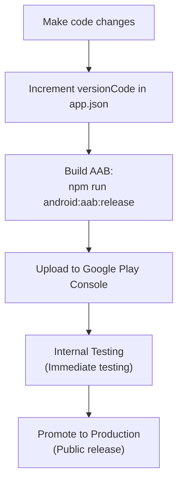

# Google Play Deployment & Release Guide

A complete step-by-step playbook for building, deploying, and releasing updates for **Kaizen Finance** on the Google Play Console.

---

## Quick Reference Workflow



---

## 1. Deploying an Initial Build (First-Time Release)

Follow this when uploading your app to Google Play for the very first time.

### Step 1.1: Verify Keystore & Signing Setup
Ensure your release signing key is configured:
1. `android/app/upload-keystore.jks` exists.
2. `android/gradle.properties` has your password configured:
   ```properties
   MYAPP_UPLOAD_STORE_FILE=upload-keystore.jks
   MYAPP_UPLOAD_KEY_ALIAS=upload
   MYAPP_UPLOAD_STORE_PASSWORD=your_password
   MYAPP_UPLOAD_KEY_PASSWORD=your_password
   ```

### Step 1.2: Build the Release AAB
Run in your terminal:
```bash
npm run android:aab:release
```
*Output file:*
```text
android/app/build/outputs/bundle/release/app-release.aab
```

### Step 1.3: Upload to Google Play Console
1. Go to [Google Play Console](https://play.google.com/console).
2. Select your app: **Kaizen Finance**.
3. In the left navigation, go to **Test and release** ➔ **Internal testing**.
4. Click **Create new release** in the top right.
5. Drag and drop `app-release.aab`.
6. Enter a release name (e.g. `1.0.0 (1)`).
7. Under **Release notes**, describe what's in this version:
   ```text
   Initial internal release of Kaizen Finance.
   ```
8. Click **Next** ➔ **Save and publish to Internal testing**.

---

## 2. Deploying New Changes & Updates (Future Releases)

Whenever you add features, fix bugs, or tweak designs and want to publish an update:

### ⚠️ Golden Rule: Always Increment `versionCode`
Google Play **strictly rejects** any upload that has the same or lower `versionCode` as an existing build.

Open [`app.json`](file:///c:/expo-repo/finance-app/app.json):
```json
{
  "expo": {
    "name": "Kaizen Finance",
    "version": "1.0.1",        // User-facing version string (e.g. 1.0.0 -> 1.0.1)
    "android": {
      "versionCode": 2         // MUST increment by +1 for every single upload! (1 -> 2 -> 3...)
    }
  }
}
```

### Step 2.1: Run Prebuild (Only if native config changed)
* If you changed app icons, permissions, native plugins, or splash screen:
  ```bash
  npm run android:prebuild
  ```
* *(Note: Do NOT run `--clean`, as that would delete your local keystore).*

### Step 2.2: Build the New Release AAB
```bash
npm run android:aab:release
```

### Step 2.3: Upload the New Release
1. In Google Play Console, go to **Test and release** ➔ **Internal testing** (or **Production**).
2. Click **Create new release**.
3. Upload the newly generated `app-release.aab`.
4. Enter Release Notes for your users:
   ```text
   - Added advanced Reports and Cash Flow analytics
   - Performance improvements and UI polish
   ```
5. Click **Next** ➔ **Save and publish**.

---

## 3. Promoting a Release to Production (Public Launch)

Once you have verified your app in Internal Testing, **you do not need to rebuild the AAB**. You can promote the exact tested bundle directly to Production:

1. In Google Play Console, navigate to **Test and release** ➔ **Internal testing**.
2. Find your active release in the table.
3. Click **Promote release** ➔ select **Production**.
4. Review the store listing details, content rating, and target audience checklists.
5. Click **Save and publish to Production**.
6. Google will review the app (usually takes 1–3 business days for new apps, or a few hours for established apps).

---

## 4. Google Play Release Tracks Explained

| Track | Purpose | Who Can Access | Review Time |
| :--- | :--- | :--- | :--- |
| **Internal testing** | Fast team testing, In-App purchase verification | Up to 100 invited email addresses | Instant (usually < 10 mins) |
| **Closed testing (Alpha/Beta)** | Testing with a broader community before public launch | Custom tester email lists or Google Groups | 1–2 days |
| **Production** | Public live release on the Google Play Store | Everyone globally (or selected countries) | 1–3 days |

---

## 5. Troubleshooting Common Google Play Errors

### Error: "Version code X has already been used"
* **Cause:** You uploaded a bundle with the same `versionCode` as a previously uploaded release.
* **Fix:** Open `app.json`, increase `expo.android.versionCode` by 1, and re-run `npm run android:aab:release`.

### Error: "Your Android App Bundle is signed with an insecure key"
* **Cause:** The release was built using the default debug keystore.
* **Fix:** Ensure `MYAPP_UPLOAD_STORE_FILE=upload-keystore.jks` and your correct password are set in `android/gradle.properties`.

### Error: "One-time products: To add one-time products, add the BILLING permission"
* **Cause:** Google Play has not yet processed a build with `BILLING`.
* **Fix:** Upload `app-release.aab` to Internal Testing first. Once uploaded, Google unlocks the "Create product" button under *Monetize with Play ➔ One-time products*.

---

## Summary Command Cheat Sheet

```bash
# 1. Update app.json (increment versionCode)

# 2. Build production bundle (.aab)
npm run android:aab:release

# 3. Build standalone test APK (.apk) for quick physical phone tests
npm run android:apk:debug:standalone

# 4. Location of final bundle to upload:
android/app/build/outputs/bundle/release/app-release.aab
```
